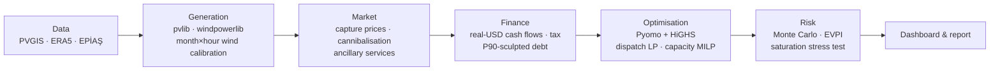

# Hybrid Wind + Solar + Battery Feasibility Model (Türkiye)

[](https://github.com/ahmethilmigrgl/hibrit-fizibilite/actions/workflows/ci.yml)

[-green.svg)](LICENSE)

[Türkçe](README.tr.md) · **Live app:** [huggingface.co/spaces/hilmi777/hibrit-fizibilite](https://huggingface.co/spaces/hilmi777/hibrit-fizibilite)

**Documents (Turkish):** [Investment memo (PDF)](outputs/08/Yatirim_Memosu.pdf) · [Presentation (PDF)](outputs/08/Sunum.pdf) ·
[Full report (PDF)](outputs/RAPOR.pdf) · [Excel financial model](outputs/08/Ezine_Hibrit_Finansal_Model.xlsx)

## Overview

**Question.** Should wind, solar and battery capacity be built behind a 50 MW grid connection in Türkiye, at which size,
where, under which revenue structure, and with what risk? The project grew in three versions:

- **v1: Ezine case study.**
  - *Method:* ERA5/PVGIS profiles with wind calibrated on nearby wind farms, 12 years of market data, a capacity MILP with
    hourly battery dispatch, project finance, and a 10,000-scenario Monte Carlo.
  - *Finding:* wind 58.8 MW + 30 MW/60 MWh battery, but the project is **marginal**. Expected NPV is −1.7 M$ in v1 and sits
    in a ±2.6 M$ band around zero.
  - *Correction note:* if Lazard's O&M already includes insurance and land lease (the report does not say), v1
    double-counted them and the expected NPV is +0.9 M$, which turns the recommendation into "due diligence + ≤0.9 M$ offer".
  - *Main contribution:* identifying the four assumptions that set the decision's sign: O&M contract scope, YEKDEM
    indexation, long-run price and ancillary market saturation.
  - *Validation:* Excel model reconciled with Python in 96/96 scenarios.
- **v2: Türkiye-wide tool.**
  - *Method:* a 90-plant calibration atlas, a confidence-rated transfer rule, ERA5/PVGIS grids over 1,464 land cells, and
    a web app that screens any site in seconds and runs a full analysis in about a minute.
  - *Finding:* wind estimate error is 3.4 CF points (median) where a calibrated farm is within 30 km and 5.6 points elsewhere.
  - *Validation:* leave-one-out cross-validation, and the Ezine regression matches v1 within Monte Carlo error.
- **v3: industrial-engineering modules.**

  | Module | Method | Finding | Validation |
  |---|---|---|---|
  | Turbine layout | PyWake wakes, MILP / GA / annealing | Wakes shrink the optimal plant; annealing within 0.13% of MILP in 2 s | Surrogate matches PyWake to 1e-6 |
  | Maintenance | SimPy discrete-event simulation, PM-scheduling MILP, base stock | Condition-based maintenance best in 20/24 sensitivity cases; a full service agreement is right for one site | Failure counts within ±4% of inputs |
  | Multi-criteria site selection | AHP / TOPSIS | Revealed developer preferences: grid proximity 34%, bird migration 2% | AUC 0.87 vs 171 existing farms |
  | Logistics and connection | Heavy-haul network + transportation LP; distance-based connection with uncertainty from YEKA opinions | Break-even +4.4 $/MWh at the median | YEKA opinions |
  | Portfolio | 40 sites × 147 designs on common scenarios; two-stage mean–CVaR MILP; synergies; Bayesian shrinkage against the optimiser's curse | Selection effect was over half the naive portfolio value (expected disappointment 46 M$); shrunk portfolio 4 sites, 20 M$; no investment below 52 $/MWh or for λ ≥ 0.25 | Brute force, exact CVaR |
  | Performance monitoring | Peer-adjusted SPC (EWMA / CUSUM) for 90 plants | 71% detection of 6-month 10% drops at 0.28 false alarms per plant-year | Synthetic faults |

- **v4: industry modules** (what IPP, developer and investor teams actually ask).

  | Module | Method | Finding | Validation |
  |---|---|---|---|
  | Bankable yield + project finance | P50–P99 uncertainty budget; multi-case debt-sizing LP (duals show the binding case); cash waterfall (DSRA, lock-up, default) over the Monte Carlo; chance-constrained sizing (P(default) ≤ 5%) | DSCR-rule debt carries a 12–43% default probability because price and ancillary-market risk escape the lender cases; an on-site measurement campaign raises debt capacity by 52% | LP equals the closed-form sculpted debt; simulated vs analytic P-values |
  | Solar/battery add-on to existing wind farms | 86 farms with their own calibration (CF error 0.6 pts); incremental MILP with the plant fixed; common-random-number Monte Carlo; MCP rescaling of an uploaded production file | Adding solar is not profitable anywhere at today's capex (break-even median 437 k$/MW vs 620); a battery adds value at 85/86 farms | Model vs observed CF for all 86 farms; CRN variance reduction 10–79% |
  | YEKA auction bidding | English auction → observed fee = second-highest value; truncated order-statistic MLE; leave-one-out | Market pays ~0.8 M€/MW above our valuation, explained only by five optimistic assumptions together (winner's curse); forecasts for the 2 Nov 2026 auctions | Synthetic recovery, 64% LOO coverage |
  | Merit-order price model | Hourly supply stack (water-filling hydro, storage arbitrage, cycling discount), calibrated 2018–23 | Levelised price 67–74 $/MWh (vs 58 assumed); solar capture 0.48 by 2035, wind ≥ 0.93; storage is the main lever on cannibalisation | Out-of-sample 2024–25 R² 0.68 / 0.73 |

Summary: [docs/PROJE_OZETI.md](docs/PROJE_OZETI.md) (Turkish). v4 formulations: `docs/v4_H_finansman.md`, `docs/v4_I_mevcut_santral_ekleme.md`,
`docs/v4_J_yeka_teklif.md`, `docs/v4_K_merit_order.md`.

**v2 (branch `v2-genel`, release candidate):** a **Türkiye-wide site screening and analysis app**. Pick any point on land and
get a quick scan in seconds or a full optimisation + Monte Carlo analysis in minutes; see [Türkiye-wide app](#türkiye-wide-app-v2).
The original Ezine study (v1.0.0) remains as a case study below.

**v3 (branch `v3-ie`, 3.0.0-rc2):** industrial-engineering extensions to the app; see [v3 extensions](#industrial-engineering-extensions-v3).
**Correction note:** v1 double-counted insurance and land lease; corrected, the Ezine recommendation turns from "shelve" to
"due diligence + ≤0.9 M$ offer" ([docs/v1_duzeltme_notu.md](docs/v1_duzeltme_notu.md)).

The case study sizes solar (PV), wind and battery storage behind a **50 MW grid connection** at Çanakkale-Ezine, Türkiye, to
**maximise project NPV**. It then stress-tests that answer under uncertainty. The pipeline goes end to end:

- **Generation:** hourly profiles from satellite and reanalysis data, with wind calibrated against nearby operating wind farms.
- **Market:** 12 years of Turkish day-ahead and ancillary-service prices.
- **Finance:** a project-finance model in real USD.
- **Optimisation:** a capacity MILP in Pyomo + HiGHS.
- **Risk:** a 10,000-scenario Monte Carlo, including a stress test of how quickly batteries saturate the secondary-reserve market.

It is a portfolio project. Every assumption is sourced in `config.yaml`, and every optimisation model is written out
mathematically in `docs/`.

## Türkiye-wide app (v2)

Run locally with one command (after the environment and data packages are in place, see [How to run](#how-to-run)):

```bash
.venv/bin/streamlit run app.py          # → http://localhost:8501
```

- **Opening screen:** a pre-screening map of all 1,464 land cells (0.25°) of Türkiye. The default layer is the break-even
  price of the best standard design; wind/solar capacity factors and break-evens are selectable. Low-confidence cells are
  hatched, and calibrated wind farms form their own layer.
- **Site selection:** click the map, type coordinates, or choose a province/district to see its windiest candidate points.
  The selected point shows its GWA wind speed, confidence level and the calibrated wind farms it relies on.
- **Quick scan (seconds):** capacity factors with an uncertainty band, capture rates, LCOE, break-even price, the rank among
  Türkiye's cells, standard designs, a representative-day optimisation and a "worth a full analysis?" check.
- **Full analysis (1–6 min):** full-year capacity MILP, run-time dispatch tables, converging Monte Carlo, revenue structures
  (merchant / annual YEKDEM option / PPA), schedule by project stage, recommendation and triggers, and an HTML/PDF site report.
- **Sharing:** every result reopens from a share link (URL parameters + result cache).
- **Data:** the app reads only local, pre-built data packages through one data-access layer (`src/veri_katmani.py`): the ERA5
  grid, the PVGIS solar grid, Global Wind Atlas, the calibration atlas and the market package. It never calls external APIs
  or uses personal credentials at run time.
- **Docs:** [data infrastructure](docs/v2_A_veri_altyapisi.md), [analysis engine](docs/v2_B_analiz_motoru.md),
  [app](docs/v2_C_arayuz.md).

- **Design:** the "Eşik" design system with a light theme (investment report) and a dark theme (control room); local fonts,
  a tile-free base map, a colour-blind-safe map scale and consistent components. See [design system](docs/v2_tasarim_sistemi.md).
- **Caveats shown in the app:** single-neighbour estimates, cells above the highest observed capacity factor in Türkiye
  ("near the upper bound") and island sites (a submarine cable is required; islands are excluded from rankings by default).

| Light | Dark |
|---|---|
|  |  |
|  |  |

## Industrial-engineering extensions (v3)

| Phase | What | Key result | Docs |
|---|---|---|---|
| D | Turbine layout optimisation (MILP / GA / simulated annealing, PyWake wakes, ERA5 wind rose); maintenance discrete-event simulation (SimPy), PM scheduling MILP, base-stock spares | Explicit wakes and smaller optimal plants; condition-based maintenance best in 20 of 24 sensitivity cases | [v3_D](docs/v3_D_yerlesim_bakim.md) |
| E | OSM/DEM GIS layers, distance-based grid connection, CBS exclusions in layout, heavy-haul network + transportation LP, AHP/TOPSIS multi-criteria site selection validated against existing wind farms | Break-even median +4.4 $/MWh with real infrastructure; revealed preferences: grid proximity 34%, bird migration 2% (AUC 0.88) | [v3_E](docs/v3_E_cbs_cok_kriterli_lojistik.md) |
| F | Multi-site portfolio: 40 candidates × 2–4 designs on 2,000 **common scenarios** (same price, ERA5 weather year, market and regulatory events), two-stage stochastic mean–CVaR MILP, synergies (O&M scale, spare pooling, bulk purchase, multi-site transport), efficient frontier, **Bayesian shrinkage against the optimiser's curse**; plant performance monitoring with peer-adjusted SPC (Shewhart/EWMA/CUSUM) | Naive selection is optimistic by 46 M$ in expectation; shrunk risk-neutral portfolio E[NPV] +20 M$ (4 sites, synergies +10.6 M$); 70% of portfolio variance is common market risk; no investment below 52 $/MWh or for λ ≥ 0.25; monitoring catches 71% of 10%/6-month drops at 0.28 false alarms per plant-year | [v3_F](docs/v3_F_portfoy_performans.md) |

New app pages: multi-criteria site selection, portfolio, performance monitoring (plant names hidden by default: results are
model-derived).

## Case study (v1.0.0): key findings

| # | Finding | Number |
|---|---|---|
| 1 | **Solar never enters the optimal design.** Turkish solar capture rates collapsed as installed PV reached 25 GW, and afternoon sea breezes make wind and solar peak together behind the shared connection. | Solar capture rate 1.21 (2016) → 0.71 (2026); 14–40% of added PV is curtailed |
| 2 | **Merchant wind alone is not investable** at today's price expectations. | NPV −1.6 M$, break-even 59 $/MWh, P(NPV > 0) 42% |
| 3 | **Battery value comes almost entirely from secondary-reserve (SFK) capacity payments**, not arbitrage. | 87% of battery revenue; NPV −1.6 → +26 M$ in the no-saturation case |
| 4 | **The saturation stress test changed the recommendation.** The SFK market needs ~1 GW against 28–33 GW of storage pre-licences. A supply–demand model calibrated on GB, Germany and Australia turns the battery into an *option*. | P(NPV > 0) for the 40 MW battery design: 97% → 59%; CVaR 5%: −2.5 → −30 M$ |
| 5 | **The valuable flexibility is deferring battery scale, not adding duration.** A 30 MW battery (the SFK entry threshold) with a conditional expansion beats both a 40 MW and a 4-hour battery. Waiting to learn costs more than the information is worth. | E[NPV] +6.3 M$ (staged) vs −0.4 M$ (4-hour); 1-year delay −2.1 M$ |
| 6 | **Real-world frictions and three consistency checks set the final answer.** Wind curtailment started in 2026; a CPM + Monte Carlo schedule puts COD at Nov 2029 for a ready-to-build project (May 2032 from a pre-licence). Under YEKDEM the battery cannot arbitrage. YEKDEM turned out to be an **annual option** (participation chosen each 30 Nov), not a 10-year lock-in. Option worth +0.5 M$ over merchant; 10-year fixed YEKDEM −12.3 M$ |
| 7 | **Reconciling deterministic and Monte Carlo values flipped the sign.** The deterministic base was −2.4 M$ but the Monte Carlo mean was +1.5 M$, even for pure merchant. The log-price process had been centred on 58 as its *median*; the lognormal skew lifted the simulated mean price to 61.8 $/MWh. Calibrated to an expected 58, the gap is explained component by component. | Base case +1.5 → **−1.7 M$**, P(NPV>0) 50% → 42% |

**Recommendation: shelve the acquisition and monitor triggers. No due-diligence budget and no offer for now.**

- **Final base case** (`config.yaml → nihai_baz_vaka`): COD Nov 2029, 58.8 MW wind + 30 MW / 60 MWh battery, YEKDEM
  annual option (nominal corridor) plus merchant.
- **Result:** expected NPV **−1.7 M$**, probability of profit **42%**, CVaR 5% −28.0 M$, maximum premium 0.
- **Sensitivity:** value is thin (break-even expected price ≈ 59 $/MWh). Indexed YEKDEM corridor +0.4 M$; pure merchant
  −2.1 M$; PPA −6.1 M$. Due-diligence items have zero value of information: even good news leaves E[NPV] negative.
- **Triggers to revisit:** YEKDEM corridor confirmed as indexed; long-term price expectations ≳ 60 $/MWh; turbine + EPC
  cost ≳ 2% below base; slow storage build-out (SFK prices hold in 2027).
  See the [report](docs/RAPOR.md#10-öneri).

<p align="center">
  <br>
  <em>Risk–return before (hollow) and after (filled) modelling ancillary-service saturation. Labels in Turkish.</em>
</p>

<p align="center">
  <br>
  <em>Solar cannibalisation in Türkiye: capture rates of solar vs wind, 2014–2026.</em>
</p>

<p align="center">
  <br>
  <em>Opportunity window: NPV if secondary-reserve revenue lasts only N years.</em>
</p>

## Case-study dashboard (v1)

<p align="center"></p>

| | |
|---|---|
|  |  |
|  |  |

*Summary, design explorer, risk and market tabs (Turkish UI; an English toggle is built in). The layout also works on a 390 px phone screen.*

## Method



| Stage | What | Docs |
|---|---|---|
| 1 Site & generation | Four candidate sites screened; 10 years of hourly PV (PVGIS-SARAH3 + pvlib PVWatts) and wind (ERA5 + Enercon E-141 power curve, 120 m) profiles | [docs/01](docs/01_uretim_modeli.md) |
| 2 Market & calibration | EPİAŞ prices 2014–2026 (DST-safe UTC conversion), capture rates, duck curve. ERA5 wind calibrated with a month × hour speed factor against three wind farms (cross-validated; hourly-profile error ÷10) | [docs/02](docs/02_piyasa_analizi.md) |
| 3 Finance | Real-USD cash flows, TEİAŞ charges, imbalance, 25% tax with loss carry-forward, P90-sculpted debt, LCOE, tornado | [docs/03](docs/03_finansal_model.md) |
| 4 Optimisation | Battery arbitrage LP → hybrid dispatch LP with grid shadow prices → capacity MILP (integer turbines, binary build decision, full year 2 × 8,760 h, ~35 s); representative days vs full year; regret analysis | [docs/04](docs/04_optimizasyon.md) |
| 5 Revenue stack & risk | Ancillary services (binary participation ≥ 30 MW), PPA, storage licence. Monte Carlo with block-bootstrapped weather, mean-reverting log prices with crisis/price-cap events, Gaussian copula. Dispatch pre-computed on a grid + trilinear interpolation (error ~1%). EVPI/EVPPI, Sobol indices | [docs/05](docs/05_risk_ve_gelir_yigini.md) |
| 6 Stress test | SFK supply–demand saturation model (GB/DE/AU calibration), opportunity window, delay & wait-and-see, flexible battery designs, conservative debt | [docs/05 §9](docs/05_risk_ve_gelir_yigini.md#9-stres-testi-sfk-piyasasının-doyumu-aşama-6) |
| 7 Real-world frictions | System curtailment detected from EPİAŞ instructions + co-located wind farms; incentives (VAT); merchant vs PPA vs YEKDEM in one Monte Carlo; avoided CO2; CPM + Monte Carlo project schedule (COD P50/P80, criticality index); 20-item risk register | [docs/07](docs/07_tamamlayici_analizler.md) |
| 8 Decision package | Formula-driven Excel model (FAST-style; 48/48 scenarios reconciled to Python), 3-page investment-committee memo, 13-slide deck with a decision-journey chart | [outputs/08](outputs/08) |

## Model validation
Full write-up (Turkish): [docs/MODEL_DOGRULAMA.md](docs/MODEL_DOGRULAMA.md).

- **Validated:** PV model vs PVGIS (+4.0% annual yield); ERA5 wind calibrated against three wind farms (hourly
  correlation 0.76 → 0.85, month × hour RMSE 10.6 → 0.9 CF points; cross-validated 2.5–2.8); Excel model reconciles with
  Python in 48/48 scenarios; representative days vs full-year MILP (−0.7 M$ bias → headline results use the full year);
  Monte Carlo interpolation error ~1%; deterministic-vs-Monte Carlo gap decomposed component by component (this found
  the price-median bug).
- **Not validated (assumptions):** YEKDEM corridor indexation, curtailment compensation share, SFK saturation pace and
  battery eligibility, PPA discount, CAPEX distributions, ornithology costs; no on-site wind measurement.
- **Most sensitive to:** long-term price level (break-even ≈ 59 $/MWh vs 58 assumed), SFK saturation pace, CAPEX/WACC,
  and the schedule (COD after 2030 loses YEKDEM).

## Tech stack
Python 3.11 · Pyomo + HiGHS (`highspy`) · CPM / schedule Monte Carlo · pandas / NumPy / SciPy · pvlib · windpowerlib · xarray / ERA5 (cdsapi) ·
EPİAŞ Transparency API · matplotlib / Plotly · Streamlit · pytest

## How to run

```bash
# Environment (Python 3.11)
uv venv --python 3.11 .venv
uv pip install -r requirements.txt --python .venv/bin/python
cp .env.example .env              # CDS (ERA5) and EPİAŞ credentials — only needed to download raw data

.venv/bin/python calistir.py --listele          # list steps and which credentials each one needs
.venv/bin/python calistir.py --asama all        # full pipeline (first run ~3–4 h, mostly downloads)
.venv/bin/python calistir.py --asama 5 6        # re-run risk + packaging from cached data
.venv/bin/python -m pytest -q                   # tests: NPV/IRR/LCOE, battery SOC, DST conversion, capacity factors

# v2 app — no credentials needed at run time; needs the local data packages:
#   data/atlas (in the repo) + data/grid (built offline, not in the repo):
.venv/bin/python src/v2_O2_era5_grid.py       # ERA5 Türkiye grid (CDS key, offline, ~7 h)
.venv/bin/python src/v2_C1_pvgis_grid.py      # PVGIS solar grid (keyless, ~1 h)
.venv/bin/python src/v2_C1_rakim_grid.py      # elevation grid (keyless, ~10 s)
.venv/bin/python -c "from src.kaynaklar import gwa250; gwa250.karolari_hazirla()"   # GWA 250 m tiles
.venv/bin/python src/v2_C2_on_tarama.py       # pre-screening map (~10 min)
.venv/bin/streamlit run app.py                # → http://localhost:8501
```

Credentials are read only from `.env`. They are never printed or committed. Raw and processed data (`data/`) are not
in the repository; the dashboard and report use small aggregated files in `results/` (< 1 MB).

## Project structure

```
├── app.py                  v2 app entry point (pages: screening & analysis, Ezine case study, method; TR/EN)
├── uygulama/               v2 app pages and helpers (map, site selection, results; v1 dashboard as sayfa_vaka.py)
├── calistir.py             Single entry point for the whole pipeline
├── config.yaml             Every assumption with value, unit, source and note
├── src/
│   ├── 00–08_*.py          Stage scripts
│   ├── uretim/             Generation models (PV, wind, calibration)
│   ├── piyasa/             EPİAŞ client, market analysis
│   ├── finans/             Price scenarios, cash-flow model, debt
│   ├── optimizasyon/       Battery/hybrid LPs, representative days, capacity MILP
│   ├── risk/               Dispatch tables, vectorised valuation, Monte Carlo, saturation, design explorer
│   ├── motor/              v2 analysis engine: analiz_et(site, "hizli" | "tam", assumptions) + cache, queue, report
│   ├── atlas/, kaynaklar/  v2 calibration atlas, transfer rule, turbine proxies; data sources (ERA5/PVGIS grids, GWA, boundaries)
│   └── veri_katmani.py     v2 single data-access layer (local now; remote hosting later)
├── tests/                  pytest suite (CI: .github/workflows/ci.yml)
├── docs/                   Formulations per stage, RAPOR.md (report), MODEL_DOGRULAMA.md (validation)
├── outputs/                Figures and tables per stage, RAPOR.pdf; 08/: memo, deck, Excel model
├── results/                Small aggregated results for the dashboard
├── dashboard/              Streamlit Community Cloud entry point (light requirements)
├── DATA_SOURCES.md         Data sources, licences, attributions
└── CHANGELOG.md            Stages, revisions and the decision journey
```

## Limitations
- **Wind resource:** ERA5 calibrated on three plants; no on-site measurement; wake losses are a lump-sum loss factor.
- **Market estimates:** SFK prices, saturation pace, scenario probabilities and the PPA discount are estimates. No
  Turkish battery has participated in SFK at scale yet.
- **Dispatch:** perfect foresight (annual LP). Arbitrage revenue is overstated, but the impact is limited because most
  battery value is capacity payments.
- **FX and debt:** FX risk is not modelled separately (real USD). Debt is not restructured within simulations.
- **Design explorer:** uses one representative weather year plus interpolation (error vs full model ≈ 0.5–0.8 M$).

## Data sources and attribution
Details, licences and what each source is used for: [DATA_SOURCES.md](DATA_SOURCES.md).

- **ERA5:** Contains modified Copernicus Climate Change Service information 2026. Neither the European Commission nor
  ECMWF is responsible for any use that may be made of the Copernicus information or data it contains.
  Dataset: *ERA5 hourly time-series data on single levels from 1940 to present*, DOI [10.24381/1cf1ad76](https://doi.org/10.24381/1cf1ad76).
- **PVGIS:** PVGIS © European Communities, 2001-2026 (PVGIS-SARAH3 database).
- **Global Wind Atlas 3.0** (DTU, World Bank Group, Vortex, ESMAP; CC BY 4.0) — https://globalwindatlas.info
- **OpenStreetMap** wind-farm and turbine data © OpenStreetMap contributors (ODbL); boundaries: geoBoundaries (Runfola et al. 2020).
- **Copernicus DEM GLO-90** © DLR e.V. 2010-2014 and © Airbus Defence and Space GmbH 2014-2018 provided under COPERNICUS by the European Union and ESA; all rights reserved.
- **EPİAŞ:** Source: EPİAŞ Transparency Platform (seffaflik.epias.com.tr). Only derived and aggregated results are
  stored in this repository; raw hourly EPİAŞ data are not redistributed.

## License
The MIT licence ([LICENSE](LICENSE)) applies **to the code only**. The embedded data packages in `data/atlas/` carry their own licences (OSM-derived files ODbL 1.0, Global Wind Atlas derivatives CC BY 4.0, boundaries ODbL/CC BY-SA); see [data/atlas/README.md](data/atlas/README.md). Data and data-derived results remain subject to the
terms of their sources (Copernicus/C3S licence, PVGIS reuse conditions, EPİAŞ Transparency Platform terms); see
[DATA_SOURCES.md](DATA_SOURCES.md).
