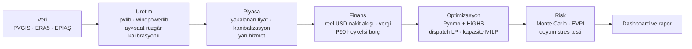

# Hibrit RES + GES + Batarya Fizibilite Modeli (Türkiye)

[English](README.md) · **Canlı dashboard:** _yayından sonra eklenecek_ · [Rapor (PDF)](outputs/RAPOR.pdf) · [Rapor (Markdown)](docs/RAPOR.md)

Bu model, Çanakkale-Ezine'de **50 MW şebeke bağlantısının** arkasındaki güneş (GES), rüzgâr (RES) ve batarya (BESS)
kapasitelerini **proje NPV'sini en yüksek yapacak** şekilde boyutlandırıyor ve bu cevabı belirsizlik altında stres
testine sokuyor. Hat uçtan uca şu aşamalardan oluşuyor:

- **Üretim:** uydu ve yeniden analiz verisinden saatlik profiller; rüzgâr, bölgedeki santrallerin gerçek üretimiyle
  kalibre edildi.
- **Piyasa:** 12 yıllık EPİAŞ fiyat ve yan hizmet verisi.
- **Finans:** reel USD proje finansmanı modeli.
- **Optimizasyon:** Pyomo + HiGHS ile kapasite MILP'i.
- **Risk:** 10.000 senaryolu Monte Carlo ve yan hizmet piyasasının doyum stres testi.

Portföy projesidir. Tüm varsayımlar kaynaklarıyla `config.yaml`'da, tüm optimizasyon modellerinin matematiksel
formülasyonları `docs/` altında.

## Ana bulgular

| # | Bulgu | Sayı |
|---|---|---|
| 1 | **GES hiçbir optimal tasarıma girmedi.** Kurulu güneş 25 GW'a çıkınca güneşin yakalanma oranı çöktü. Öğleden sonra meltemi yüzünden rüzgâr ve güneş ortak bağlantıda aynı saatlerde tepe yapıyor. | Güneş yakalanma oranı 1,21 (2016) → 0,71 (2026); ek GES'in %14–40'ı kesiliyor |
| 2 | **Yalnız RES bugünkü fiyat beklentisiyle yatırım yapılabilir değil.** | NPV −1,6 M$, başabaş 59 $/MWh, P(NPV>0) %42 |
| 3 | **Bataryanın değeri neredeyse tamamen SFK kapasite ödemesinden geliyor**, arbitrajdan değil. | Batarya gelirinin %87'si; doyumsuz durumda NPV −1,6 → +26 M$ |
| 4 | **Doyum stres testi öneriyi değiştirdi.** SFK ihtiyacı ~1 GW, depolamalı ön lisans 28–33 GW. İngiltere, Almanya ve Avustralya ile kalibre edilen arz-talep modeli bataryayı bir *opsiyona* dönüştürüyor. | 40 MW bataryalı tasarımın P(NPV>0) değeri %97 → %59; CVaR %5: −2,5 → −30 M$ |
| 5 | **Değerli esneklik, süre eklemek değil ölçeği ertelemek.** 30 MW (SFK eşiği) + koşullu büyütme, hem 40 MW'lık hem 4 saatlik bataryadan iyi. Beklemenin maliyeti, kazandırdığı bilgiden büyük. | E[NPV] +6,3 M$ (aşamalı) vs −0,4 M$ (4 saatlik); 1 yıl erteleme −2,1 M$ |
| 6 | **Gerçek dünya sürtünmeleri ve üç tutarlılık düzeltmesi nihai cevabı belirliyor.** 2026'da RES kesintisi başladı; CPM + Monte Carlo takvimi inşaata hazır projede COD'u Kasım 2029'a (ön lisanstan Mayıs 2032) koyuyor. YEKDEM'de batarya arbitraj yapamıyor. YEKDEM 10 yıllık bir kilit değil, her 30 Kasım'da seçilen **yıllık bir opsiyon**. | Baz vaka E[NPV] +1,5 M$, P(NPV>0) %50; 10 yıl sabit YEKDEM −10,9 M$ |

**Öneri: inşaata hazır bir proje için dar kapsamlı durum tespiti ve bağlayıcı olmayan teklif. Henüz yatırım kararı yok.**

- **Durum tespiti bütçesi:** ~0,5 M$; bilgi değeriyle belirlenen tavanı ~1,0 M$.
- **Teklif sınırı:** azami edinim primi ~1,5 M$.
- **Nihai baz vaka** (`config.yaml → nihai_baz_vaka`): COD Kasım 2029; RES 58,8 MW + 30 MW / 60 MWh batarya; YEKDEM yıllık
  opsiyonu (nominal koridor) + tüccar.
- **Sonuç:** beklenen NPV **+1,5 M$**, kâr olasılığı **%50**, CVaR %5 −25,8 M$.
- **Duyarlılık:** Değer ince. Endeksli YEKDEM koridorunda +3,1 M$, saf tüccarda +1,2 M$, PPA'da −4,0 M$.
  Bkz. [rapor §10](docs/RAPOR.md#10-öneri).

<p align="center">
  <br>
  <em>Yan hizmet doyumu modellenmeden önce (boş) ve sonra (dolu) risk-getiri.</em>
</p>

<p align="center">
  <br>
  <em>Türkiye'de güneş kanibalizasyonu: güneş ve rüzgârın yakalanma oranı, 2014–2026.</em>
</p>

<p align="center">
  <br>
  <em>Fırsat penceresi: SFK geliri yalnızca N yıl sürerse NPV.</em>
</p>

## Yöntem



| Aşama | İçerik | Doküman |
|---|---|---|
| 1 Saha ve üretim | 4 aday saha taraması; 10 yıllık saatlik GES (PVGIS-SARAH3 + pvlib) ve RES (ERA5 + E-141, 120 m) profilleri | [docs/01](docs/01_uretim_modeli.md) |
| 2 Piyasa ve kalibrasyon | EPİAŞ 2014–2026 (yaz saati güvenli UTC dönüşümü), yakalanan fiyat, ördek eğrisi; ERA5 rüzgârının üç santralle ay × saat kalibrasyonu | [docs/02](docs/02_piyasa_analizi.md) |
| 3 Finans | Reel USD nakit akışı, TEİAŞ bedelleri, dengesizlik, vergi, P90 heykelsi borç, LCOE, tornado | [docs/03](docs/03_finansal_model.md) |
| 4 Optimizasyon | Arbitraj LP → hibrit dispatch LP (şebeke gölge fiyatı) → kapasite MILP (tamsayı türbin, ikili yatırım kararı, tam yıl); temsilî günler; pişmanlık | [docs/04](docs/04_optimizasyon.md) |
| 5 Gelir yığını ve risk | Yan hizmet (≥30 MW ikili katılım), PPA, depolamalı lisans; Monte Carlo (blok bootstrap, ortalamaya dönen log-fiyat + kriz/tavan, Gauss kopula), önceden hesaplanmış dispatch + ara değerleme (~%1 hata), EVPI/EVPPI, Sobol | [docs/05](docs/05_risk_ve_gelir_yigini.md) |
| 6 Stres testi | SFK arz-talep doyum modeli, fırsat penceresi, erteleme ve bekle-gör, esnek batarya tasarımları, muhafazakâr borç | [docs/05 §9](docs/05_risk_ve_gelir_yigini.md) |
| 7 Gerçek dünya | EPİAŞ talimatları ve referans santrallerle sistem kesintisi; teşvikler (KDV); tüccar / PPA / YEKDEM aynı Monte Carlo'da; önlenen CO2; CPM + Monte Carlo proje takvimi (COD P50/P80, kritiklik indeksi); 20 maddelik risk kaydı | [docs/07](docs/07_tamamlayici_analizler.md) |

## Kullanılan teknolojiler
Python 3.11 · Pyomo + HiGHS · pandas / NumPy / SciPy · pvlib · windpowerlib · xarray / ERA5 (cdsapi) · EPİAŞ Şeffaflık
API · matplotlib / Plotly · Streamlit · pytest

## Nasıl çalıştırılır

```bash
uv venv --python 3.11 .venv
uv pip install -r requirements.txt --python .venv/bin/python
cp .env.example .env              # CDS (ERA5) ve EPİAŞ bilgileri — yalnızca ham veri indirmek için

.venv/bin/python calistir.py --listele          # adımlar ve gereken kimlik bilgileri
.venv/bin/python calistir.py --asama all        # tüm hat (ilk çalıştırma ~3-4 saat, çoğu indirme)
.venv/bin/python calistir.py --asama 5 6        # önbellekten risk + paketleme
.venv/bin/python -m pytest -q                   # testler

# Yalnızca dashboard — kimlik bilgisi ve ham veri gerekmez (results/ okunur)
uv pip install -r requirements-app.txt --python .venv/bin/python
.venv/bin/streamlit run app.py
```

Kimlik bilgileri yalnızca `.env`'den okunur, hiçbir zaman yazdırılmaz ve repoya girmez. Ham ve işlenmiş veri (`data/`)
repoda yok; dashboard ve rapor `results/` altındaki küçük, toplulaştırılmış dosyaları (< 1 MB) kullanır.

## Proje yapısı

```
├── app.py                  Streamlit dashboard (6 sekme, TR/EN)
├── calistir.py             Tüm hattın tek giriş noktası
├── config.yaml             Tüm varsayımlar (değer, birim, kaynak, not)
├── src/                    Aşama betikleri (00–06) ve modüller (uretim, piyasa, finans, optimizasyon, risk)
├── tests/                  pytest testleri
├── docs/                   Aşama bazında formülasyonlar + RAPOR.md
├── outputs/                Aşama bazında grafikler ve tablolar, RAPOR.pdf
├── results/                Dashboard için küçük, toplulaştırılmış sonuçlar
└── dashboard/              Streamlit Community Cloud giriş noktası (hafif bağımlılıklar)
```

## Sınırlamalar
- **Rüzgâr kaynağı:** ERA5 üç santralle kalibre edildi; saha ölçümü yok. İz kaybı toplu kayıp oranıyla yaklaşıklandı.
- **Piyasa tahminleri:** SFK fiyatı, doyum hızı, senaryo olasılıkları ve PPA iskontosu tahmin. Türkiye'de SFK'ya
  ölçekli katılan batarya verisi henüz yok.
- **Dispatch:** mükemmel öngörülü (yıllık LP). Arbitraj geliri abartılı, ama gelirin çoğu kapasite ödemesi olduğu için
  etkisi sınırlı.
- **Kur ve borç:** Kur riski ayrıca modellenmedi (reel USD). Borç simülasyonda yeniden yapılandırılmıyor.
- **Tasarım gezgini:** tek temsilî hava yılı + ara değerleme kullanıyor (tam modele göre hata ≈ 0,5–0,8 M$).

## Lisans
MIT — bkz. [LICENSE](LICENSE).
