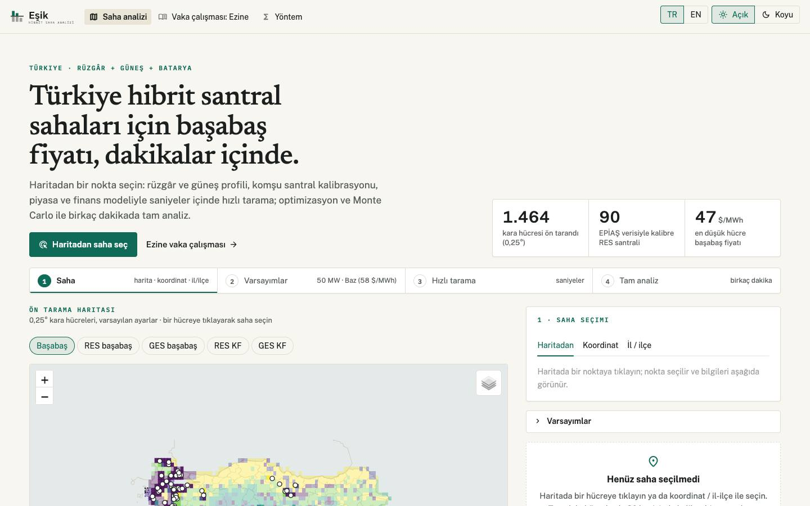
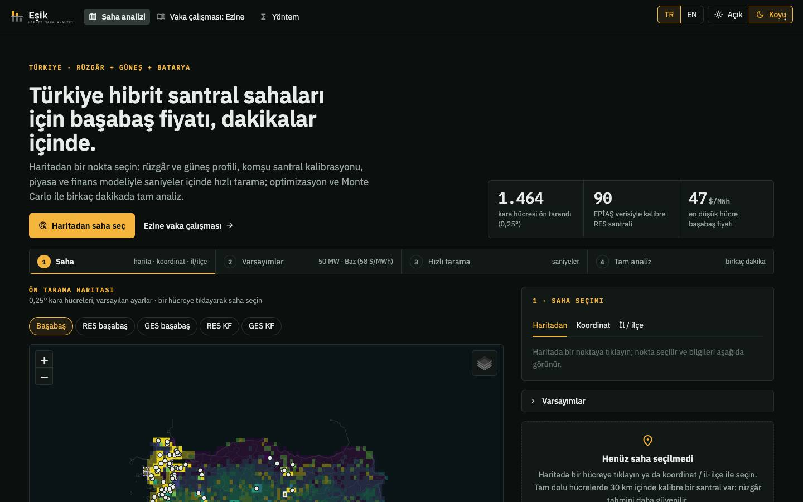
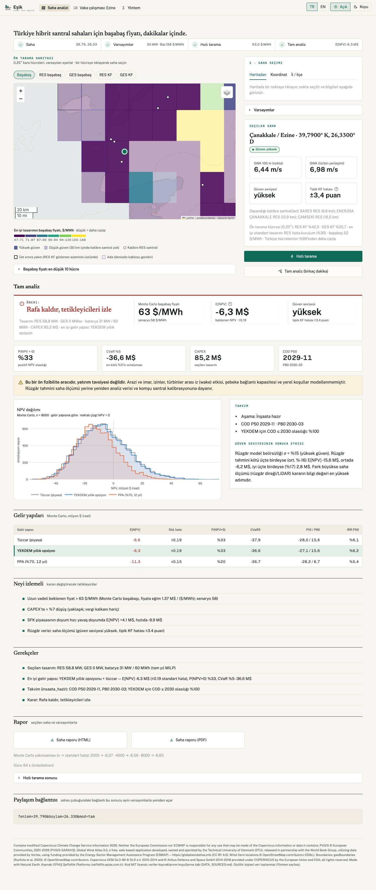
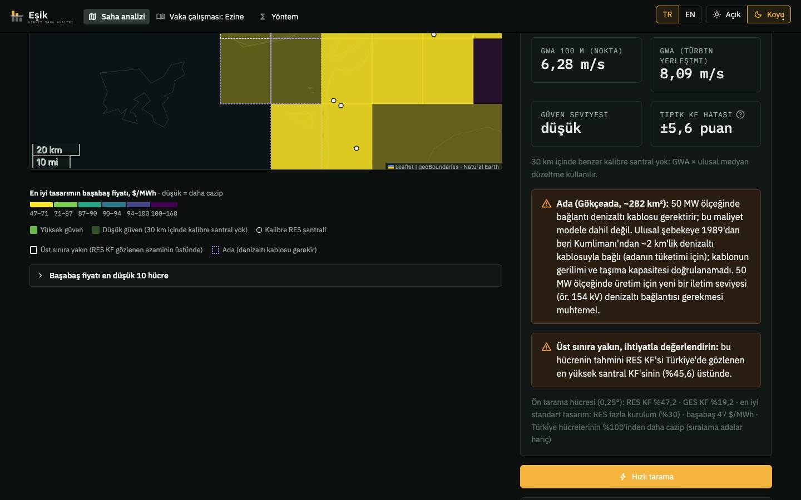
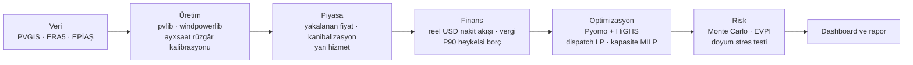

# Hibrit RES + GES + Batarya Fizibilite Modeli (Türkiye)

[](https://github.com/KULLANICI/hibrit-fizibilite/actions/workflows/ci.yml)

[-green.svg)](LICENSE)

[English](README.md) · **Canlı dashboard:** _yayından sonra eklenecek_

**Belgeler:** [Yatırım memosu (PDF)](outputs/08/Yatirim_Memosu.pdf) · [Sunum (PDF)](outputs/08/Sunum.pdf) ·
[Rapor (PDF)](outputs/RAPOR.pdf) · [Rapor (Markdown)](docs/RAPOR.md) · [Excel finansal model](outputs/08/Ezine_Hibrit_Finansal_Model.xlsx)

**v2 (`v2-genel` dalı, sürüm adayı):** Türkiye'nin herhangi bir kara noktası için **saha tarama ve analiz uygulaması**.
Bir nokta seçin; saniyeler içinde hızlı tarama ya da dakikalar içinde optimizasyon + Monte Carlo ile tam analiz alın
(bkz. [Türkiye geneli uygulama](#türkiye-geneli-uygulama-v2)). İlk Ezine çalışması (v1.0.0) aşağıda vaka çalışması olarak duruyor.

**v3 (`v3-ie` dalı, 3.0.0-rc1):** uygulamaya endüstri mühendisliği eklentileri; bkz. [v3 eklentileri](#endüstri-mühendisliği-eklentileri-v3).
**Düzeltme notu:** v1'de sigorta ve arazi kirası çift sayılmıştı. Düzeltilince Ezine önerisi "rafa kaldır"dan "durum
tespiti + ≤0,9 M$ teklif"e dönüyor ([docs/v1_duzeltme_notu.md](docs/v1_duzeltme_notu.md)).

Vaka çalışması, Çanakkale-Ezine'de **50 MW şebeke bağlantısının** arkasındaki güneş (GES), rüzgâr (RES) ve batarya (BESS)
kapasitelerini **proje NPV'sini en yüksek yapacak** şekilde boyutlandırıyor ve bu cevabı belirsizlik altında stres
testine sokuyor. Hat uçtan uca şu aşamalardan oluşuyor:

- **Üretim:** uydu ve yeniden analiz verisinden saatlik profiller; rüzgâr, bölgedeki santrallerin gerçek üretimiyle
  kalibre edildi.
- **Piyasa:** 12 yıllık EPİAŞ fiyat ve yan hizmet verisi.
- **Finans:** reel USD proje finansmanı modeli.
- **Optimizasyon:** Pyomo + HiGHS ile kapasite MILP'i.
- **Risk:** 10.000 senaryolu Monte Carlo ve yan hizmet piyasasının doyum stres testi.

Portföy projesidir. Tüm varsayımlar kaynaklarıyla `config.yaml`'da, tüm optimizasyon modellerinin matematiksel
formülasyonları `docs/` altında.

## Türkiye geneli uygulama (v2)

Ortam ve veri paketleri hazırsa ([Nasıl çalıştırılır](#nasıl-çalıştırılır)) tek komutla yerelde açılır:

```bash
.venv/bin/streamlit run app.py          # → http://localhost:8501
```

- **Açılış ekranı:** Türkiye'nin 1.464 kara hücresinin (0,25°) ön tarama haritası. Varsayılan katman en iyi standart tasarımın
  başabaş fiyatı; RES/GES kapasite faktörü ve başabaş fiyatları seçilebilir. Düşük güvenli hücreler ayrı işaretli;
  kalibre santraller ayrı katman.
- **Saha seçimi:** haritadan tıklama, koordinat girme ya da il/ilçe seçip ilçenin en rüzgârlı aday noktalarından birini seçme.
  Seçilen noktada GWA hızı, güven seviyesi ve dayandığı kalibre santraller anında görünür.
- **Hızlı tarama (saniyeler):** kapasite faktörleri ve belirsizlik bandı, yakalanma oranları, LCOE, başabaş fiyatı, Türkiye
  hücreleri arasındaki sıra, standart tasarımlar, temsilî gün optimizasyonu ve "tam analize değer mi?" değerlendirmesi.
- **Tam analiz (1–6 dk):** tam yıl kapasite MILP'i, çalışma anında işletme tabloları, yakınsamalı Monte Carlo, gelir yapıları
  (tüccar / yıllık YEKDEM opsiyonu / PPA), proje aşamasına göre takvim, öneri ve tetikleyiciler, HTML/PDF saha raporu.
- **Paylaşım:** her sonuç bir bağlantıyla (URL parametreleri + sonuç önbelleği) yeniden açılır.
- **Veri:** Uygulama yalnız yerel, önceden hazırlanmış veri paketlerini tek bir veri katmanı (`src/veri_katmani.py`) üzerinden
  okur: ERA5 gridi, PVGIS güneş gridi, Global Wind Atlas, kalibrasyon atlası, piyasa paketi. Çalışma anında dış API ya da
  kişisel kimlik bilgisi kullanmaz.
- **Belgeler:** [veri altyapısı](docs/v2_A_veri_altyapisi.md), [analiz motoru](docs/v2_B_analiz_motoru.md),
  [uygulama](docs/v2_C_arayuz.md).

- **Tasarım:** açık (yatırım raporu) ve koyu (kontrol odası) temalı "Eşik" tasarım sistemi; yerel yazı tipleri, karosuz
  altlık harita, renk körlüğüne uygun harita skalası ve ortak bileşenler. Bkz. [tasarım sistemi](docs/v2_tasarim_sistemi.md).
- **Uygulamadaki uyarılar:** tek komşu santrale dayanan tahminler, Türkiye'de gözlenen en yüksek kapasite faktörünü aşan
  hücreler ("üst sınıra yakın") ve ada sahaları (denizaltı kablosu gerekir; adalar sıralamalardan varsayılan olarak hariç).

| Açık | Koyu |
|---|---|
|  |  |
|  |  |

## Endüstri mühendisliği eklentileri (v3)

| Faz | Kapsam | Ana sonuç | Belge |
|---|---|---|---|
| D | Türbin yerleşimi optimizasyonu (MILP / GA / benzetimli tavlama, PyWake iz modeli, ERA5 rüzgâr gülü); bakım ayrık olay simülasyonu (SimPy), önleyici bakım çizelgesi MILP'i, taban stok | İz kaybı açıkça modellendi, optimal santral küçüldü; durum bazlı bakım 24 duyarlılık senaryosunun 20'sinde en iyi | [v3_D](docs/v3_D_yerlesim_bakim.md) |
| E | OSM/DEM coğrafi katmanlar, mesafeye bağlı şebeke bağlantısı, yerleşimde CBS dışlamaları, ağır nakliye ağı + ulaştırma LP'si, AHP/TOPSIS çok kriterli seçim ve mevcut santrallerle doğrulama | Gerçek altyapıyla başabaş medyanı +4,4 $/MWh; açığa çıkan tercih: şebekeye yakınlık %34, kuş göçü %2 (AUC 0,88) | [v3_E](docs/v3_E_cbs_cok_kriterli_lojistik.md) |
| F | Çoklu saha portföyü: 40 aday × 2–4 tasarım, 2.000 **ortak senaryo** (aynı fiyat, ERA5 hava yılı, piyasa ve düzenleyici olaylar), iki aşamalı stokastik ortalama–CVaR MILP'i, sinerjiler (işletme ölçeği, yedek parça havuzu, toplu alım, çok sahalı ulaştırma), etkin sınır; akran düzeltmeli SPC ile santral performans izleme (Shewhart/EWMA/CUSUM) | Risk nötr portföy E[NPV] +41 M$ (5 saha); sinerjiler +9,4 M$; portföy varyansının %70'i ortak piyasa riski; 46 $/MWh altında ya da λ ≥ 0,40'ta yatırım yok; izleme 6 ay süren %10'luk düşüşlerin %71'ini santral-yıl başına 0,28 yanlış alarmla yakalıyor | [v3_F](docs/v3_F_portfoy_performans.md) |

Yeni sayfalar: çok kriterli saha seçimi, portföy, performans izleme. Santral adları varsayılan olarak gizli, çünkü
sonuçlar bir modelden türetiliyor.

## Vaka çalışması (v1.0.0): ana bulgular

| # | Bulgu | Sayı |
|---|---|---|
| 1 | **GES hiçbir optimal tasarıma girmedi.** Kurulu güneş 25 GW'a çıkınca güneşin yakalanma oranı çöktü. Öğleden sonra meltemi yüzünden rüzgâr ve güneş ortak bağlantıda aynı saatlerde tepe yapıyor. | Güneş yakalanma oranı 1,21 (2016) → 0,71 (2026); ek GES'in %14–40'ı kesiliyor |
| 2 | **Yalnız RES bugünkü fiyat beklentisiyle yatırım yapılabilir değil.** | NPV −1,6 M$, başabaş 59 $/MWh, P(NPV>0) %42 |
| 3 | **Bataryanın değeri neredeyse tamamen SFK kapasite ödemesinden geliyor**, arbitrajdan değil. | Batarya gelirinin %87'si; doyumsuz durumda NPV −1,6 → +26 M$ |
| 4 | **Doyum stres testi öneriyi değiştirdi.** SFK ihtiyacı ~1 GW, depolamalı ön lisans 28–33 GW. İngiltere, Almanya ve Avustralya ile kalibre edilen arz-talep modeli bataryayı bir *opsiyona* dönüştürüyor. | 40 MW bataryalı tasarımın P(NPV>0) değeri %97 → %59; CVaR %5: −2,5 → −30 M$ |
| 5 | **Değerli esneklik, süre eklemek değil ölçeği ertelemek.** 30 MW (SFK eşiği) + koşullu büyütme, hem 40 MW'lık hem 4 saatlik bataryadan iyi. Beklemenin maliyeti, kazandırdığı bilgiden büyük. | E[NPV] +6,3 M$ (aşamalı) vs −0,4 M$ (4 saatlik); 1 yıl erteleme −2,1 M$ |
| 6 | **Gerçek dünya sürtünmeleri ve üç tutarlılık düzeltmesi nihai cevabı belirliyor.** 2026'da RES kesintisi başladı; CPM + Monte Carlo takvimi inşaata hazır projede COD'u Kasım 2029'a (ön lisanstan Mayıs 2032) koyuyor. YEKDEM'de batarya arbitraj yapamıyor. YEKDEM 10 yıllık bir kilit değil, her 30 Kasım'da seçilen **yıllık bir opsiyon**. Opsiyonun tüccara göre değeri +0,5 M$; 10 yıl sabit YEKDEM −12,3 M$ |
| 7 | **Deterministik ile Monte Carlo sonucunu uzlaştırmak işareti değiştirdi.** Deterministik baz −2,4 M$ iken Monte Carlo ortalaması (saf tüccarda bile) +1,5 M$ idi. Log-fiyat süreci 58'i *medyan* olarak alıyordu; lognormal çarpıklık simüle ortalama fiyatı 61,8 $/MWh'e çıkarıyordu. Beklenen fiyat 58'e ayarlanınca fark bileşen bileşen açıklanıyor. | Baz vaka +1,5 → **−1,7 M$**, P(NPV>0) %50 → %42 |

**Öneri: edinimi rafa kaldır, tetikleyicileri izle. Şimdilik durum tespiti bütçesi ve teklif yok.**

- **Nihai baz vaka** (`config.yaml → nihai_baz_vaka`): COD Kasım 2029; RES 58,8 MW + 30 MW / 60 MWh batarya; YEKDEM yıllık
  opsiyonu (nominal koridor) + tüccar.
- **Sonuç:** beklenen NPV **−1,7 M$**, kâr olasılığı **%42**, CVaR %5 −28,0 M$, azami edinim primi 0.
- **Duyarlılık:** Değer ince (başabaş beklenen fiyat ≈ 59 $/MWh). Endeksli YEKDEM koridorunda +0,4 M$, saf tüccarda
  −2,1 M$, PPA'da −6,1 M$. Durum tespiti kalemlerinin bilgi değeri sıfır: olumlu sonuç bile E[NPV]'yi pozitife çevirmiyor.
- **Yeniden değerlendirme tetikleyicileri:** YEKDEM koridorunun endeksli olduğunun teyidi; uzun vadeli fiyat beklentisi
  ≳ 60 $/MWh; türbin + EPC maliyeti baz CAPEX'in ≳ %2 altında; yavaş depolama yayılımı (2027'de SFK fiyatı korunuyor).
  Bkz. [rapor §10](docs/RAPOR.md#10-öneri).

<p align="center">
  <br>
  <em>Yan hizmet doyumu modellenmeden önce (boş) ve sonra (dolu) risk-getiri.</em>
</p>

<p align="center">
  <br>
  <em>Türkiye'de güneş kanibalizasyonu: güneş ve rüzgârın yakalanma oranı, 2014–2026.</em>
</p>

<p align="center">
  <br>
  <em>Fırsat penceresi: SFK geliri yalnızca N yıl sürerse NPV.</em>
</p>

## Vaka çalışması dashboard'u (v1)

<p align="center"></p>

| | |
|---|---|
|  |  |
|  |  |

*Özet, tasarım gezgini, risk ve piyasa sekmeleri (TR/EN geçişi var). Düzen 390 px telefon ekranında da taşmadan çalışıyor.*

## Yöntem



| Aşama | İçerik | Doküman |
|---|---|---|
| 1 Saha ve üretim | 4 aday saha taraması; 10 yıllık saatlik GES (PVGIS-SARAH3 + pvlib) ve RES (ERA5 + E-141, 120 m) profilleri | [docs/01](docs/01_uretim_modeli.md) |
| 2 Piyasa ve kalibrasyon | EPİAŞ 2014–2026 (yaz saati güvenli UTC dönüşümü), yakalanan fiyat, ördek eğrisi; ERA5 rüzgârının üç santralle ay × saat kalibrasyonu | [docs/02](docs/02_piyasa_analizi.md) |
| 3 Finans | Reel USD nakit akışı, TEİAŞ bedelleri, dengesizlik, vergi, P90 heykelsi borç, LCOE, tornado | [docs/03](docs/03_finansal_model.md) |
| 4 Optimizasyon | Arbitraj LP → hibrit dispatch LP (şebeke gölge fiyatı) → kapasite MILP (tamsayı türbin, ikili yatırım kararı, tam yıl); temsilî günler; pişmanlık | [docs/04](docs/04_optimizasyon.md) |
| 5 Gelir yığını ve risk | Yan hizmet (≥30 MW ikili katılım), PPA, depolamalı lisans; Monte Carlo (blok bootstrap, ortalamaya dönen log-fiyat + kriz/tavan, Gauss kopula), önceden hesaplanmış dispatch + ara değerleme (~%1 hata), EVPI/EVPPI, Sobol | [docs/05](docs/05_risk_ve_gelir_yigini.md) |
| 6 Stres testi | SFK arz-talep doyum modeli, fırsat penceresi, erteleme ve bekle-gör, esnek batarya tasarımları, muhafazakâr borç | [docs/05 §9](docs/05_risk_ve_gelir_yigini.md) |
| 7 Gerçek dünya | EPİAŞ talimatları ve referans santrallerle sistem kesintisi; teşvikler (KDV); tüccar / PPA / YEKDEM aynı Monte Carlo'da; önlenen CO2; CPM + Monte Carlo proje takvimi (COD P50/P80, kritiklik indeksi); 20 maddelik risk kaydı | [docs/07](docs/07_tamamlayici_analizler.md) |
| 8 Karar paketi | Formüllü Excel modeli (FAST benzeri; 48/48 senaryo Python ile mutabık), 3 sayfalık yatırım komitesi memosu, karar yolculuğu grafikli 13 slaytlık sunum | [outputs/08](outputs/08) |

## Model doğrulama
Ayrıntı: [docs/MODEL_DOGRULAMA.md](docs/MODEL_DOGRULAMA.md).

- **Doğrulananlar:** GES modeli – PVGIS (+%4,0); ERA5 rüzgârı üç santralle kalibrasyon (saatlik korelasyon 0,76 → 0,85,
  çapraz doğrulamada ay × saat RMSE 2,5–2,8 KF puanı); Excel–Python 48/48 mutabakat; temsilî gün – tam yıl; ara
  değerleme hatası ~%1; deterministik–Monte Carlo farkının ayrıştırılması (fiyat medyanı hatasını bu buldu).
- **Doğrulanamayanlar:** YEKDEM endekslemesi, kesinti tazmin oranı, SFK doyum hızı ve parametreleri, PPA iskontosu,
  CAPEX dağılımları, ornitoloji; saha rüzgâr ölçümü yok.
- **En duyarlı olduğu girdiler:** uzun vadeli fiyat seviyesi (başabaş ≈ 59 $/MWh), SFK doyumu, CAPEX/WACC, takvim.

## Kullanılan teknolojiler
Python 3.11 · Pyomo + HiGHS · pandas / NumPy / SciPy · pvlib · windpowerlib · xarray / ERA5 (cdsapi) · EPİAŞ Şeffaflık
API · matplotlib / Plotly · Streamlit · pytest

## Nasıl çalıştırılır

```bash
uv venv --python 3.11 .venv
uv pip install -r requirements.txt --python .venv/bin/python
cp .env.example .env              # CDS (ERA5) ve EPİAŞ bilgileri — yalnızca ham veri indirmek için

.venv/bin/python calistir.py --listele          # adımlar ve gereken kimlik bilgileri
.venv/bin/python calistir.py --asama all        # tüm hat (ilk çalıştırma ~3-4 saat, çoğu indirme)
.venv/bin/python calistir.py --asama 5 6        # önbellekten risk + paketleme
.venv/bin/python -m pytest -q                   # testler

# v2 uygulaması — çalışma anında kimlik bilgisi gerekmez; yerel veri paketleri gerekir:
#   data/atlas (repoda) + data/grid (çevrimdışı üretilir, repoda yok):
.venv/bin/python src/v2_O2_era5_grid.py       # ERA5 Türkiye gridi (CDS anahtarı, çevrimdışı, ~7 saat)
.venv/bin/python src/v2_C1_pvgis_grid.py      # PVGIS güneş gridi (anahtarsız, ~1 saat)
.venv/bin/python src/v2_C1_rakim_grid.py      # rakım ızgarası (anahtarsız, ~10 s)
.venv/bin/python -c "from src.kaynaklar import gwa250; gwa250.karolari_hazirla()"   # GWA 250 m karoları
.venv/bin/python src/v2_C2_on_tarama.py       # ön tarama haritası (~10 dk)
.venv/bin/streamlit run app.py                # → http://localhost:8501
```

Kimlik bilgileri yalnızca `.env`'den okunur, hiçbir zaman yazdırılmaz ve repoya girmez. Ham ve işlenmiş veri (`data/`)
repoda yok; dashboard ve rapor `results/` altındaki küçük, toplulaştırılmış dosyaları (< 1 MB) kullanır.

## Proje yapısı

```
├── app.py                  v2 uygulama giriş noktası (sayfalar: saha tarama ve analiz, Ezine vaka çalışması, yöntem; TR/EN)
├── uygulama/               v2 sayfaları ve yardımcıları (harita, saha seçimi, sonuçlar; v1 dashboard'u sayfa_vaka.py)
├── calistir.py             Tüm hattın tek giriş noktası
├── config.yaml             Tüm varsayımlar (değer, birim, kaynak, not)
├── src/                    Aşama betikleri (00–08, v2_*) ve modüller (uretim, piyasa, finans, optimizasyon, risk; v2: motor,
│                           atlas, kaynaklar, veri_katmani.py — tek veri erişim katmanı)
├── tests/                  pytest testleri (CI: .github/workflows/ci.yml)
├── docs/                   Aşama bazında formülasyonlar, RAPOR.md, MODEL_DOGRULAMA.md
├── outputs/                Aşama bazında grafikler ve tablolar, RAPOR.pdf; 08/: memo, sunum, Excel modeli
├── results/                Dashboard için küçük, toplulaştırılmış sonuçlar
├── dashboard/              Streamlit Community Cloud giriş noktası (hafif bağımlılıklar)
├── DATA_SOURCES.md         Veri kaynakları, lisanslar, atıflar
└── CHANGELOG.md            Aşamalar, revizyonlar ve karar yolculuğu
```

## Sınırlamalar
- **Rüzgâr kaynağı:** ERA5 üç santralle kalibre edildi; saha ölçümü yok. İz kaybı toplu kayıp oranıyla yaklaşıklandı.
- **Piyasa tahminleri:** SFK fiyatı, doyum hızı, senaryo olasılıkları ve PPA iskontosu tahmin. Türkiye'de SFK'ya
  ölçekli katılan batarya verisi henüz yok.
- **Dispatch:** mükemmel öngörülü (yıllık LP). Arbitraj geliri abartılı, ama gelirin çoğu kapasite ödemesi olduğu için
  etkisi sınırlı.
- **Kur ve borç:** Kur riski ayrıca modellenmedi (reel USD). Borç simülasyonda yeniden yapılandırılmıyor.
- **Tasarım gezgini:** tek temsilî hava yılı + ara değerleme kullanıyor (tam modele göre hata ≈ 0,5–0,8 M$).

## Veri kaynakları ve atıf
Ayrıntılar, lisanslar ve her kaynağın ne için kullanıldığı: [DATA_SOURCES.md](DATA_SOURCES.md).

- **ERA5:** Contains modified Copernicus Climate Change Service information 2026. Neither the European Commission nor
  ECMWF is responsible for any use that may be made of the Copernicus information or data it contains.
  Veri seti: *ERA5 hourly time-series data on single levels from 1940 to present*, DOI [10.24381/1cf1ad76](https://doi.org/10.24381/1cf1ad76).
- **PVGIS:** PVGIS © European Communities, 2001-2026 (PVGIS-SARAH3 veritabanı).
- **Global Wind Atlas 3.0** (DTU, Dünya Bankası, Vortex, ESMAP; CC BY 4.0) — https://globalwindatlas.info
- **OpenStreetMap** santral ve türbin verisi © OpenStreetMap katkıcıları (ODbL); sınırlar: geoBoundaries (Runfola et al. 2020).
- **Copernicus DEM GLO-90** © DLR e.V. 2010-2014 and © Airbus Defence and Space GmbH 2014-2018 provided under COPERNICUS by the European Union and ESA; all rights reserved.
- **EPİAŞ:** Kaynak: EPİAŞ Şeffaflık Platformu (seffaflik.epias.com.tr). Repoda yalnız türetilmiş ve toplulaştırılmış
  sonuçlar var; ham saatlik EPİAŞ verisi yeniden dağıtılmıyor.

## Lisans
MIT lisansı ([LICENSE](LICENSE)) **yalnızca koda** uygulanır. `data/atlas/` içindeki gömülü veri paketleri kendi lisanslarına tabidir (OSM türevleri ODbL 1.0, Global Wind Atlas türevleri CC BY 4.0, sınırlar ODbL/CC BY-SA); bkz. [data/atlas/README.md](data/atlas/README.md). Veriler ve veriden türetilen sonuçlar kaynaklarının
koşullarına tabidir (Copernicus/C3S lisansı, PVGIS yeniden kullanım koşulları, EPİAŞ Şeffaflık Platformu koşulları);
bkz. [DATA_SOURCES.md](DATA_SOURCES.md).
