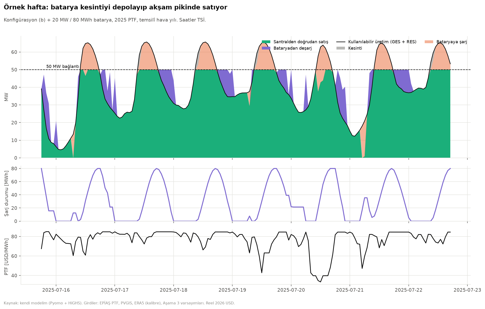

# Aşama 4 — Optimizasyon

**Amaç:** GES, RES ve batarya (BESS) kapasitelerini 50 MW şebeke bağlantısı altında proje değerini
(NPV) en büyük yapacak şekilde boyutlandırmak. Model adım adım büyütüldü:

1. **Basamak 1:** Batarya arbitrajı (LP)
2. **Basamak 2:** Sabit hibrit santral + batarya (LP)
3. **Basamak 3:** Kapasite optimizasyonu (MILP)
4. **Basamak 4:** Ayrıntılı değerlendirme ve senaryolar

| | |
|---|---|
| Kodlar | `src/optimizasyon/batarya.py` (B1), `hibrit.py` (B2 + dispatch kancası), `temsili_gunler.py`, `kapasite.py` (B3) |
| Çalıştırma | `.venv/bin/python src/04_optimizasyon.py` (~15-20 dk) |
| Çözücü | Pyomo + HiGHS (`appsi_highs`) |
| Çıktılar | `outputs/04_optimizasyon/` |

---

## 0. Ön adımlar

### 0.1 Aşama 3 borç kontrolü — hata yok
Borç nominal USD (%8), model reel USD. Borç servisinin reel nakit akışına doğru çevrildiği üç
bağımsız testle doğrulandı (konfigürasyon b):

| Test | Sonuç |
|---|---|
| Reel borç servisinin reel faizle [(1,08/1,025) − 1 = %5,37] COD'a indirgenmiş değeri = reel borç | 44,916 = 44,916 M$ (oran 1,0000) |
| Öz kaynak nakit akışı tamamen nominalde kurulup IRR hesaplandı | %8,903 = modelin nominal IRR'ı %8,903 |
| P90 DSCR, vade boyunca | tam 1,30; son bakiye 0 |

**Doğru deflate etmek neden önemli?** Nominal borç servisi reel nakit akışından deflate edilmeden düşülseydi, reel öz kaynak IRR'ı %6,25 yerine **%4,21** çıkardı.

**Kalan bilinen basitleştirmeler** (zaten docs/03'te):
- inşaat dönemi faizi yok,
- faiz vergi kalkanı kaldıraçsız vergiyle sınırlı.

### 0.2 Finansal modelde yapılan değişiklikler
- **Ekonomik kesinti:** PTF < TEİAŞ enerji bedeli (3,8 $/MWh) olan saatlerde santral satmaz. Optimizasyon modeli bunu kendiliğinden yapıyordu; iki model tutarlı olsun diye ayrıntılı modele de eklendi. Kanibalizasyon nedeniyle öğle fiyatları sıfıra yaklaştıkça bu saatler çoğalıyor.
- **Batarya kancası:** Kanca artık (şebekeye verilen, deşarj, şarj) üçlüsünü döndürüyor. Önceki sürümde bataryadan satılan enerjinin geliri toplam gelire eklenmiyordu; bataryasız konfigürasyonları etkilemeyen bu hata düzeltildi.
- **Batarya yenileme ve yıpranma:**
  - 20. yılda yenileme (CAPEX × (1 − %3)^20), sonrasında augmentation 28. yılda da devam ediyor.
  - Kullanıma bağlı yıpranma maliyeti **6 $/MWh deşarj**. Gerekçe: hücre payı ~%55 × 110 bin $/MWh ≈ 60 bin $/MWh; ~7.000 tam döngüyle ~8,6 $/MWh; takvimsel kısım augmentation ile karşılandığından ~%70'i alındı.

### 0.3 Başabaş fiyat
NPV'yi sıfır yapan reel yıllık ortalama fiyat seviyesi L. Fiyat şekli ve kanibalizasyon varyantı
sabit tutulup yalnızca seviye değiştirilerek Brent kök bulmayla hesaplanıyor (`src/finans/metrikler.py`).
Sonuçlar bölüm 6'da.

### 0.4 Düzenleyici araştırma

**(1) Depolamalı tesislere bağlantı kapasitesi tahsisi**
- **Yasal dayanak:** 7417 sayılı Kanun (1 Temmuz 2022) ve Lisans Yönetmeliği ile Depolama Faaliyetleri Yönetmeliği değişiklikleri ([Resmî Gazete 19.11.2022, sayı 32018](https://www.resmigazete.gov.tr/eskiler/2022/11/20221119-3.htm)). Bu düzenlemeyle **"depolamalı elektrik üretim tesisi"** kategorisi tanımlandı.
- **Mekanizma:** Depolama tesisi kurmayı taahhüt edene, **depolama kurulu gücü kadar** RES ve/veya GES için ön lisans veriliyor. Yarışmasız ek bağlantı kapasitesi anlamına geliyor.
- **Oran şartı:** RES/GES elektriksel kurulu gücünün depolama kurulu gücüne oranı **en fazla 1**.
- **Bağlantı şekli:** Üretim, sisteme **depolama ünitesi üzerinden** verilmek zorunda; sisteme verilen enerji, lisanstaki elektriksel kurulu güçle yapılabilecek üretimi geçemez ([Erdem & Erdem](https://www.erdem-erdem.av.tr/bilgi-bankasi/elektrik-depolama-faaliyetlerindeki-guncel-gelismeler), [Mondaq](https://www.mondaq.com/turkey/renewables/1256572/elektrik-piyasas%C4%B1nda-depolamal%C4%B1-%C3%9Cretim-faaliyeti-ve-lisanslama-s%C3%BCreci)).
- **Başvuru durumu:**
  - Ekim 2023'te bu kapsamdaki yeni ön lisans başvuruları geçici olarak durduruldu ([AA](https://www.aa.com.tr/tr/ekonomi/depolamali-elektrik-uretim-tesisi-on-lisans-basvurulari-gecici-olarak-durduruldu/3019820), [GÜNDER](https://www.gunder.org.tr/epdk-depolamali-elektrik-uretim-tesislerine-iliskin-on-lisans-basvurularini-gecici-olarak-almayacak/)).
  - Mart 2025 itibarıyla 676 projeye **33,1 GW** ön lisans verilmiş, sonrasında ilk üretim lisansları (ör. Mersin 100 MW RES) çıkmış ([AA](https://www.aa.com.tr/tr/ekonomi/epdk-depolamali-elektrik-uretimine-yonelik-33-1-gigavat-kurulu-guc-icin-on-lisans-verdi/3520127)).
  - **Emin olamadığım nokta:** Bu lisansların askıya almadan önceki başvurulardan geldiğini düşünüyorum; yeni başvuruların yeniden açılıp açılmadığını doğrulayamadım.
- **Modelde:** `duzenleme.depolamali_tesis_modu` (varsayılan kapalı). Açıksa `BESS gücü ≥ GES + RES` kısıtı eklenir.

**(2) Entegre bataryanın şebekeden şarjı**
- **Tanım:** Depolama yönetmeliği "üretim tesisine entegre elektrik depolama ünitesini", tesiste **üretilen veya sistemden çekilen** enerjiyi depolayıp geri verebilen ünite olarak tanımlıyor. Yani şebekeden şarj **teknik olarak tanımın içinde** ([Lexpera konsolide metin](https://www.lexpera.com.tr/mevzuat/yonetmelikler/elektrik-piyasasinda-depolama-faaliyetleri-yonetmeligi-2)).
- **Kısıtlar:**
  - Sistemden çekilip geri verilen enerji, üretim tesisinin teşvik veya alım garantisinden (YEKDEM vb.) **yararlanamaz**.
  - Uzlaştırma dönemi bazında sisteme verilen enerji, tesisin elektriksel kurulu gücünü aşamaz.
- **Emin olamadığım nokta:** Şebekeden şarj edilen enerjinin uzlaştırmada nasıl ayrıştırıldığı ve lisans koşullarının pratikte ne olduğu. Depolamalı tesislerde "üretim depolama üzerinden verilir" şartı ayrıca var.
- **Modelde:** `duzenleme.sebekeden_sarj: false` (muhafazakâr varsayılan). Basamak 1 öğrenme amacıyla şebekeden şarjı serbest bırakıyor.

**(3) RES'e yardımcı kaynak olarak GES**
- **Çerçeve:** "Birden fazla kaynaklı elektrik üretim tesisi" düzenlemesiyle (2020) yardımcı kaynak üniteleri ana kaynaklı tesisin ünitesi sayılıyor ve tek lisans içinde değerlendiriliyor ([Resmî Gazete 08.03.2020](https://www.resmigazete.gov.tr/eskiler/2020/03/20200308-7.htm)).
- **Genel kural:** Yardımcı kaynağın mekanik gücü, ana kaynağın kurulu gücünü geçemez. Kurulu gücü 50 MW üstü olanlarda sınır "50 MW + aşan kısmın yarısı", toplamda en fazla 100 MW.
- **RES istisnası:** EPDK'nın **2 Kasım 2022** tarihli kararıyla rüzgâr ana kaynaklı tesisler için bu sınır **kaldırıldı** ([Enerji Günlüğü](https://www.enerjigunlugu.net/reslerde-yardimci-kaynak-kurulu-guc-siniri-kalkti-51087h.htm), [Enerji Ajansı](https://enerjiajansi.com.tr/lisansli-hibrit-ruzgar-projelerinde-yardimci-kaynak-kurulu-guc-siniri-kalkti/)).
- **Kalan bağlayıcı sınır:** Tesisin elektriksel kurulu gücü, yani bağlantı kapasitesi. Modelde bu `şebekeye verilen ≤ L` kısıtı.
- **Modelde:** `duzenleme.yardimci_kaynak_siniri` (varsayılan kapalı; açıksa GES ≤ oran × RES).
- **Ayrıca:** `optimizasyon.ges_azami_mw` = 100 MWac arazi sınırı (tahmin) ve `turbin_azami` = 24 türbin.

---

## 1. Basamak 1 — Batarya arbitrajı (LP)

**Soru:** 10 MW / 40 MWh'lik bir batarya, 2025'in saatlik fiyatlarıyla en kârlı şarj/deşarj
planını nasıl yapar? (Bu basamakta batarya **şebekeden şarj olabiliyor**; yalnızca öğrenme amaçlı.)

**Kümeler**
$$T = \{0, 1, \dots, 8759\} \quad \text{(saatler)}$$

**Parametreler**
- $p_t$: saat $t$'deki fiyat [USD/MWh] (2025 PTF, USD)
- $\bar P = 10$ MW: güç sınırı; $\bar E = 40$ MWh: enerji kapasitesi
- $\eta_c = \eta_d = \sqrt{0{,}87}$: şarj ve deşarj verimi (gidiş-dönüş %87)
- $c^{y} = 6$ USD/MWh: yıpranma maliyeti (deşarj edilen MWh başına)
- $s_0 = 0{,}5\,\bar E$: başlangıç şarj durumu

**Karar değişkenleri**
- $c_t \ge 0$: şarj gücü [MW]
- $d_t \ge 0$: deşarj gücü [MW]
- $s_t \ge 0$: saat sonundaki şarj durumu, SOC [MWh]

**Amaç**
$$\max \; \sum_{t \in T} \Big[ p_t\,(d_t - c_t) \; - \; c^{y}\, d_t \Big]$$

**Kısıtlar**

| Kısıt | Ne anlama geliyor? |
|---|---|
| $s_t = s_{t-1} + \eta_c c_t - d_t/\eta_d$ ($s_{-1} = s_0$) | **SOC dengesi:** Bataryadaki enerji = bir önceki saatteki enerji + şarjın verimle depolanan kısmı − deşarj için harcanan enerji (deşarjda da kayıp var) |
| $0 \le c_t \le \bar P$, $0 \le d_t \le \bar P$ | **Güç sınırı:** İnverter bir saatte en fazla 10 MW alıp verebilir |
| $0 \le s_t \le \bar E$ | **Enerji sınırı:** Batarya 40 MWh'ten fazlasını tutamaz, negatif olamaz |
| $s_{8759} = s_0$ | **Döngüsellik:** Yıl, başladığı enerjiyle biter. Yoksa model yıl sonunda bataryayı "bedavaya" boşaltırdı |

**Aynı saatte şarj ve deşarj neden olmaz?**
- **Kayıplı döngü:** Aynı saatte 1 MWh şarj edip deşarj etmek net olarak $\eta_c\eta_d = 0{,}87$ MWh geri verir. Yani enerji kaybettirir ve üstüne yıpranma maliyeti ekler.
- **Fiyat pozitifken:** Amaç fonksiyonunda aynı saat için $p_t(d_t - c_t)$ olduğundan, ikisini birlikte yapmak yalnızca kayıp ve maliyet üretir. Optimizasyon bunu kendiliğinden yapmaz; bu yüzden tamsayı (ikili) değişkene gerek yok, model LP olarak kalır.
- **İstisna, negatif fiyat:** Fiyat negatifse, fazla enerjiyi "yakmak" (şebekeden çekip kayıpla geri vermek) para kazandırabilir. O zaman eşzamanlı şarj/deşarj optimal olabilir ve bunu engellemek isteniyorsa ikili değişken gerekir. Türkiye'de PTF'nin alt sınırı 0 olduğundan bu durum yok.
- **Çözümde doğrulandı:** Yıl boyunca 0 saat eşzamanlı şarj/deşarj.

**Boyut:** 26.280 değişken, 8.761 kısıt; çözüm ~0,6 s.

### Basamak 1 sonuçları (2025 PTF, USD)

| Gösterge | Değer |
|---|---|
| Amaç: arbitraj geliri − yıpranma | **408.143 $/yıl** (40,8 $/kW-yıl) |
| Net arbitraj geliri (deşarj geliri − şarj maliyeti) | 505.967 $ |
| Yıpranma maliyeti (16.304 MWh × 6 $/MWh) | 97.824 $ |
| Eşdeğer tam döngü | **408 /yıl** (günde ortalama 1,12) |
| Ortalama şarj / deşarj fiyatı | 43,9 / 81,5 $/MWh |
| Birden fazla döngü yapılan gün / hiç çalışılmayan gün | 229 / 6 |
| Aynı saatte şarj ve deşarj | 0 saat |

**Günlük spread üst sınırıyla karşılaştırma** (Aşama 2: en pahalı 4 saat − en ucuz 4 saat):

| | $/yıl |
|---|---|
| Üst sınır: günde 1 döngü, %100 verim, yıpranmasız | 589.283 |
| Günde 1 döngü, %87 verim + 6 $/MWh yıpranma | 358.358 |
| **LP optimumu** | **408.143** |

1. **Verim farkı:** 40 MWh deşarj için ~46 MWh şarj gerekiyor (1/0,87). Ucuz saatte bile alınan fazladan %15 enerjinin maliyeti var.
2. **Yıpranma:** Her MWh deşarj 6 $; yılda ~98 bin $ ediyor. Ayrıca küçük spreadli günlerde çalışmamayı seçtiriyor (6 gün hiç çalışılmadı).
3. **Döngü sayısı:** LP "günde 1 döngü" yaklaşıklığından **daha fazla** kazanıyor (408 bin $ > 358 bin $). 229 günde iki fiyat çukurundan (gece ve öğle) yararlanarak 1'den fazla döngü yapıyor. Yani basit spread göstergesi hem üst sınır değil (kayıpsız versiyonu üst sınır) hem de çok döngünün değerini kaçırıyor.

**Ekonomik değerlendirme:** 10 MW / 40 MWh bataryanın yıllık eşdeğer maliyeti
(10 × 11.833 + 40 × 15.853 ≈ **752 bin $/yıl**; CAPEX, O&M, augmentation, yenileme dahil),
2025 fiyatlarıyla elde edilen 408 bin $/yıl'ın neredeyse iki katı. **Yalnız arbitraj,
şebekeden şarja izin verilse bile bataryayı amorti etmiyor.**

---

## 2. Basamak 2 — Sabit hibrit santral + batarya (LP)

**Soru:** Konfigürasyon (b) (RES 50 + GES 25 MW, 50 MW bağlantı) yanına 20 MW / 80 MWh batarya
konursa ne kazanılır? Batarya **yalnızca santralden** şarj olur (`sebekeden_sarj = false`).
Girdiler: 2025 fiyatları ve tek bir temsilî hava yılı.

**Temsilî hava yılı nasıl seçildi?** 10 yıl arasında GES ve RES yıllık kapasite faktörü
ortalamaya (standartlaştırılmış uzaklıkla) en yakın olan yıl: **2015**. Ardından seviyesi 10 yıl
ortalamasına ölçeklendi.

**Ek parametreler**
- $A_t = 25 \cdot g_t + 50 \cdot r_t$: kullanılabilir üretim [MW] ($g_t$, $r_t$: GES/RES kapasite faktörü)
- $L = 50$ MW: bağlantı kapasitesi

**Ek değişkenler**
- $y_t \ge 0$: santralden doğrudan şebekeye
- $k_t \ge 0$: kesinti
- $c_t$: santralden bataryaya şarj
- (şebekeden şarj $g_t$, burada 0)

**Amaç**
$$\max \sum_t \Big[ p_t\,(y_t + d_t) - c^{y} d_t \Big]$$

**Kısıtlar**

| Kısıt | Anlamı |
|---|---|
| $y_t + k_t + c_t = A_t$ | **Üretim dengesi:** O saatte üretilebilen enerji ya satılır, ya kesilir ya da bataryaya gider. Kesinti serbest bir değişken; model kesmeyi ancak başka seçenek yoksa (veya fiyat çok düşükse) seçer |
| $y_t + d_t \le L$ | **Şebeke kısıtı:** Santralden ve bataryadan şebekeye verilen toplam, bağlantı kapasitesini aşamaz |
| $c_t \le \bar P$, $d_t \le \bar P$, $s_t \le \bar E$ | Batarya güç ve enerji sınırları |
| $s_t = s_{t-1} + \eta_c c_t - d_t/\eta_d$, $s_{\text{son}} = s_0$ | SOC dengesi ve döngüsellik |
| $g_t = 0$ | Şebekeden şarj yok (düzenleyici varsayım) |

**Şebeke kısıtının gölge fiyatı:** $\lambda_t$ = şebeke kısıtının dual değeri, yani **o saatte
bağlantıyı 1 MW büyütmenin amaca katkısı** [USD/MWh].
- **Kısıt bağlayıcı değilse** (şebeke dolu değilse) $\lambda_t = 0$.
- **Kısıt bağlayıcıysa** $\lambda_t$, kesilen ya da bataryaya mecburen giden enerjinin o saatteki değeridir.
- **Yıllık toplam** $\sum_t \lambda_t$ = 1 MW ek bağlantı kapasitesinin bir yıllık değeri [USD/MW-yıl].

**Aşama 0'la bağlantı:** Bu, Aşama 0'daki ısınma modelindeki "şebeke gölge fiyatı 0,012 M$/MW" yorumunun saatlik versiyonu. Orada şebeke yılda tek bir sayıydı; burada bağlantının değeri saatten saate değişiyor ve yalnızca dolu olduğu saatlerde ortaya çıkıyor.

### Basamak 2 sonuçları (konfig. b + 20 MW / 80 MWh, 2025 PTF, temsilî hava yılı)

| Gösterge | Bataryasız | Bataryalı | Fark |
|---|---|---|---|
| Gelir [M$/yıl] | 12,99 | 14,17 | **+1,17** |
| Yıpranma [M$/yıl] | — | 0,17 | |
| Net ek gelir [M$/yıl] | | | **+1,01** |
| Kesinti [MWh/yıl] | 6.143 | 1.112 | **5.031 kurtarıldı** (%82) |
| Yakalanan fiyat [$/MWh] | 63,7 | 69,2 | **+5,4** |
| Deşarj (zamanda kaydırılan enerji) [MWh] | | 27.607 | 345 tam döngü |

- **Bataryanın işi çoğunlukla kesinti kurtarmak değil, zaman kaydırma.** Şarjın yalnızca %16'sı kesintiden geliyor; geri kalanı öğle saatlerinde satılabilecek ama ucuz olan enerjinin akşam pikine taşınması.
- **Kesinti tasarrufu tek başına küçük:** 5.031 MWh × ~45 $/MWh ≈ 0,23 M$/yıl.
- **Ekonomik sonuç:** 20 MW / 80 MWh'in yıllık eşdeğer maliyeti ≈ **1,50 M$/yıl** > 1,01 M$/yıl ek gelir. 2025 fiyatlarında bu batarya kârlı değil.

**Şebeke kısıtının gölge fiyatı** (`b2_sebeke_golge_fiyati.png`):
- **Bağlayıcılık:** Kısıt yılda **1.263 saat** bağlayıcı (gölge fiyat > 0). Bu saatlerde ortalama 14,6 $/MWh, en yüksek ~90 $/MWh.
- **Ne zaman en değerli?** En yüksek değerler **Temmuz–Ağustos 13:00–17:00 TSİ** (meltem + güneş + yüksek yaz fiyatı) ve Şubat gündüzleri (güçlü kış rüzgârı).
- **Yıllık toplam:** $\sum_t \lambda_t$ = **18.452 $/MW-yıl**. Yani bu santral için 1 MW ek bağlantı yılda ~18,5 bin $ değerinde.
- **Maliyetle kıyas:** Bağlantının yıllık eşdeğer maliyeti (CAPEX + TEİAŞ) ≈ 14.900 $/MW-yıl. 2025 fiyatlarıyla (b) için bağlantıyı büyütmek mantıklı olurdu.
- **Aşama 0 ile kıyas:** Isınma modelinde şebekenin gölge fiyatı 0,012 M$/MW-yıl = 12.000 $/MW-yıl çıkmıştı; aynı mertebe. Fark, burada değerin yalnızca dolu saatlerde ortaya çıkması ve bataryanın bir kısmını emmesi.

---

## 3. Basamak 3 — Kapasite optimizasyonu (MILP)

### 3.1 LP ile MILP farkı ve neden MILP?
- **LP (doğrusal programlama):** Tüm değişkenler sürekli. Çözüm uzayı bir çokyüzlü; optimum her zaman bir köşede ve çok hızlı bulunuyor (simplex, iç nokta yöntemleri).
- **MILP (karma tamsayılı doğrusal programlama):** Bazı değişkenlerin tamsayı olması gerekiyor. Burada **RES türbin sayısı N** tamsayı: 4,2 MW'lık bir türbinin 2,7'sini kuramayız.
- **Nasıl çözülüyor?** Çözücü (HiGHS) "dal ve sınır" (branch-and-bound) yöntemini kullanır. Önce tamsayılığı gevşetip LP çözer; N kesirli çıkarsa (ör. 13,4) iki dala ayırır (N ≤ 13 ve N ≥ 14) ve her dalda tekrar LP çözer. En iyi tamsayı çözüm ile LP sınırı arasındaki fark **MIP boşluğu**dur; boşluk 0'a inince çözüm kanıtlanmış optimumdur.
- **Bu projede MILP neden gerekli?** Türbin sayısının tamsayı olması gerçek bir kısıt. LP gevşetmesi (ör. 13,4 türbin) maliyet ve üretimi orantılı bölerek gerçek dışı bir tasarım önerir; 0,4 türbinlik fark ~1,7 MW ve ~2 M$ CAPEX demek.
- **İleride daha fazla tamsayı gerekebilir:** Sabit (kapasiteden bağımsız) maliyetler, örneğin "batarya kurulursa 0,5 M$ trafo merkezi", "kur / kurma" ikili değişkeni gerektirir; aynı saatte şarj/deşarjı yasaklamak (negatif fiyat varsa) da öyle. Bu modelde bunlar yok, bu yüzden tek tamsayı değişken N ve model hızlı çözülüyor.

### 3.2 Formülasyon

**Kümeler**
- $\mathcal{S}$: zaman segmentleri. Tam yıl = 2 segment (iki fiyat şekli yılı × 8.760 saat); temsilî günler = K segment × 24 saat.
- $T_s$: segment $s$'nin saatleri.
- $w_s$: segment ağırlığı. Tam yılda $0{,}5$ (iki fiyat yılının ortalaması); temsilî günde kümedeki gün sayısı (yıl başına). Böylece $\sum_s w_s |T_s| = 8760$.

**Parametreler**
- $\hat p_t$: **seviyelendirilmiş saatlik fiyat** = $\sum_{k} DF_k\, p_{k,t} / \sum_k DF_k$. Her saat için 30 yıllık fiyatların (kanibalizasyon ve seviye senaryosu dahil) iskonto ağırlıklı ortalaması.
- $g_t, r_t$: temsilî hava yılının GES ve RES kapasite faktörleri; seviyelendirilmiş degradasyon çarpanlarıyla ($f_{GES} = 0{,}953$, $f_{RES} = 0{,}971$).
- $m = 4{,}2$ MW: türbin gücü; $L = 50$ MW: bağlantı.
- $\tau_e = 3{,}8$ USD/MWh: TEİAŞ enerji bedeli; $c^{y} = 6$ USD/MWh: yıpranma; $\eta_c, \eta_d$: verimler.
- $a_X$: kalem $X$'in **yıllık eşdeğer maliyeti** (bkz. 3.3).

**Karar değişkenleri**
- $N \in \{0, 1, \dots, 24\}$: türbin sayısı (**tamsayı**)
- $G \in [0, 100]$: GES [MWac]
- $P \ge 0$: batarya gücü [MW]; $E \ge 0$: batarya enerjisi [MWh]
- $y_t, k_t, c_t, d_t, s_t \ge 0$: Basamak 2'deki gibi

**Amaç (yıllık eşdeğer, vergi öncesi eşdeğer USD)**
$$\max \; \underbrace{\sum_{s} w_s \sum_{t \in T_s} \Big[(\hat p_t - \tau_e)(y_t + d_t) - c^{y} d_t\Big]}_{\text{piyasa geliri}}
\; - \; (a_{RES} + \delta_{RES})\, m N \; - \; (a_{GES} + \delta_{GES})\, G \; - \; a_P P \; - \; a_E E \; - \; a_L L$$

Burada $\delta_{GES}$ ve $\delta_{RES}$, dengesizlik maliyeti ve RES eşzamanlılık düzeltmesinin MW başına
yıllık karşılığıdır. Kesinti öncesi üretim üzerinden hesaplandıkları için kapasitelerle doğrusaldırlar.

**Kısıtlar**

| Kısıt | Anlamı |
|---|---|
| $y_t + k_t + c_t = G\, g_t + m N\, r_t$ | Üretim dengesi; kapasite değişkenleri burada saatlik üretime bağlanıyor |
| $y_t + d_t \le L$ | Şebeke kısıtı |
| $c_t \le P,\; d_t \le P$ | Batarya gücü, kapasite **değişkeni** $P$ ile sınırlı |
| $s_t \le E$ | Batarya enerjisi, kapasite değişkeni $E$ ile sınırlı |
| $s_t = s_{t-1} + \eta_c c_t - d_t/\eta_d$; her segmentin son saati ilk saatine bağlı | SOC dengesi; her segment (temsilî gün ya da tam yıl) döngüsel |
| $1 \cdot P \le E \le 6 \cdot P$ | Batarya süresi 1-6 saat |
| $G \le 100$; (opsiyonel) $G \le \text{oran} \cdot mN$; (opsiyonel) $P \ge G + mN$ | Arazi; yardımcı kaynak kuralı; depolamalı tesis kuralı |

**Neden hâlâ doğrusal?** Tüm çarpımlar "parametre × değişken" ($G \cdot g_t$, $mN \cdot r_t$).
"Değişken × değişken" çarpımı yok; tek doğrusal olmayan unsur $N$'in tamsayı olması.

### 3.3 Yıllıklandırma ve vergi yaklaşımı
Aşama 3'ün zaman çizelgesiyle aynı tanımlar:
- 2 yıl inşaat (%40 / %60), 30 yıl işletme
- $DF_y = (1+r)^{-y}$, $r = \%7$ reel WACC

**Tanımlar:**
- $S = \sum_{k=1}^{30} DF_{2+k} = 10{,}84$: işletme yıllarının iskonto çarpanları toplamı
- $C = \sum_y \text{takvim}_y \, DF_{y+1}$: 1 USD CAPEX'in bugünkü değeri
- $z = \sum_{k=1}^{10} \tfrac{1}{10}\, DF_{2+k}$: 1 USD CAPEX'in amortisman vergi kalkanı tabanı

**Vergi sonrası NPV:**
$$\text{NPV} \approx (1-t)\, S \cdot \text{(yıllık gelir − gider)} \; - \; \text{CAPEX}\,(C - t z)$$

Her iki taraf $(1-t)S$'ye bölününce **vergi düzeltmeli yıllık sermaye çarpanı** elde edilir:
$$a_{cap} = \frac{C - t z}{(1-t) S} = 0{,}0916$$

Bu çarpanla:
- $a_{RES} = \text{CAPEX}_{RES}\, a_{cap} + \text{O\&M} + \text{arazi} + \text{sigorta} + \text{söküm}/S$
- Batarya enerji kalemi $a_E$'ye augmentation (8., 16., 28. yıllar), 20. yıl yenilemesi ve söküm de bugünkü değerleri üzerinden yıllıklandırılarak eklenir.
- Bağlantı ($a_L$) CAPEX'i ve yıllık TEİAŞ kapasite bedelini içerir.

**Sonuç:** Amaç değeri × $(1-t)\,S$ = 8,13 → **NPV tahmini**.

**Basitleştirmeler** (ayrıntılı değerlendirmeyle karşılaştırma bölüm 5'te):
1. **Saatlik gelir tek bir seviyelendirilmiş fiyat vektörüyle hesaplanır.** Kanibalizasyonun yıllar içindeki ilerleyişi ortalamaya gömülür.
2. **Degradasyon** çarpanları da seviyelendirilmiştir (üretim ile fiyatın yıllar içindeki birlikte değişimi ihmal edilir).
3. **Dengesizlik ve eşzamanlılık düzeltmesi** kesinti öncesi üretim üzerinden, doğrusal olarak hesaplanır.
4. **Zarar mahsubu ihmal edilir:** Her yıl vergi matrahı pozitif kabul edilir.
5. **Tek temsilî hava yılı** kullanılır (10 yıl ortalamasına ölçekli); yıllar arası değişkenliğin kesintiye etkisi (doğrusal olmayan) kaybolur.

### 3.4 Temsilî günler: mantık ve sınırlar
- **Neden?** Tam yıl modelinde 2 × 8.760 saat × 5 değişken ≈ 87.600 değişken var. Bu model HiGHS ile ~35 s'de çözülüyor, ama senaryo taramalarında çok kez çözülecek.
- **Yöntem** (`src/optimizasyon/temsili_gunler.py`):
  1. 730 gün (2 fiyat yılı × 365) için 72 boyutlu öznitelik vektörü oluşturulur: [fiyat/ortalama (24), GES KF (24), RES KF (24)].
  2. k-means ile K kümeye ayrılır (k-means++ başlangıcı, 10 tekrar).
  3. Her küme, merkezine en yakın **gerçek gün** (medoid) ile temsil edilir. Ortalama gün kullanılmaz, çünkü ortalama fiyat piklerini düzleştirir ve batarya değerini düşük gösterir.
  4. Ağırlık = kümedeki gün sayısı.
- **Moment eşleştirme:** Medoidler yıllık ortalama fiyatı ve kapasite faktörlerini tam korumaz. Bu yüzden ağırlıklı ortalamaları tam yılla eşleşecek şekilde ölçeklenir (gün içi şekil korunur). İlk denemede eşleştirme olmadan NPV tam yıla göre 2-4 M$ düşük çıktı.
- **Sınırlar:**
  - Günler birbirinden kopuk (her gün SOC başa döner), yani çok günlük depolama değeri kaybolur.
  - Uç günler (çok rüzgârlı ya da çok güneşli) kümelerde sönümlenir; kesinti bu uç günlerde oluştuğu için kesinti biraz düşük tahmin edilebilir.

### Basamak 3 sonuçları (baz fiyat 58 $/MWh, kanibalizasyon devam, yatırım zorunlu)

| Zaman temsili | Türbin | RES [MW] | GES | BESS | NPV tahmini [M$] | Çözüm süresi | MIP boşluğu |
|---|---|---|---|---|---|---|---|
| 12 temsilî gün | 13 | 54,6 | 0 | 0 | −1,69 | 0,1 s | 2·10⁻¹⁴ |
| 24 temsilî gün | 13 | 54,6 | 0 | 0 | −1,69 | 0,3 s | 3·10⁻¹⁴ |
| 48 temsilî gün | 13 | 54,6 | 0 | 0 | −2,00 | 0,9 s | 1·10⁻¹⁴ |
| **Tam yıl (2 × 8.760 saat)** | **14** | **58,8** | **0** | **0** | **−1,04** | **36 s** | 2·10⁻¹³ |

**Temsilî günler vs tam yıl:**
- **Benzerlik:** Temsilî günler tasarımın karakterini doğru yakalıyor: GES yok, batarya yok, bağlantının ~%10–20 fazlası RES.
- **Fark:** Temsilî günler 1 türbin eksik buluyor ve NPV'yi ~0,7 M$ düşük tahmin ediyor. Nedeni, kesintinin oluştuğu uç rüzgâr günlerinin kümelerde sönümlenmesi; bu da 14. türbinin değerini olduğundan düşük gösteriyor. K'yı 48'e çıkarmak düzeltmedi.
- **Karar:** Tam yıl modeli zaten ~36 s'de çözüldüğü için **ana sonuçlar, senaryolar ve şebeke taraması tam yılla** çözüldü. Temsilî günler (K = 24) yalnızca 63 hücrelik GES × batarya ızgarasında ve türbin eğrisinde kullanıldı.

**Optimal tasarım (yatırım yapılacaksa):**
- **RES 14 × 4,2 = 58,8 MW, GES 0, batarya 0.** Bağlantı 50 MW, yani **%18 aşırı kurulum**.
- **Kesinti %5,8** (ekonomik kesinti dahil).
- **Ayrıntılı modelle** (bölüm 4.1) NPV −1,58 M$, IRR %6,74.

**Türbin sayısı eğrisi** (K = 24, `b4_turbin_egrisi.csv`):
- NPV, 9'dan 13 türbine kadar her türbinle **+0,34 M$** artıyor. Bağlantı maliyeti sabit, ek türbinler onu daha çok üretime yayıyor.
- 14'te düzleşiyor, 15'ten sonra hızla düşüyor (15: −3,0; 17: −7,0 M$). Bağlantı doldukça kesinti artıyor.
- **Sonuç:** Optimum keskin bir "aşırı kurulum oranı" etrafında.

**İkili yatırım değişkeni ($b$):**
- **İlk sürümdeki hata:** Bağlantı maliyeti amaçta her zaman vardı. Bu yüzden "hiç kurma" seçeneği −6 M$ görünüyor ve optimizasyon negatif NPV'li tasarımı ona tercih ediyordu.
- **Düzeltme:** İkili $b$ eklendi. Bağlantı maliyeti $a_L L b$ oldu ve $N \le N_{max} b$, $G \le G_{max} b$, $P \le 4L\, b$ kısıtları getirildi.
- **Bu, MILP'te sabit maliyetin klasik modellenme şekli.** "Kurarsan sabit maliyet ödersin" kararı ancak tamsayı değişkenle ifade edilebilir; bu, modeldeki ikinci tamsayı değişken.
- **İki mod:**
  - "Zorunlu" ($b = 1$): kurulacaksa en iyi tasarım
  - "Serbest": gerçek yatırım kararı

---

## 4. Basamak 4 — Ayrıntılı değerlendirme ve senaryolar

### 4.1 Optimizasyon modeli vs ayrıntılı model (optimal tasarım, baz senaryo)

| | NPV [M$] | Kesinti |
|---|---|---|
| Optimizasyon (seviyelendirilmiş fiyat, temsilî hava yılı, yıllık eşdeğer) | −1,04 | %5,76 |
| Ayrıntılı `proje_degerle`, aynı temsilî hava yılı | −1,13 | — |
| **Ayrıntılı `proje_degerle`, 10 hava yılı** | **−1,58** (IRR %6,74) | %5,75 |

**Farkın kaynakları:**
1. **Seviyelendirme ve doğrusallaştırma (−0,09 M$):** Seviyelendirilmiş fiyat × seviyelendirilmiş degradasyon, gerçek yıllık çarpımdan biraz farklı. Dengesizlik ve eşzamanlılık düzeltmesi kesinti öncesi üretim üzerinden; zarar mahsubu yok. Küçük.
2. **Hava yılları (−0,45 M$):** Temsilî yıl 10 yıl ortalamasına ölçeklense de kesinti doğrusal değil. Çok rüzgârlı yıllarda kesinti artar, zayıf yıllarda bağlantı boş kalır; ortalama yılla hesaplanan gelir bu asimetriyi kaçırır. Bu, Jensen eşitsizliğinin bir örneği: ortalamanın fonksiyonu ≠ fonksiyonun ortalaması.

**Sonuç:** Fark ~0,5 M$ (CAPEX'in ~%0,7'si). **Tasarım kararını değiştirmiyor**, ama nihai değerlendirmede 10 hava yılı kullanılmalı.

**Batarya içeren tasarımlarda dispatch kancası** (`src/optimizasyon/hibrit.py → dispatch_kancasi`) şöyle çalışıyor:
- Her fiyat-yılı grubu × 10 hava yılı × 2 şekil yılı için 8.760 saatlik LP çözülüyor (persistent HiGHS; konfigürasyon (b) + 20/80 için 120 LP, ~46 s).
- Fiyatı aynı olan yıllar (kanibalizasyon tabanından sonra) tek grupta toplanıyor. Gruptaki sonraki yıllarda degradasyon nedeniyle şarj, kullanılabilir üretimle sınırlanıyor (küçük yaklaşım).
- Başabaş fiyat hesabında dispatch planı baz seviyede bir kez çözülüp diğer seviyelerde yeniden kullanılıyor.

### 4.2 Senaryolar ve pişmanlık (`b4_senaryo_tasarimlari.png`)

| Senaryo | Optimal karar (yatırım serbest) | Kurulursa en iyi tasarım | Kurulursa NPV [M$] |
|---|---|---|---|
| Düşük (45) / durur | **Yatırım yapma** | (kârlı tasarım yok) | — |
| Düşük (45) / devam | **Yatırım yapma** | (kârlı tasarım yok) | — |
| Baz (58) / durur | Kur | RES 58,8 | +0,37 |
| **Baz (58) / devam** | **Yatırım yapma** | RES 58,8 | −1,04 |
| Yüksek (72) / durur | Kur | RES 58,8 + GES 5 + BESS 3 MW / 6 MWh | +20,35 |
| Yüksek (72) / devam | Kur | RES 63,0 + BESS 7 MW / 18 MWh | +18,89 |

**Pişmanlık** [M$] = o senaryonun gerçek optimumu (yatırım yapmama dahil) − tasarımın o senaryodaki NPV'si:

| Tasarım | Düşük/durur | Düşük/devam | Baz/durur | Baz/devam | Yüksek/durur | Yüksek/devam | **En büyük** |
|---|---|---|---|---|---|---|---|
| Yatırım yapma | 0,0 | 0,0 | 0,4 | 0,0 | 20,3 | 18,9 | 20,3 |
| **RES 58,8** | 17,9 | 19,0 | 0,0 | 1,0 | 0,3 | 0,6 | **19,0** |
| RES 58,8 + GES 5 + BESS 3/6 | 19,4 | 20,6 | 0,6 | 1,9 | 0,0 | 0,6 | 20,6 |
| RES 63,0 + BESS 7/18 | 21,2 | 21,9 | 1,7 | 2,3 | 0,3 | 0,0 | 21,9 |

**Yorum:**
1. **Asıl karar "kurmak ya da kurmamak".** Kurmanın doğru olduğu senaryolarda (baz/durur, yüksek) tasarımlar arası pişmanlık **en fazla 0,6 M$**; tasarım senaryolara dayanıklı. Yanlış yatırım kararının bedeli ise 18–22 M$.
2. **Baz senaryoda seçilen tasarımın (RES 58,8) en büyük pişmanlığı 19,0 M$** ve bu düşük fiyat senaryosundan geliyor (kurmamak gerekirken kurmuş olmak). Yüksek senaryolarda optimumdan yalnızca 0,3–0,6 M$ geride.
3. **Minimaks pişmanlık ölçütü** (en kötü pişmanlığı en küçük yapan) **RES 58,8**'i seçiyor (19,0 < 20,3 "yapma" < 20,6 < 21,9). Yani belirsizlik altında da sağlam tercih "yalnız RES, ~%18 aşırı kurulum".
4. **Batarya ve GES yalnızca yüksek fiyatta** ve küçük boyutlarda (7 MW / 18 MWh ≈ 2,6 saat; 5 MW GES) giriyor. Kanibalizasyon devam ederse GES hiç girmiyor, yerini batarya alıyor.
5. **Pratik anlamı:** Değeri artırmanın yolu tasarımı inceltmek değil, **fiyat riskini yönetmek** (PPA / YEKA). Bu, Aşama 5'teki Monte Carlo'nun ana konusu olacak.

### 4.3 Şebeke boyutu duyarlılığı (`b4_sebeke_boyutu.png`)

Her bağlantı boyutu L için kapasiteler yeniden optimize edildi (yatırım zorunlu, kanibalizasyon devam):

| L [MW] | Baz: tasarım | Baz: NPV [M$] | Yüksek: tasarım | Yüksek: NPV [M$] |
|---|---|---|---|---|
| 30 | RES 33,6 | −0,77 | RES 37,8 + BESS 4/11 | 11,3 |
| 40 | RES 46,2 | −0,90 | RES 50,4 + BESS 5/15 | 15,1 |
| 50 | RES 58,8 | −1,04 | RES 63,0 + BESS 7/18 | 18,9 |
| 60 | RES 71,4 | −1,18 | RES 75,6 + BESS 8/22 | 22,7 |
| 70 | RES 84,0 | −1,43 | RES 84,0 + BESS 7/17 | 26,5 |
| 80 | RES 96,6 | −1,76 | RES 96,6 + BESS 8/20 | 30,3 |

**Optimal tasarım bağlantıyla orantılı ölçekleniyor:** RES ≈ 1,2–1,26 × L, kesinti ~%5–6 sabit (70 MW'tan sonra türbin azami sınırı 24'e yaklaşıyor).

**Bağlantının MW başına marjinal değeri** (bugünkü değer):

| | Baz | Yüksek |
|---|---|---|
| Marjinal NPV (bağlantı maliyeti sonrası) | −0,014 M$/MW | **+0,38 M$/MW** |
| Bağlantı maliyeti öncesi değer | 0,107 M$/MW | **0,50 M$/MW** |
| Bağlantının kendi maliyeti (CAPEX 120 bin $ + TEİAŞ kapasite bedeli, BD) | 0,121 M$/MW | 0,121 M$/MW |

**TEİAŞ katkı payı yarışmasıyla bağlantısı:**
- **Kural:** Bir yatırımcının yarışmada MW başına teklif edebileceği **azami katkı payı = bağlantı maliyeti öncesi marjinal değer − bağlantının kendi maliyeti**. Bu, marjinal NPV'nin kendisi.
- **Baz senaryoda (58 $/MWh) katkı payı teklif tavanı sıfır;** bağlantı maliyetini bile karşılamıyor.
- **Yüksek senaryoda (72 $/MWh) MW başına ~0,38 M$** (bugünkü değer), yani 50 MW için ~19 M$'a kadar katkı payı ödenebilir. Bu tutar projenin tüm NPV'sine eşit; teklif ancak bu fiyat görüşüne güveniliyorsa rasyonel.
- **Saatlik görünüm:** Basamak 2'nin saatlik gölge fiyatları bu değerin bir yılda nasıl oluştuğunu gösteriyor (Temmuz–Ağustos öğleden sonraları).

### 4.4 GES × batarya ızgarası: optimum ne kadar düz? (`b4_ges_bess_npv_izgara.png`)

RES 58,8 MW sabit, 50 MW bağlantı, baz senaryo, 24 temsilî gün; hücreler en iyi tasarıma göre NPV farkı [M$]:

| BESS MWh ↓ / GES MWac → | 0 | 10 | 20 | 30 | 40 | 60 |
|---|---|---|---|---|---|---|
| 0 | **0,0** | −2,5 | −5,3 | −8,3 | −11,5 | −18,6 |
| 20 | −0,6 | −2,5 | −5,2 | −8,2 | −11,3 | −18,2 |
| 40 | −1,9 | −3,1 | −5,3 | −8,2 | −11,3 | −18,1 |
| 80 | −5,1 | −5,4 | −6,8 | −9,0 | −11,9 | −18,3 |
| 160 | −13,8 | −13,1 | −13,0 | −13,8 | −15,6 | −21,1 |

**Yorum:**
- **GES yönünde optimum dik:** Her 10 MW GES ~2,5–3,5 M$ kaybettiriyor (kesinti + kanibalizasyon).
- **Batarya yönünde ilk 20 MWh'te optimum düz** (−0,6 M$), sonra her 20 MWh ~1,3–2 M$ kaybettiriyor.
- **GES ile batarya birbirini kısmen telafi ediyor:** GES 20–30 MW iken 20–40 MWh batarya NPV'yi biraz iyileştiriyor (−5,3 → −5,2; −8,3 → −8,2). Batarya GES'in kesilen ve ucuz öğle enerjisini taşıyor. Ama bu, ikisinin toplam maliyetini karşılamaya yetmiyor.

### 4.5 Başabaş fiyat (reel yıllık ortalama, $/MWh)

| Tasarım | Kanibalizasyon durur | Kanibalizasyon devam |
|---|---|---|
| **Optimal (RES 58,8, 50 MW bağlantı)** | **57,9** | **59,0** |
| (a) RES 50 | 58,5 | 59,6 |
| (b) RES 50 + GES 25 | 60,1 | 62,8 |
| (c) RES 50 + GES 50 | 63,5 | 67,1 |
| (d) GES 50 | 72,8 | 89,4 |

**Yorum:**
- **Optimizasyon başabaş fiyatı (b)'ye göre 3,8 $/MWh, (a)'ya göre 0,6 $/MWh düşürüyor.** Fark küçük ama değerli: 58 $/MWh'lik baz fiyat, optimal tasarımın başabaşına (59,0) yalnızca 1 $/MWh uzak.
- **Kanibalizasyonun etkisi:** Optimal tasarımın başabaşında devam ile durur arasındaki fark yalnızca 1,1 $/MWh, (d)'de ise 16,6 $/MWh. Yalnız RES tasarımı kanibalizasyona en az maruz kalan tasarım.

---

## 5. Sınırlamalar

1. **Tek temsilî hava yılı:** Optimizasyonda kesintinin yıllar arası doğrusal olmayan etkisi kayboluyor (bölüm 4.1, −0,45 M$). Çözüm: 10 hava yılını senaryo olarak içeren stokastik program (model ~10 kat büyür) ya da Aşama 5'te Monte Carlo.
2. **Seviyelendirilmiş fiyat:** Kanibalizasyonun zamanlaması ortalamaya gömülü. Batarya için "erken yıllarda düşük, geç yıllarda yüksek değer" ayrımı yapılamıyor. Bataryayı sonradan kurmak (aşamalı yatırım) modellenmedi; bu, gerçek bir opsiyon değeri.
3. **Mükemmel öngörü:** Dispatch bir yıllık fiyatları önceden bilerek yapılıyor; gerçekte gün öncesi tahminle yapılır. Batarya değeri olduğundan yüksek gösteriliyor (büyüklüğü bu projede ölçülmedi).
4. **Yalnızca gün öncesi enerji arbitrajı:** Yan hizmetler (frekans kontrolü), kapasite mekanizması ve dengesizlikten kaçınma gelirleri dahil değil. Bu nedenle batarya değeri **muhafazakâr**.
5. **Şebekeden şarj kapalı ve depolamalı tesis kuralı kapalı;** düzenleyici belirsizlikler bölüm 0.4'te.
6. **Batarya yıpranması** sabit $/MWh ve takvimsel augmentation ile temsil edildi; derinlik ve sıcaklığa bağlı yaşlanma yok.
7. **Bağlantı maliyeti doğrusal varsayıldı** (MW başına). Gerçekte trafo merkezi gibi kademeli maliyetler var; ayrıca TEİAŞ'ın verebileceği kapasite sınırlı.

---

## 6. Çıktılar (`outputs/04_optimizasyon/`)

| Dosya | İçerik |
|---|---|
| `b2_ornek_hafta_dispatch.png` | Temmuz haftası: üretim, kesinti, şarj/deşarj, SOC, fiyat |
| `b2_sebeke_golge_fiyati.png` | Şebeke kısıtının gölge fiyatı, ay × saat |
| `b3_temsili_vs_tam_yil.png` | Temsilî gün (12/24/48) vs tam yıl: NPV, kapasite, süre |
| `b4_senaryo_tasarimlari.png` | Senaryoya göre tasarım ve pişmanlık matrisi |
| `b4_sebeke_boyutu.png` | Bağlantı boyutu eğrisi ve marjinal değer |
| `b4_ges_bess_npv_izgara.png` | GES × batarya NPV ısı haritası |
| `*.csv`, `ozet.json` | Tüm tablolar |

---

## Mülakat özeti

> Optimizasyonu adım adım kurdum. Önce yalnız bir bataryanın 2025 fiyatlarıyla en kârlı
> şarj-deşarj planını bulan bir LP yazdım: 10 MW'lık batarya yılda 400 küsur döngüyle 400 bin
> dolar kazanıyor, ama bu yatırımını karşılamaya yetmiyor. Sonra hibrit santralin yanına batarya
> koyup şebeke kısıtının gölge fiyatını saat saat çıkardım: bağlantı en çok yaz öğleden sonraları
> değerli, çünkü o saatlerde hem rüzgâr hem güneş tepe yapıyor. Son olarak türbin sayısını tamsayı
> alan bir MILP ile GES, rüzgâr ve batarya kapasitelerini birlikte optimize ettim. Temsilî günleri
> tam yılla karşılaştırıp doğruladım ve sonucu ayrıntılı finansal modelle yeniden değerlendirdim.
> Optimizasyonun söylediği şu: bugünkü fiyat ve maliyetlerle en iyi tasarım, 50 MW bağlantıya
> yaklaşık 59 MW rüzgâr kurmak; güneş ve batarya ancak yüksek fiyat senaryosunda ve küçük
> boyutlarda giriyor. Pişmanlık analizi asıl kararın "hangi tasarım" değil "kurmalı mı" olduğunu
> gösterdi: tasarımlar arasındaki fark 1 milyon doları geçmezken yanlış yatırım kararının bedeli 20
> milyon. Bağlantı kapasitesinin marjinal değerini de hesapladım: yüksek fiyat senaryosunda MW
> başına yaklaşık 380 bin dolar, ki bu TEİAŞ yarışmasında ödenebilecek katkı payının üst sınırı.
