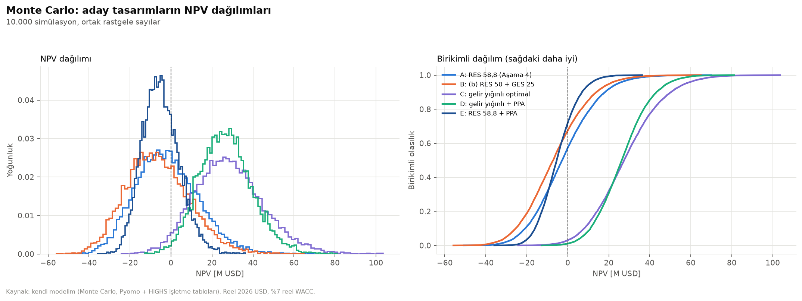
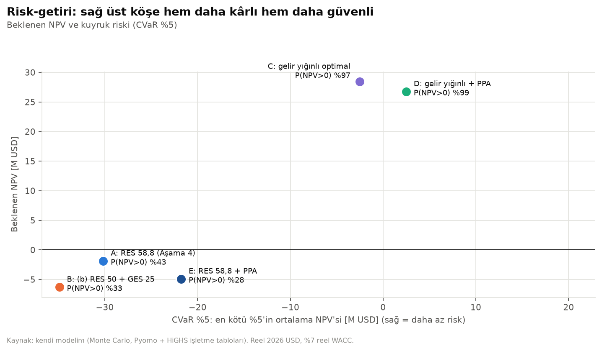
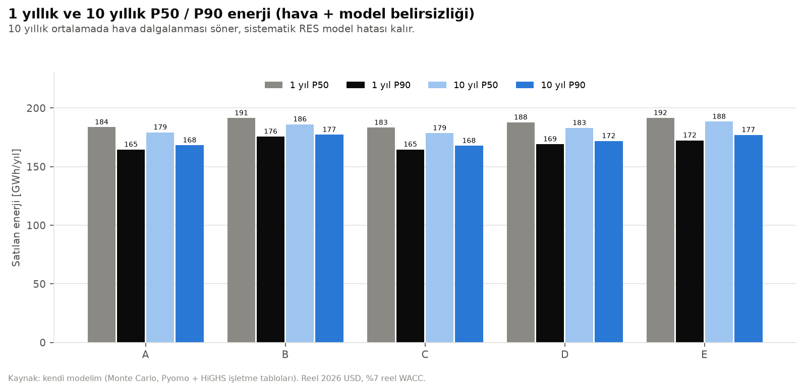
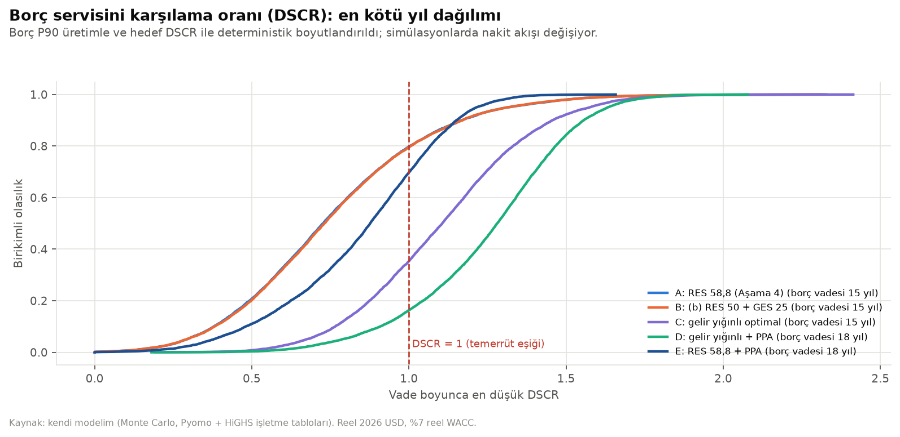
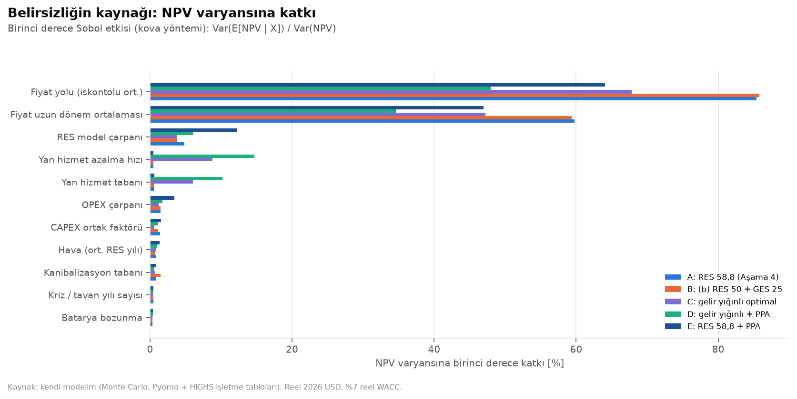

# Aşama 5 — Batarya gelir yığını, PPA ve Monte Carlo risk simülasyonu

Kod: `src/05_gelir_yigini.py` (Bölüm A), `src/05_monte_carlo.py` (Bölüm B), modüller `src/optimizasyon/gelir_yigini.py`,
`src/risk/` (`isletme.py`, `degerleme.py`, `senaryo.py`, `monte_carlo.py`). Tüm çıktılar `outputs/05_risk/`.
Tüm parasal değerler **reel 2026 USD**, iskonto %7 reel WACC.

> **Revizyon (Aşama 6, stres testi):** §5 ve §7'deki Monte Carlo sonuçları ve öneri, SFK fiyatının zamanla sabit bir
> hızda düştüğü varsayımına dayanıyordu. §9'daki doyum stres testi bu varsayımı piyasa yapısına bağladı ve **öneriyi
> değiştirdi**. §5–§7 "revizyon öncesi" olarak saklandı (dosyalar: `outputs/05_risk/revizyon_oncesi/`). Güncel sonuç ve
> öneri: **§9**.

---

## 1. Araştırma bulguları (A1)

### 1.1 Yan hizmet (PFK / SFK) kapasite fiyatları
Veri: EPİAŞ Şeffaflık Platformu, `ancillary-services/data/primary|secondary-frequency-capacity-price` ve miktar
servisleri, 2023-01 – 2026-09, saatlik (`data/processed/yan_hizmet_2023_guncel.parquet`).

| Ürün | 2023 | 2024 | 2025 | 2026 (Oca–Eyl) | Son 12 ay | Ortalama ihtiyaç |
|---|---|---|---|---|---|---|
| SFK [USD/MW-saat] | 50,1 | 43,2 | 36,9 | 67,9 | 58,5 | ~953 MW |
| PFK [USD/MW-saat] | — | — | 24,8 | — | 40,7 | ~355 MW |

- Fiyat 4 saatlik bloklar hâlinde oluşuyor; PTF ile korelasyon **−0,65** (fiyat düşükken rezerv pahalı → batarya için
  doğal bir hedge).
- **Bataryanın katılımı:** TEİAŞ'ın depolama tesislerinin yan hizmetlere katılım usul ve esaslarına göre SFK için
  **iletime bağlı ve ≥30 MW** tesis, AGC/SCADA bağlantısı ve TEİAŞ performans testi gerekiyor. PFK'da tam rezerv
  30 s içinde (%50'si 15 s). **Rezervi kaç saat sürdürme şartı bulunamadı** → 1 saat varsayıldı (`enerji_saat`, TAHMİN).
- **Piyasa derinliği:** SFK ihtiyacı ~1 GW. Buna karşılık **33,1 GW depolamalı ön lisans** var. Bunların küçük bir
  kısmı bile devreye girerse kapasite fiyatı çöker. Bu yüzden tek tesise **30 MW rezerv tavanı** konuldu ve fiyatın
  yılda %15 azalıp 2026 seviyesinin %25'inde durduğu varsayıldı (ikisi de TAHMİN, Monte Carlo'da belirsiz).

### 1.2 Dengesizlik fiyatlaması
Pozitif dengesizlik 0,97·min(PTF, SMF), negatif 1,03·max(PTF, SMF). 2025–26 verisinde ortalama karşılıkları
≈ 0,84·PTF ve ≈ 1,15·PTF. RES'in dengesizlik maliyeti Aşama 3'te gelirin %4'ü alınmıştı. Batarya bunun bir kısmını
(en fazla %60) azaltabilir ve etki batarya/RES oranı 0,2'de doyar (TAHMİN).

### 1.3 YEK-G
Rüzgâr YEK-G ağırlıklı ortalaması 2023 0,07; 2024 0,19; 2025 0,10; 2026 0,11 USD/MWh. Pratikte ihmal edilebilir
(yıllık ~20 bin $), modelde 0,10 $/MWh.

### 1.4 Kurumsal PPA
Türkiye'de kurumsal PPA'lar tipik 5–15 yıl (Mondaq, Enerji Ajansı). **Kamuya açık PPA fiyat verisi yok.** Avrupa'daki
pay-as-produced RES pratiğinden baz seviyeye **%10 iskonto** varsayıldı (TAHMİN). Bankalar sözleşmeli nakit akışına
daha düşük DSCR (1,15–1,25) ve daha uzun vade (15–18 yıl) uyguluyor → modelde 1,20 ve 18 yıl.

### 1.5 Depolamalı elektrik üretim tesisi (ek lisans)
- Lisans Yönetmeliği (19.11.2022): depolama gücü kadar RES/GES ön lisansı, üretim sisteme depolama üzerinden verilir.
- **Ekim 2023'ten beri yeni başvuru alınmıyor.** Mart 2025 itibarıyla **676 proje, 33,1 GW** ön lisans
  (263 RES 18,4 GW; 413 GES 14,7 GW). İlk üretim lisansları 20 Mart 2025 (Mersin 100 MW RES, 29 MW depolamalı GES).
- Başvuruların yeniden açılacağına dair kanıt bulunamadı. **Ön lisans devir fiyatları kamuya açık değil** →
  50.000 $/MW (TAHMİN). Yani bu yol bugün yalnızca mevcut bir ön lisansı satın alarak mümkün.

Kaynaklar: TEİAŞ yan hizmet usul ve esasları (webim.teias.gov.tr), Resmî Gazete 27.01.2021 (Elektrik Piyasası Yan
Hizmetler Yönetmeliği değişikliği), Lexpera, pemenerji, Berk Orbay (Medium, EPİAŞ verisi), Bigpara (20.03.2025), AA,
Mondaq, Enerji Ajansı, EPİAŞ Şeffaflık Platformu.

**Bu aşamanın en büyük belirsizlikleri:** (1) yan hizmet fiyatlarının depolama girişiyle ne kadar hızlı düşeceği,
(2) TEİAŞ'ın hibrit tesis içindeki bataryaya, 50 MW bağlantı içinde rezerv sağlatıp sağlatmayacağı,
(3) PPA fiyatı. Üçü de TAHMİN olarak işaretlendi ve Monte Carlo'da ya da duyarlılıkta test edildi.

---

## 2. Modele eklenen gelir kalemleri (A2)

Hepsi `config.yaml → gelir_yigini.*` altında aç/kapa yapılabiliyor. Kapasite MILP'i (`src/optimizasyon/kapasite.py`,
Aşama 4 formülasyonu) şu eklerle genişletildi:

**Yan hizmet (SFK).** Her saat için rezerv $r_t \ge 0$ ve ikili katılım $z$:

$$d_t + r_t \le P,\quad c_t + r_t \le P,\quad h\,r_t \le s_t \le E - h\,r_t,\quad r_t \le R_{\max}\,z,\quad P \ge P_{\min}\,z$$

$P_{\min} = 30$ MW, $R_{\max} = 30$ MW, $h = 1$ saat. Amaçta $+\bar a\, a_t\, r_t$ terimi var ($\bar a$: seviyelendirilmiş
kapasite fiyatı, $a_t$: 2025–26 saatlik şekli). Rezerv şebeke kısıtına **girmiyor**, çünkü yukarı yönlü aktivasyon
gerektiğinde santral çıkışı kısılarak bağlantı aşılmıyor (varsayım; TEİAŞ onayı gerekli).

**Dengesizlik azaltımı.** Yıllık azaltım $u$ (M$/yıl):

$$u \le \alpha \cdot C^{imb}_{RES},\qquad u \le \frac{\alpha\, C^{imb}_{RES}}{\rho\, R}\,(P - \bar r)$$

Rezerve ayrılmayan güç oranında doğrusal, $\rho = 0{,}2$ batarya/RES oranında doyuyor.

**YEK-G.** Yenilenebilir satışa +0,10 $/MWh.

**PPA.** Pay-as-produced: $p^y_t = (1-\phi)\,p_t + \phi\cdot \text{PPA} + \text{YEK-G}$.
$\phi = 0{,}70 \times P90/P50 \approx 0{,}66$ ilk 12 yıl, MILP'te iskontolu ağırlıkla seviyelendirildi
(`src/optimizasyon/gelir_yigini.py`). Finansal modelde borç, sözleşmeli ve tüccar CFADS paylarının harmanlanmış
DSCR'ı ile boyutlandırılıyor: $1/\text{DSCR} = \pi/1{,}20 + (1-\pi)/1{,}30$, vade 18 yıl.

**Depolamalı lisans.** Ek bağlantı $L_2 \le P$ ve ek RES/GES bloğu $\le L_2$. Bloğun üretimi yalnızca bataryayı
şarj edebiliyor. Şebeke kısıtı $y_t \le L$, $y_t + d_t \le L + L_2$. Maliyet: (şebeke CAPEX + ön lisans edinme) $\cdot L_2$.

---

## 3. Bölüm A sonuçları — yeniden optimizasyon (A3)

Tam yıl MILP, baz fiyat 58 $/MWh, kanibalizasyon "devam". `outputs/05_risk/a3_yeniden_optimizasyon.csv`

| Kombinasyon | Tasarım | NPV [M$] | Proje IRR | Öz kaynak IRR | Başabaş [$/MWh] | Borç (P90) [M$] |
|---|---|---|---|---|---|---|
| (1) Aşama 4 baz | RES 58,8 | −1,6 | %6,7 | %8,0 | 59,0 | 44,3 (%60), 15 yıl |
| (2) + yan hizmet + dengesizlik + YEK-G | RES 58,8 + BESS 40,0 MW / 70,0 MWh | **+26,4** | %10,8 | %22,7 | 40,4 | 63,1 (%74, tavan), 15 yıl |
| (3) = (2) + PPA | RES 58,8 + BESS 39,5 / 62,7 | +26,0 | %10,8 | **%24,4** | **33,4** | 62,4, 18 yıl |
| (4) = (2) + depolamalı lisans | (2) ile aynı, $L_2 = 0$ | +26,4 | %10,8 | %22,7 | 40,4 | 63,1 |
| (5) = (2), yüksek fiyat 72 | RES 63,0 + GES 0,3 + BESS 40,2 / 81,8 | +48,2 | %13,1 | %30,3 | 42,0 | — |

**Batarya gelir yığını** (2), seviyelendirilmiş: yan hizmet **4,30 M$/yıl**, arbitraj 0,32, dengesizlik azaltımı 0,26,
kesinti kurtarma 0,05. Ortalama rezerv 28,2 MW, 148 döngü/yıl.

**Yorum:**
1. **Bataryayı tasarıma sokan kalem yan hizmet (SFK).** Gelirin %87'si buradan geliyor. Arbitraj + kesinti kurtarma
   tek başına bataryayı karşılamıyor (Aşama 4 sonucu). Yalnız dengesizlik azaltımı 11,8 MW'lık küçük bir batarya
   getiriyor ama NPV'ye etkisi ~0.
2. **Gerekli yan hizmet fiyatı.** SFK katılımının (≥30 MW) optimal olması için seviyelendirilmiş kapasite fiyatı
   **≥ 3,6 $/MW-saat** olmalı. Bu, 2026 seviyesinin (47,7) yalnızca **%7,5'i** ve baz yoldaki seviyeli fiyatın (16,8)
   %21'i (`a3_yan_hizmet_esigi.csv`, `a3_yan_hizmet_tarama.csv`). Yani yan hizmete katılım kararı fiyat düşüşüne çok
   dayanıklı. NPV ise fiyatla doğrusal düşüyor.
3. **GES hiçbir kombinasyonda girmiyor.** Batarya şebekeyi rezerve ayırıyor, enerji satmak için kullanmıyor. Dolayısıyla
   öğle saatlerindeki kanibalizasyona karşı GES'e yer açmıyor.
4. **PPA** NPV'yi biraz düşürüyor (%10 iskontonun bedeli −0,5 M$), ama başabaş fiyatı 40'tan 33'e indiriyor ve
   öz kaynak IRR'ını borç vadesi sayesinde artırıyor.
5. **Depolamalı lisans kullanılmıyor.** Batarya zaten yan hizmete ayrılmış. Ek bloğun enerjisini depolayıp satmak,
   ek bağlantı + ön lisans maliyetini karşılamıyor. Ek blok çıkışı yalnızca bataryadan geçebildiği için
   bataryanın fırsat maliyeti SFK geliri oluyor (ön lisans bedelinin 0–150 bin $/MW duyarlılığı açık iş).

### Monte Carlo adayları
| Aday | Neden |
|---|---|
| **A: RES 58,8** | Aşama 4'ün optimal tasarımı, referans |
| **B: (b) RES 50 + GES 25** | Aşama 3'ün temsilî hibriti; GES'in risk azaltıp azaltmadığını görmek için |
| **C: gelir yığınlı optimal** | (2) — RES 58,8 + BESS 40 / 70 |
| **D: gelir yığınlı + PPA** | (3) — RES 58,8 + BESS 39,5 / 62,7 + PPA |
| **E: RES 58,8 + PPA** | Bataryasız tasarımda PPA'nın tek başına etkisi (C/D ile karşılaştırma) |

---

## 4. Monte Carlo kurgusu (B1–B2)

### 4.1 Belirsizlikler ve dağılımlar (`config.yaml → monte_carlo`)

| Belirsizlik | Dağılım | Gerekçe |
|---|---|---|
| Hava | Her işletme yılı 10 hava yılından biri, blok bootstrap (saatlik yapı korunur); 2 fiyat şekli yılından biri | Aşama 1 profilleri 2014–2023 |
| RES model hatası | Üçgen 0,88 / 1,00 / 1,08, simülasyon başına sabit | Aşama 2 kalibrasyon belirsizliği (vekil türbin/göbek k = 0,91–1,12) |
| Kullanılabilirlik | Normal: simülasyon σ 0,01, yıl σ 0,015 | Türbin kullanılabilirliği %95–98 |
| Fiyat uzun dönem ortalaması | Lognormal, medyan 58, log-σ 0,15 | Aşama 3 senaryoları (45 / 58 / 72) ≈ %5 / %50 / %92 yüzdelikleri |
| Fiyat yolu | log-fiyat AR(1), φ = 0,55, σ = 0,20, 2026'da 49'dan başlar | 2014–2025 yıllık USD PTF tahmini: φ 0,50–0,60, σ 0,22 (2022 yumuşatılmış) – 0,36 |
| Kriz yılları | Yıllık %3, 1–2 yıl, fiyat ×1,6; %80 olasılıkla düzenleyici tavan (0,70 × seviye) | 2022: PTF ×2,6, AUF 1,5 yıl |
| Kanibalizasyon tabanı (2033 GES yakalanma oranı) | Üçgen 0,55 / 0,62 / 0,769 | Kullanıcı aralığı; tepe "devam" tarafında |
| CAPEX | Üçgen çarpan: RES 0,90/1,00/1,20; GES 0,85/1,00/1,15; BESS 0,75/1,00/1,20 | Tedarik ve kur riski yukarı çarpık; batarya fiyatları aşağı yönlü |
| OPEX | Normal çarpan, σ 0,08 | Tahmin |
| Batarya bozunma | Üçgen 0,8 / 1,0 / 1,6 (yıpranma + augmentation) | Sık döngüde LFP yaşlanması belirsiz |
| Yan hizmet fiyat düşüşü | Üçgen yıllık azalma 0,05 / 0,15 / 0,30; düzgün taban 0,15–0,40 | Depolama girişinin hızı belirsiz |
| **Korelasyon** | Gauss kopula: fiyat uzun ortalaması ↔ CAPEX ρ = 0,4 | 2021–22: emtia döngüsü hem fiyatı hem ekipman maliyetini artırdı |

Ortak rastgele sayılar: beş aday **aynı 10.000 senaryoyla** değerlendirildi. Bu yüzden farklar gürültüden değil,
tasarımdan kaynaklanıyor.

### 4.2 Verimlilik: önceden hesaplanmış işletme tabloları
10.000 × 30 yıl × 5 tasarım = 1,5 milyon yıllık dispatch LP'si çözmek pratik değil. Bunun yerine:
- Dispatch, fiyat seviyesinin ölçeklenmesine karşı neredeyse değişmez. LP, **birim fiyat şekli** ile çözülüyor ve
  "birim" toplamlar (Σ y·q, Σ d·q, Σ r·a, enerjiler, tavanlı gelir) saklanıyor. Gelir = seviye × birim toplam.
- Izgara: hava yılı (10) × şekil yılı (2) × GES yakalanma hedefi $h$ × RES çarpanı $m$ × yan hizmet seviyesi $a$
  × PPA (açık/kapalı). Bataryalı tasarımda 4 × 3 × 3 nokta (1.440–2.880 LP, persistent HiGHS); bataryasızda kapalı
  form (ekonomik kesinti dahil), $m$ için 9 nokta. Tablolar diske önbellekleniyor (`data/processed/isletme_tablolari/`).
- Simülasyonda $(h, m, a)$ üzerinden **üç doğrusallı ara değerleme**, nakit akışları vektörize (vergi zararı 5 yıl
  devri dahil), IRR vektörize ikiye bölme. 10.000 simülasyon × 5 tasarım ≈ **2 dakika**.

**Yaklaşım hatası** (`b_yaklasim_hatasi.csv`): bataryalı tasarımlarda 5'er simülasyon her yıl için tam LP ile yeniden
çözüldü. Fark **−0,09 ile −0,47 M$** (NPV'nin ~%1'i, hep aynı yönde: ara değerleme hafifçe düşük, yani muhafazakâr).
Bataryasız tasarımlarda hızlı değerleyici ile Aşama 3 `proje_degerle` farkı: RES 58,8 −1,62 / −1,58,
(b) −7,54 / −7,43 M$ (kalan fark GES bozunmasının kesintiden sonra uygulanması).

**Yakınsama** (`b_yakinsama.png`): ~3.000 simülasyondan sonra ortalama NPV ve P(NPV>0) sabitleniyor. 10.000'de
ortalama NPV'nin standart hatası ≈ 0,15 M$.

---

## 5. Sonuçlar (B3) — revizyon öncesi (SFK doyumu modellenmeden)

`outputs/05_risk/b_metrikler.csv`

| | A: RES 58,8 | B: RES 50 + GES 25 | C: gelir yığınlı | **D: gelir yığınlı + PPA** | E: RES 58,8 + PPA |
|---|---|---|---|---|---|
| E[NPV] [M$] | −1,9 | −6,3 | **28,4** | 26,8 | −4,9 |
| NPV P10 / P50 / P90 | −20,8 / −2,8 / 18,2 | −25,5 / −7,2 / 13,9 | 8,0 / 27,5 / 50,3 | 11,1 / 26,3 / 43,2 | −16,0 / −5,4 / 6,9 |
| P(NPV > 0) | %43 | %33 | %97 | **%99** | %28 |
| CVaR %5 [M$] | −30,2 | −34,9 | −2,5 | **+2,5** | −21,8 |
| Proje IRR P10 / P50 / P90 | 3,6 / 6,6 / 9,7 | 3,0 / 5,9 / 9,0 | 8,1 / 10,8 / 13,8 | 8,6 / 10,6 / 12,9 | 4,3 / 6,2 / 8,0 |
| Öz kaynak IRR P10 / P50 / P90 | 2,8 / 7,7 / 14,0 | 2,0 / 6,5 / 12,2 | 12,3 / 20,6 / 32,4 | 14,5 / 21,7 / 31,9 | 3,8 / 7,3 / 11,0 |
| P(herhangi bir yıl DSCR < 1) | %80 | %80 | %35 | **%16** | %70 |
| P(herhangi bir yıl DSCR < 1,2) | %91 | %92 | %64 | %38 | %94 |
| Enerji 1 yıl P50 / P90 [GWh] | 184 / 165 | 191 / 176 | 183 / 165 | 188 / 169 | 192 / 172 |
| Enerji 10 yıl ort. P50 / P90 [GWh] | 179 / 168 | 186 / 177 | 179 / 168 | 183 / 172 | 188 / 177 |
| EVPI / EVPPI (fiyat) [M$] | 5,2 / 4,8 | 3,7 / 3,3 | 0,16 / 0,01 | 0,04 / 0,00 | 1,8 / 1,2 |
| Borç (P90) [M$], vade | 44,3, 15 | 44,5, 15 | 63,1, 15 | 62,4, 18 | 49,8, 18 |

### 5.1 Stokastik baskınlık
CDF'lerde C ve D, A, B ve E'nin tamamen sağında: **birinci derece stokastik baskınlık**. Her olasılık düzeyinde
NPV'leri daha yüksek, yani hangi risk tercihine sahip olursa olsun her yatırımcı C/D'yi seçer. D'nin CDF'i C'den daha
dik: alt kuyrukta D, üst kuyrukta C iyi. Kesişme olduğu için aralarındaki seçim risk iştahına bağlı (ikinci derece
kuyruk riski D lehine: CVaR +2,5 / −2,5). A ile E arasında PPA, NPV'yi 3 M$ düşürüp kuyruğu 8 M$ iyileştiriyor.
B, A'ya tamamen baskın değil ama her metrikte daha kötü: GES riski azaltmıyor, sadece NPV'yi düşürüyor.

### 5.2 P50 / P90 enerji — bankacı ne görür?

- **1 yıllık P90** (A: 165 GWh, P50'nin %90'ı): "10 yıldan birinde bundan kötü bir yıl olur". Bankalar borç
  servisini **tek yılın** kötü senaryosuna karşı test ettiği için DSCR boyutlandırması buna dayanır.
- **10 yıllık P90** (A: 168 GWh, P50'nin %94'ü): yıllar arası hava dalgalanması ortalamada söner, geriye
  **sistematik** hata (RES model çarpanı, kullanılabilirlik) kalır. Uzun vadeli değerleme ve öz kaynak getirisinde
  bu önemli. 1 ve 10 yıllık P90 arasındaki fark küçük çünkü belirsizliğin büyük kısmı sistematik (model hatası ±%10);
  saha ölçümü (met direği) bu farkı açıp P90'ı yukarı çeker.

### 5.3 Borç servisi riski

Borç, **P90 üretim + baz fiyat** ile boyutlandırıldı (Aşama 3 yöntemi). Ama fiyat belirsizliği P90 üretimden çok daha
büyük olduğu için tüccar projede (A, B) en az bir yılda DSCR < 1 olasılığı **%80**. Yani yalnızca hava P90'ına göre
boyutlandırılan borç tüccar fiyat riskine karşı korumasız. Gerçekte banka ya fiyat P90'ını da kullanır ya da borç
oranını düşürür. Bu, tüccar RES'in borçla finanse edilemeyeceği anlamına geliyor.
**PPA, ihlal olasılığını C → D'de %35'ten %16'ya, A → E'de %80'den %70'e** indiriyor. Bataryalı tasarımda borç %74
tavanında olduğu için D bile %16 ihlal taşıyor; yatırım komitesine önerilecek yapıda borç oranı düşürülmeli (§7).

### 5.4 EVPI / EVPPI — bilginin değeri
EVPI $= E[\max(NPV, 0)] - \max(E[NPV], 0)$: belirsizlik tamamen çözülseydi (kötü senaryoda yatırım yapılmasaydı)
kazanılacak beklenen değer. EVPPI fiyat için: yalnızca fiyat yolu bilinseydi ne kazanılırdı (100 kovada koşullu
beklenen değer).

- **A için EVPI 5,2, fiyat EVPPI 4,8 M$.** Bilginin değerinin ~%92'si fiyattan geliyor. Yorum: bataryasız RES için
  bir pazar çalışmasına / forward fiyat bilgisine / yatırımı ertelemeye **en fazla ~5 M$** harcamak rasyonel. Aşama 4'teki
  "yanlış kurma kararının pişmanlığı ~20 M$" ile ilişki: o, senaryo gerçekleştikten sonraki pişmanlık; EVPI ise
  bunun olasılık ağırlıklı beklenen değeri (yanlış kararın olasılığı × bedeli).
  Erteleme belirsizliği tamamen çözmediği için gerçek opsiyon değeri 4,8 M$'ın altında.
- **C ve D için EVPI ≈ 0.** Karar ("kur") senaryoların %97–99'unda zaten doğru. Ek fiyat bilgisi kararı değiştirmez.
  Yani gelir yığını varsayımları geçerliyse **beklemenin değeri yok**.

### 5.5 Varyans katkısı ve tornado ile karşılaştırma

Birinci derece Sobol etkisi $\text{Var}(E[NPV \mid X]) / \text{Var}(NPV)$, kova yöntemi (50 kova). Fiyatın uzun dönem
ortalaması ile iskontolu fiyat yolu birbirini içerdiği için (yol, ortalamayı içerir) toplamlar %100'ü aşıyor. Bu ikisi
tek bir "fiyat" grubu olarak okunmalı.

| Sıra | A: RES 58,8 | C: gelir yığınlı | D: + PPA |
|---|---|---|---|
| 1 | Fiyat yolu %85 | Fiyat yolu %68 | Fiyat yolu %48 |
| 2 | RES model çarpanı %5 | Yan hizmet azalma hızı %9 | Yan hizmet azalma hızı %15 |
| 3 | OPEX %1,5 / CAPEX %1,4 | Yan hizmet tabanı %6 | Yan hizmet tabanı %10 |

**Tornado (Aşama 3) ile fark:** Tornado CAPEX'i (27 M$ aralık) ve WACC'ı fiyatın hemen arkasına koymuştu. Monte
Carlo'da CAPEX'in payı yalnızca ~%1. Nedenleri: (1) tornado her değişkeni aynı "makul uç" aralıkta oynatır; Monte
Carlo gerçek olasılık dağılımıyla ağırlıklar. Fiyatın yıllık oynaklığı (σ 0,20) ve uzun ortalamanın dağılımı, ±%20'lik
üçgen CAPEX'ten çok daha geniş. (2) WACC belirsizlik değil karar parametresi olarak Monte Carlo'ya dahil edilmedi.
(3) Fiyat ↔ CAPEX korelasyonu (+0,4) CAPEX'in etkisini kısmen nötrlüyor: CAPEX'in yüksek olduğu dünyada fiyat da
yüksek. Ortak mesaj aynı: **fiyat baskın risk**. Monte Carlo'nun yeni söylediği: bataryalı tasarımda ikinci risk
ailesi **yan hizmet fiyatının geleceği** (D'de toplam %25).

---

## 6. Sınırlamalar
1. **Yan hizmet varsayımları kritik ve büyük ölçüde TAHMİN:** 30 MW rezerv tavanı, 1 saat enerji şartı, yıllık %15
   düşüş, rezervin şebeke kısıtına girmemesi ve TEİAŞ'ın hibrit tesisteki bataryayı ön yeterlilikten geçirmesi.
   Sonuçların 26 M$'lık NPV artışının neredeyse tamamı bunlara dayanıyor.
2. **Yan hizmet fiyatı spot fiyattan bağımsız simüle edildi.** Gözlenen korelasyon −0,65 (saatlik) modele yalnızca
   saatlik şekil üzerinden giriyor; yıllık seviyeler arasında korelasyon yok. Negatif korelasyon eklenseydi C/D'nin
   riski daha da düşük çıkardı.
3. **Dispatch mükemmel öngörüyle** (yıllık LP). Gerçekte gün öncesi tahmin hatası arbitraj gelirini düşürür;
   burada arbitraj gelirin küçük bir kısmı olduğu için etkisi sınırlı.
4. **İşletme tablosu ızgarası seyrek** (bataryalı tasarımda 4 × 3 × 3). Ölçülen hata ~0,3 M$ (%1).
5. **Borç sabit** (deterministik P90 ile boyutlandırıldı); simülasyonda yeniden boyutlandırma, nakit süpürme ya da
   yeniden yapılandırma yok. DSCR ihlal olasılıkları bu yüzden "erken uyarı" olarak okunmalı, temerrüt olasılığı değil.
6. **Kur riski ayrıca modellenmedi.** Tüm analiz reel USD'de; TL/USD etkisi tarihsel USD PTF serisinin oynaklığı içinde.
7. **Depolamalı lisansın değeri** yalnızca yan hizmet bağlamında test edildi. Yan hizmet olmayan bir dünyada
   (ör. SFK fiyatı çökerse) ek bloğun değeri yeniden hesaplanmalı.
8. **PPA fiyatı** için Türkiye'den gerçek veri yok; %10 iskonto Avrupa pratiği.

---

## 7. Mülakat özeti (revizyon öncesi; güncel hâli §9.8)
- **Problem:** Ezine'de 50 MW bağlantıya ne kurulmalı? Aşama 4'te yalnız RES 58,8 MW çıktı ama NPV ≈ 0 ve başabaş
  fiyat 59 $/MWh — "kurmalı mı" sorusu açıktı.
- **Bölüm A:** EPİAŞ'tan 2023–26 SFK/PFK kapasite fiyatlarını çektim, TEİAŞ'ın depolama katılım kurallarını
  (≥30 MW, iletime bağlı) MILP'e ikili değişkenle ekledim. **Yan hizmet geliri 40 MW / 70 MWh bataryayı tasarıma
  sokuyor ve NPV'yi −1,6'dan +26,4 M$'a çıkarıyor.** Batarya gelirinin %87'si yan hizmet; katılım kararı, kapasite
  fiyatı 2026 seviyesinin %7,5'ine düşse bile değişmiyor. GES hiçbir kombinasyonda girmiyor. Depolamalı lisans
  ekonomik değil.
- **Bölüm B:** 11 belirsizlik (blok bootstrap hava, ortalamaya dönen log-fiyat + kriz/tavan, kopula ile fiyat–CAPEX
  korelasyonu…), 10.000 senaryo, ortak rastgele sayılar. 1,5 milyon LP yerine önceden hesaplanmış işletme tabloları +
  üç doğrusallı ara değerleme; hata ~%1, toplam süre 2 dk.
- **Bulgu:** Gelir yığınlı tasarımlar tüccar RES'e **birinci derece stokastik baskın**: P(NPV>0) %43 → %97–99.
  Tüccar RES'in DSCR ihlal olasılığı %80 — borçla finanse edilemez. Varyansın %50–85'i fiyattan, bataryalı tasarımda
  %15–25'i yan hizmet fiyatının geleceğinden. EVPI tüccar RES için 5 M$, bataryalı tasarım için ~0.
- **Öneri:** RES 58,8 MW + BESS ~40 MW / 63–70 MWh + üretimin %70 P90'ına 12 yıllık PPA (D); şartlar:
  TEİAŞ'tan rezerv ön yeterliliği, borcun yan hizmet gelirinin taban senaryosuyla boyutlandırılması.
- **Ne öğrendim:** Bir teknolojinin değeri hangi piyasalara erişebildiğine bağlı. "Batarya arbitrajda kârsız" sonucu
  doğruydu ama yanlış soruya cevaptı.

---

## 9. Stres testi: SFK piyasasının doyumu (Aşama 6)

Kod: `src/05_stres_testi.py`, `src/risk/doyum.py`; parametreler `config.yaml → stres_testi`; çıktılar `outputs/05_risk/s_*`.

**Neden?** Aşama 5'te NPV artışının ~%87'si SFK gelirinden geliyordu ve SFK fiyatının düşüş hızı bir tahmindi
(yılda %15, tabanı 2026'nın %25'i). SFK ihtiyacı ~950 MW iken 28–33 GW depolamalı ön lisans var; bunların küçük bir
kısmı bile kurulsa piyasa doyar. %97'lik başarı olasılığı büyük ölçüde bizim varsaydığımız dağılımı yansıtıyordu.

### 9.1 Başka ülkelerde ne oldu? (kalibrasyon)

| Piyasa | Ne oldu | Hız | Kaynak |
|---|---|---|---|
| **İngiltere — Dynamic Containment** | Eyl 2020–Eki 2021 £17/MW/h tavanında; batarya filosu ihtiyacı aşınca Haz→Eyl 2022 DC-Low −%50; Mayıs 2023'te DC-Low £1,37, DC-High £3,95 (−%77 ile −%92). Uygun batarya 2.229 MW, ihtiyaç 1.099 MW (~2 kat). Doyum sonrası fiyatı hizmetin maliyeti (£0,5–1,5) değil, diğer piyasalardaki **fırsat maliyeti** belirliyor (~£5). | Düşüşün başlangıcından tabana ~1,5–2 yıl | [Modo Energy](https://modoenergy.com/research/en/battery-energy-storage-revenue-benchmark-may-2023), [Modo: post-saturation](https://modoenergy.com/research/en/dynamic-containment-low-prices-post-saturation), [Timera](https://timera-energy.com/blog/gb-batteries-confront-ancillary-saturation/) |
| **Almanya — FCR** | Ocak 2023'te ön yeterlilikli batarya 630 MW, Alman FCR ihtiyacı 570 MW (~1,1 kat); 1 MW'ın yıllık FCR geliri 2022 ~€180 bin → 2023 ~yarısı. Bugün ~1,5 GW batarya / 500–600 MW ihtiyaç (~3 kat): "esasen doymuş". | ~1 yılda −%45 | [GEM Energy Analytics](https://gemenergyanalytics.substack.com/p/focus-on-european-power-reserves), [Capstone DC](https://capstonedc.com/insights/europes-battery-storage-edge/) |
| **Avustralya — FCAS** | Kontenjan FCAS gelirleri 2020'den beri düşüyor; 2023 sonu–2024'te çöktü. FCAS'ın batarya gelirindeki payı Q2 2023 %50 → Q2 2026 %7. | ~2–3 yıl | [WattClarity](https://wattclarity.com.au/articles/2026/02/who-killed-fcas/), [Energy Insights](https://blog.energy-insights.com.au/fcas-revenues-are-drying-up.-what-happens-now) |

**Ortak desen:** Uygun batarya kapasitesi ihtiyaca yaklaşınca fiyat düşmeye başlıyor, ihtiyacın ~2–3 katında
fırsat maliyetine iniyor; bu geçiş 1–3 yıl sürüyor.

**Türkiye'de durum:** EPDK verisine göre işletmedeki depolama ~208 MW, lisanslı 1.070 MW (2025). EDEDER 2026'da
1.500 MWh (~750 MW) devreye alma bekliyor; sektör beklentisi 2–3 GW. ETKB hedefi 2030'da 2,1 GW, 2035'te 9,3 GW.
Depolamalı ön lisans 33 GW (Haziran 2025) → 28 GW (Temmuz 2026). ETKB 2026'nın ilk yarısında 122 projede 5.023 MW
depolama onayladı. Ön lisansların ortalama depolama süresi ~1,1 saat. Kaynaklar: [Dünya](https://www.dunya.com/ekonomi/2026da-1500-megavatsaat-elektrik-depolama-kapasitesi-devreye-alinacak-haberi-805196),
[Enerji Bülteni](https://www.enerjibulteni.com/2026/09/21/enerji-depolama-da-28-bin-mwi-asan-kapasite-yeni-yatirim-gundemini-sekillendiriyor/),
[Forbes Türkiye](https://www.forbes.com.tr/dergi/gundem-2025-depolama-kapasitesi), [Yeşil Haber](https://yesilhaber.net/turkiye-uzun-sureli-enerji-depolama-acigi/),
[Elektrikport](https://www.elektrikport.com/haber-roportaj/turkiye-enerji-depolama-analiz-raporu-2025/24661).

### 9.2 Doyum modeli (arz-talep)

$$D_t = 950\cdot1{,}03^{\,t-2026},\qquad x_t = \frac{\theta\cdot \text{Kurulu}_t}{D_t}$$

$$p_t = \begin{cases} p_0 & x_t \le 0{,}8 \\ c_b + (p_0 - c_b)\,\dfrac{2 - x_t}{2 - 0{,}8} & 0{,}8 < x_t < 2 \\ c_b & x_t \ge 2 \end{cases}$$

- **Talep:** SFK ihtiyacı $D_t$ (EPİAŞ ortalaması, yılda %3 büyüme — TAHMİN).
- **Arz:** Bataryalar fırsat maliyetiyle ($c_b$) teklif verir, kalan ihtiyacı geleneksel santraller karşılar ve bugünkü
  fiyatı ($p_0$ = 2026 seviyesi 47,7 $/MW-saat) onlar belirler. Batarya payı arttıkça marjinal geleneksel teklif
  aşağı kayar (doğrusal arz eğrisi). $\theta$: kurulu bataryanın SFK'ya teklif veren payı (iletime bağlı ≥30 MW + AGC
  şartı; 0,35–0,65).
- **Eşikler** İngiltere ve Almanya'dan: düşüş ~0,8 katında başlar (Almanya 1,1 katında −%45), 2 katında tabana iner
  (İngiltere ~2 kat).
- **Fırsat maliyeti ($c_b$):** Doymuş piyasada fiyatı marjinal batarya belirler. Tipik Türk bataryası (~1,1 saat,
  şebekeden şarj) SFK'ya rezerv ayırınca arbitraj kârından vazgeçer. Aşama 4'ün arbitraj LP'si iki fiyat şekli yılıyla
  çözüldü: 1 saatlik **2,16**, 2 saatlik **3,66 $/MW-saat** → $c_b$ = **2,31 $/MW-saat = 2026 seviyesinin %4,8'i**
  (Monte Carlo'da ×0,7–1,5). İngiltere'de doyum sonrası DC-Low ~%8 seviyesinde kaldı; bizimki biraz muhafazakâr.
- **Projenin kendi bataryası** santralden şarj olduğu için çok az arbitraj değeri var: fırsat maliyeti yalnızca
  0,10 $/MW-saat. Yani fiyat tabana inse de SFK'da kalmak onun için doğru ("inframarjinal" sağlayıcı).

**Senaryolar** (kurulu batarya yol haritası, `s_sfk_carpan_yollari.csv`):

| Senaryo | Olasılık | Kurulu batarya | SFK fiyatı tabana iniyor | Gerekçe |
|---|---|---|---|---|
| Yavaş doyum | %25 | 2026: 0,6 GW → 2030: 2,1 GW → 2035: 9,3 GW | ~2033 | Resmî ETKB hedef hızı; lisans, şebeke ve finansman gecikmeleri |
| Baz doyum | %40 | 2026: 1 GW → 2028: 3 GW → 2030: 6 GW | **2029** | Ön lisansların ~%20'si 2030'a kadar; 2026'da 5 GW onay ve EDEDER beklentisi |
| Hızlı doyum | %20 | 2026: 2,5 GW → 2027: 5 GW | 2028 (devreye almadan önce) | Sektörün 2026 beklentisinin üst ucu; İngiltere hızı |
| SFK'ya katılamama | %15 | — | Hiç gelir yok | TEİAŞ hibrit tesisteki bataryayı 50 MW bağlantı içinde kabul etmez |

Olasılıklar TAHMİN. Baz senaryoya en yüksek ağırlık, çünkü 2026'daki onay ve devreye alma verileri bu hızla uyumlu.
"Katılamama" için %15: usul ve esaslar depolamaya izin veriyor ama tek bağlantı içinde hibrit tesis için emsal yok.
Senaryo içinde takvim ±1 yıl, $\theta$ ve $c_b$ belirsiz.

### 9.3 Fırsat penceresi (A2)

SFK geliri ilk N işletme yılı 2026 seviyesinde sürer, sonra tabana iner. Deterministik, baz fiyat 58 $/MWh
(`s_pencere.csv`, `s_minimum_pencere.csv`).

| Tasarım | N=0 | N=2 | N=3 | N=5 | N=7 | N=10 | Min. N: NPV ≥ 0 | Min. N, taban 0 olsa |
|---|---|---|---|---|---|---|---|---|
| C: RES + BESS 40/70 | −1,0 | 12,7 | 18,8 | 29,9 | 39,4 | 51,6 | 0,1 yıl | 0,5 yıl |
| D: C + PPA | −1,3 | 12,3 | 18,3 | 29,3 | 38,7 | 50,7 | 0,2 yıl | 0,6 yıl |
| F1: RES + BESS 40/160 (4 saat) | −7,2 | 6,7 | 12,9 | 24,1 | 33,7 | 45,8 | 1,0 yıl | 1,5 yıl |
| F2a: RES + BESS 30/52,5 | 0,0 | 11,7 | 16,9 | 26,4 | 34,5 | 44,9 | 0 yıl | 0,4 yıl |

Karşılaştırma: A (yalnız RES) −1,6; E (RES + PPA) −3,9 M$.

**Yorum:**
1. **Bataryanın kendini ödemesi için çok kısa bir pencere yetiyor:** 2026 seviyesinde ~6 aylık SFK geliri, taban
   sıfır olsa bile bataryanın yatırımını karşılıyor. Her ek pencere yılı ~5–6 M$ NPV ekliyor.
2. **Tersi de doğru:** Pencere hiç açılmazsa (katılamama) bataryalı tasarımlar yalnız RES'ten kötü: C −3,9, F2a −2,2
   (A −1,6).
3. **Uzun süreli batarya (F1) en kötüsü.** 4 saatlik batarya SFK düşünce arbitraja kayabiliyor, ama santralden şarj
   olan bir bataryanın arbitraj değeri ek 90 MWh'nin maliyetini karşılamıyor.

### 9.4 Monte Carlo (doyum senaryoları olasılıklarla ağırlıklı)

10.000 simülasyon, Aşama 5 ile aynı tohum ve belirsizlikler; SFK yolu artık doyum modelinden (`s_metrikler.csv`).

| Tasarım | E[NPV] | P(NPV>0) | CVaR %5 | Proje IRR P50 | P(DSCR<1)¹ | P(DSCR<1)² | EVPI | EVPPI doyum |
|---|---|---|---|---|---|---|---|---|
| A: RES 58,8 | −1,9 | %42 | −30,0 | %6,6 | %80 | %46 | 5,2 | 0,0 |
| C: RES + BESS 40/70 | 6,2 | %59 | −30,1 | %7,7 | %81 | %41 | 5,2 | 0,9 |
| D: C + PPA | 4,9 | %58 | −25,0 | %7,5 | %84 | %38 | 4,5 | 1,3 |
| E: RES + PPA | −4,9 | %28 | −21,5 | %6,1 | %69 | %35 | 1,8 | 0,0 |
| F1: BESS 40/160 | −0,4 | %47 | −39,2 | %6,8 | %84 | %45 | 8,4 | 4,4 |
| F2: aşamalı 30 → 40 MW | **6,3** | **%60** | −28,4 | %7,7 | %80 | %40 | 4,8 | 0,4 |
| **F2P: aşamalı + PPA** | 4,5 | %58 | **−23,2** | %7,4 | %82 | **%37** | 4,2 | 1,1 |
| *C (Aşama 5, doyumsuz)* | *28,4* | *%97* | *−2,5* | *%10,8* | *%35* | — | *0,2* | — |

¹ Borç, baz doyum yolu + baz fiyat + P90 üretimle (Aşama 5 yöntemi). ² **Muhafazakâr borç:** SFK geliri yok, fiyat
45 $/MWh, P90 üretim. Borç A'da 44 → 30, F2P'de 60 → 43 M$ olur; öz kaynak IRR P50 F2P'de %11,1 → %9,4.

**Senaryoya göre E[NPV]** (`s_senaryo_npv.csv`):

| | Yavaş | Baz | Hızlı | Katılamama |
|---|---|---|---|---|
| A: RES 58,8 | −1,5 | −2,2 | −2,0 | −1,5 |
| C: BESS 40/70 | 23,9 | 2,9 | −1,4 | −3,9 |
| F2: aşamalı | 22,2 | 3,1 | −0,4 | −2,2 |
| F2P: aşamalı + PPA | 20,2 | 1,5 | −2,1 | −4,2 |
| E: RES + PPA | −4,7 | −5,2 | −4,9 | −4,7 |

**Bulgular:**
1. **Bataryanın avantajının çoğu kayboluyor.** C'de E[NPV] 28,4 → 6,2 M$, P(NPV>0) %97 → %59, CVaR −2,5 → −30 M$.
   Değer artık neredeyse tümüyle **yavaş doyum** senaryosundan (%25 olasılık, +24 M$) geliyor. Baz senaryoda batarya
   yalnız RES'e göre ~+5 M$, hızlıda ~+0,6 M$, katılamamada −2,5 M$.
2. **Küçük batarya asimetrik bir opsiyon:** 30 MW (SFK'ya giriş eşiği) ile 30 MW rezerv tavanının tamamı korunuyor,
   CAPEX ~2,8 M$ azalıyor. Kötü senaryoda kayıp yalnız RES'e göre −0,8 M$, yavaş senaryoda kazanç +23 M$. Aşamalı
   tasarım (F2) 3. yıl sonunda SFK fiyatı 2026'nın yarısının üstündeyse 40 MW'a büyüyor (simülasyonların %23'ünde).
   E[NPV]'si en yüksek ve kuyruğu C'den iyi.
3. **Esneklik türü önemli.** "Uzun süreli batarya, SFK düşünce arbitraja kayar" (F1) en kötü sonucu verdi: E[NPV]
   −0,4, CVaR −39. Değerli esneklik, SFK fiyatına göre **ölçeği ertelemek** (F2); süreyi önden almak değil.
4. **PPA kuyruk riskini azaltıyor** (F2 → F2P: CVaR −28,4 → −23,2) ama beklenen değerden 1,8 M$ vazgeçiyor.
5. **DSCR:** Borç SFK'ya dayanarak boyutlanırsa tüm tasarımlarda en az bir yıl DSCR < 1 olasılığı ~%80. Muhafazakâr
   borçla ~%37–46'ya iniyor. Kalan ihlallerin kaynağı yıllık fiyat oynaklığı; bir borç servisi yedek hesabı (DSRA)
   bunların çoğunu karşılar.
6. **Varyans katkısı** (`s_varyans_katkisi.csv`): F2P'de fiyat yolu %45, doyum senaryosu %34, RES model çarpanı %5.
   Doyum, fiyattan sonra ikinci büyük risk; Aşama 5'te bu ~%25'ti (yan hizmet azalma + taban).

### 9.5 Erteleme ve bilginin değeri

Devreye alma 1–3 yıl ertelenirse (fiyat ve doyum yolları takvime göre kayar, batarya CAPEX'i yılda %4 ucuzlar;
2026 değeri, `s_erteleme.csv`):

| Erteleme | A | C | F2 | F2P | Bekle-gör (senaryo bilinerek en iyi seçim) |
|---|---|---|---|---|---|
| 0 | −1,9 | 6,2 | **6,3** | 4,5 | 7,1 (bugün bilinseydi) |
| 1 yıl | −1,6 | 4,0 | 4,2 | 2,5 | **4,8** |
| 2 yıl | −1,5 | 2,7 | 3,0 | 1,4 | 3,3 |
| 3 yıl | −1,3 | 1,9 | 2,2 | 0,7 | 2,4 |

**Aşama 5'teki EVPI bulgusu tersine dönüyor mu?** Kısmen:
- Aşama 5'te bataryalı tasarımın EVPI'ı ~0'dı ("karar zaten doğru, bilgiye para harcama"). Doyumla **EVPI 4–5 M$'a
  çıkıyor**: artık bilginin değeri var.
- Ama bu bilgi **beklenerek alınamıyor.** 1 yıl bekleyip doyum senaryosunu kesin öğrensek bile beklenen değer 4,8 M$;
  bugün F2'yi kurmanın değeri 6,3 M$. Beklemenin maliyeti (kaybedilen SFK penceresi, ~2,1 M$/yıl) bilginin değerinden
  büyük. Bataryalı tasarımlarda erteleme her yıl değer kaybettiriyor.
- Yalnız RES'te (A, E) erteleme beklenen değeri hafifçe "iyileştiriyor". Bunun tek nedeni negatif NPV'nin daha uzağa
  iskontolanması. Doğru okuma: yalnız RES bugün kurulmamalı.
- **Sonuç:** Bilgi beklenerek değil, **sözleşme ve ön yeterlilikle** alınmalı. TEİAŞ'tan yazılı SFK kabulü
  "katılamama" senaryosunu ortadan kaldırıyor (F2P E[NPV] 4,5 → 6,1). Bataryanın siparişini RES'in kesin yatırım
  kararından ~12 ay sonra, 2027 SFK fiyatlarını ve kurulu depolamayı görerek vermek ise bekleme maliyeti olmadan bilgi
  kazandırır (batarya kurulumu RES'ten kısa sürer; modellenmedi).

### 9.6 Sınırlamalar (stres testi)
- Kurulu batarya yol haritaları ve olasılıklar TAHMİN; Türkiye'de SFK'ya fiilen katılan batarya verisi henüz yok.
- Doğrusal arz eğrisi basit. Gerçek teklif davranışı (stratejik teklif, 4 saatlik bloklar, PFK/SFK arası ikame) fiyatı
  daha erken ya da daha geç düşürebilir.
- SFK ihtiyacının yenilenebilir payıyla büyümesi (%3/yıl) tahmin. Daha hızlı büyüme doyumu geciktirir.
- Aşamalı tasarımın büyütme kararı basit bir eşik kuralı (optimal durma problemi olarak çözülmedi). Büyütme CAPEX'i
  vergide giderleştirildi (amortisman yerine) ve ek kısmın augmentation'ı ihmal edildi; ikisi de küçük etkiler.
- Bataryanın siparişini RES'ten ayrı zamanlama esnekliği modellenmedi.

### 9.7 Nihai öneri (güncellendi)

> **Güncel öneri (Aşama 7 + Ö1–Ö2 tutarlılık düzeltmeleri): yatırım önerilmez.** Ayrıntı:
> [docs/07, "Güncelleme (Ö1–Ö2)"](07_tamamlayici_analizler.md).
> - **Nihai baz vaka:** inşaata hazır proje, COD 2030; RES 58,8 MW + 30 MW / 60 MWh; nominal YEKDEM, sonra tüccar.
>   Beklenen NPV −11,4 M$, P(NPV>0) %13, azami edinim primi 0.
> - **En iyi alternatif, tüccar yapı:** +0,8 M$, P %49.
> - Aşağıdaki "batarya siparişi FID'den ~12 ay sonra" koşulu da Aşama 7'de kaldırılmıştı.
> Aşağıdaki metin Aşama 6 önerisi olarak saklandı.

**Öneri değişti.** Aşama 5'te D tasarımını (RES 58,8 + BESS ~40 MW / 63 MWh + PPA), %99 başarı olasılığıyla
öneriyordum. Doyum stres testi bu güvenin büyük ölçüde benim varsaydığım yavaş fiyat düşüşünden geldiğini gösterdi.
Yeni öneri:

**Karar:** Koşullu onay. **RES 58,8 MW (14 × 4,2 MW) + 30 MW / 52,5 MWh batarya (40 MW'a büyütme opsiyonuyla) +
P90 üretimin %70'ine 12 yıllık PPA (F2P)**. Beklenen NPV 4,5 M$, P(NPV>0) %58, CVaR %5 −23 M$; TEİAŞ teyidiyle
6,1 M$ / %62.

Neden bu tasarım:
- Yalnız RES bugünkü fiyat beklentisiyle yatırım yapılabilir değil (E[NPV] −1,9, P %42). Projeyi pozitife çeviren SFK.
- 30 MW, SFK'nın tamamını yakalayan en küçük batarya. Kötü senaryoda kaybı küçük, yavaş doyumda kazancı büyük:
  ucuz bir opsiyon.
- PPA, beklenen değerden ~1,8 M$ vazgeçip kuyruk riskini ~5 M$ iyileştiriyor. Borç kullanan bir yatırımcı için doğru
  takas.

**Koşullar (FID öncesi):**
1. **TEİAŞ'tan yazılı SFK ön yeterliliği:** hibrit tesisteki bataryanın 50 MW bağlantı içinde rezerv sağlayabileceği
   teyit edilmeli. Sağlanamazsa batarya yok; yalnız RES de yatırım yapılabilir olmadığı için proje FID'e gitmez,
   geliştirme aşamasında tutulur.
2. **PPA fiyatı ≥ ~52 $/MWh (reel)**, 12 yıl, P90'ın %70'i. Tasarımın baz doyumdaki deterministik başabaş fiyatı
   ~57 $/MWh.
3. **Borç SFK geliri olmadan ve düşük fiyat senaryosuyla boyutlanır** (~43 M$, CAPEX'in ~%52'si) ve 6 aylık DSRA
   eklenir. SFK'ya dayalı ~60 M$'lık borç, ihlal olasılığını iki katına çıkarıyor.
4. **Batarya sözleşmesi RES'ten ayrı ve geç verilir** (RES FID'inden ~12 ay sonra), 2027'deki SFK fiyatı ve kurulu
   depolama görülerek.

**İzlenecek tetikleyiciler (hangi gösterge değişirse karar değişir):**

| Gösterge | Eşik | Karar değişikliği |
|---|---|---|
| Türkiye'de işletmedeki depolama (EPDK/TEİAŞ) | Batarya siparişinden önce ~1,5 GW'ı aşarsa (SFK'ya uygun ≈ ihtiyacın 0,8 katı: doyum başlıyor) | Hızlı doyum: batarya 30 MW'ta kalır, büyütme yok. İptal edilmez: hızlı doyumda bile 30 MW'lık batarya bataryasız tasarımdan ~1,5–3 M$ iyi (taban SFK + dengesizlik azaltımı). |
| Aylık SFK kapasite fiyatı (EPİAŞ) | İki çeyrek üst üste < ~24 $/MW-saat (2026'nın yarısı) | Büyütme opsiyonu kullanılmaz. |
| SFK fiyatı 3. işletme yılında | ≥ 2026'nın %50'si | 40 MW'a büyüt (F2 kuralı). |
| TEİAŞ'ın hibrit SFK kabulü | Red | Batarya yok, proje FID'e gitmez. |
| Uzun vadeli fiyat beklentisi / PPA teklifleri | < ~52 $/MWh (reel) | FID ertelenir. Yalnız RES de, bataryalı tasarım da başabaşın altında. |
| Batarya CAPEX | > +%20 | 30 MW yeniden değerlendirilir. Kötü senaryodaki kayıp büyür. |
| SFK ihtiyacı (TEİAŞ) | Yenilenebilir payıyla hızlı büyürse (> %10/yıl) | Doyum gecikir: 40 MW'a büyütme erkene çekilebilir. |

### 9.8 Mülakat özeti (güncel)
- Aşama 5'te bataryalı tasarım %97 olasılıkla kârlı görünüyordu, ama gelirin %87'si SFK'dan geliyordu ve SFK
  fiyatının düşüş hızını ben varsaymıştım. Bu varsayımı stres testine soktum.
- İngiltere, Almanya ve Avustralya'da bataryalar frekans piyasalarını 1–3 yılda doyurmuş; fiyat, batarya ihtiyacın
  ~2 katına çıkınca fırsat maliyetine inmiş. Türkiye'de ~1 GW'lık SFK ihtiyacına karşı 28–33 GW depolamalı ön lisans
  var. SFK fiyatını kurulu batarya / ihtiyaç oranına bağlayan basit bir arz-talep modeli kurdum, tabanı tipik bir
  1 saatlik bataryanın arbitraj fırsat maliyetinden (2,3 $/MW-saat) hesapladım ve dört senaryo tanımladım.
- Sonuç: başarı olasılığı %97'den ~%60'a, en kötü %5'in ortalaması −2,5'ten −30 M$'a indi. Bataryanın değeri artık
  büyük ölçüde "yavaş doyum" senaryosuna bağlı bir opsiyon.
- Bu yüzden bataryayı SFK'ya giriş eşiğine (30 MW) küçülttüm ve büyütmeyi SFK fiyatına bağladım. Bu tasarım
  beklenen değerde en iyisi ve kuyruğu daha ince. Beklemek bilgi kazandırıyor ama SFK penceresini kaçırdığı için
  değer kaybettiriyor; bilgiyi TEİAŞ teyidi ve geç batarya siparişiyle almayı öneriyorum.
- **Ders:** Modelin en güvendiğim sonucu, en az sorguladığım varsayımına dayanıyordu.

---

## 8. Çıktılar
| Dosya | İçerik |
|---|---|
| `a3_yeniden_optimizasyon.csv` | 5 kombinasyonun tasarım, NPV, IRR, borç ve gelir ayrıştırması |
| `a3_batarya_gelir_yigini.png` | Batarya gelir yığını ve NPV / başabaş |
| `a3_yan_hizmet_esigi.csv`, `a3_yan_hizmet_tarama.csv` | Gerekli yan hizmet fiyatı |
| `adaylar.json` | Monte Carlo aday tasarımları |
| `b_metrikler.csv` | Aday başına tüm risk metrikleri |
| `b_npv_dagilim_cdf.png` | NPV histogramı ve CDF (stokastik baskınlık) |
| `b_risk_getiri.png` | E[NPV] – CVaR %5 |
| `b_fiyat_yollari.png`, `b_fiyat_yolu_yuzdelik.csv` | Simüle edilen fiyat yelpazesi |
| `b_enerji_p50_p90.png` | 1 ve 10 yıllık P50 / P90 enerji |
| `b_dscr_dagilimi.png` | En kötü yıl DSCR dağılımı |
| `b_varyans_katkisi.png`, `b_varyans_katkisi.csv` | Birinci derece varyans katkısı |
| `b_yakinsama.png` | Yakınsama |
| `b_yaklasim_hatasi.csv` | Ara değerleme ile tam LP karşılaştırması |
| `s_doyum_senaryolari.png`, `s_sfk_carpan_yollari.csv` | Doyum senaryoları ve SFK fiyat çarpanı yolları |
| `s_firsat_maliyeti.csv` | SFK fırsat maliyeti (taban) hesabı |
| `s_pencere.csv`, `s_minimum_pencere.csv`, `s_firsat_penceresi.png` | Fırsat penceresi |
| `s_deterministik_baz_doyum.csv`, `s_senaryo_npv_deterministik.csv` | Deterministik özet ve senaryo NPV'leri |
| `s_metrikler.csv`, `s_senaryo_npv.csv`, `s_risk_getiri.png`, `s_senaryo_npv.png`, `s_npv_cdf.png` | Doyumlu Monte Carlo |
| `s_erteleme.csv`, `s_erteleme.png` | Erteleme ve bekle-gör |
| `s_varyans_katkisi.csv`, `s_npv_ornekleri.npz` | Varyans katkısı, NPV örnekleri (dashboard) |
| `revizyon_oncesi/` | Aşama 5 Monte Carlo sonuçları (doyumsuz) |
