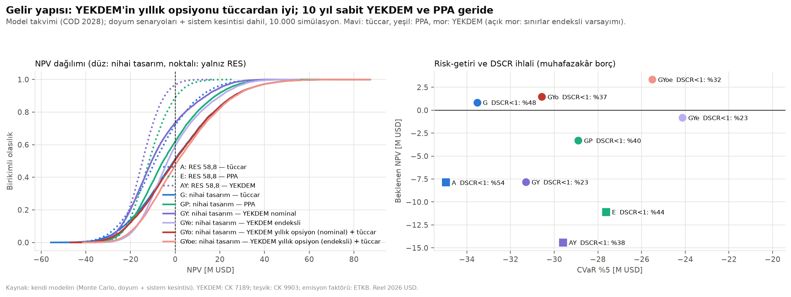
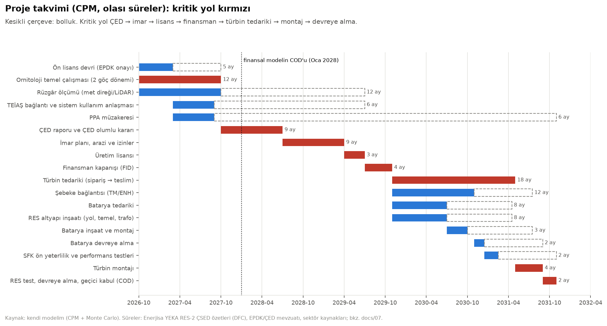
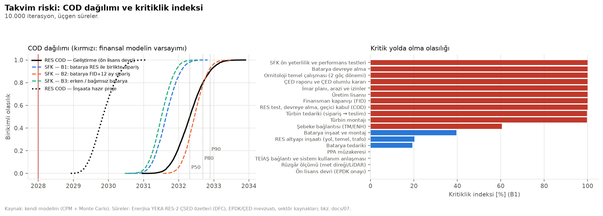
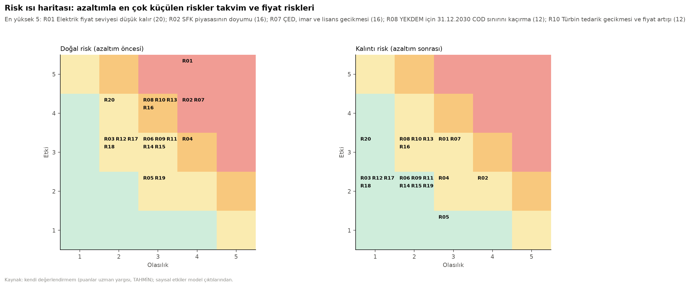

# Aşama 7 — Tamamlayıcı analizler: sistem kesintisi, teşvikler, gelir yapıları, çevresel etki, takvim riski, risk kaydı

Kod: `src/07_sistem_kesintisi.py`, `src/07_gelir_yapilari.py`, `src/07_takvim.py`, `src/07_risk_kaydi.py`.
Çıktılar: `outputs/07/`. Parametreler: `config.yaml → kesinti, yekdem, tesvik, karbon, takvim`.
Para birimi: reel 2026 USD, %7 reel WACC.

**Okuma notu:** Emin olmadığım her şey açıkça **TAHMİN** olarak işaretlendi ve config'te de öyle yazıldı. Her bölümün
sonunda o adımın nihai öneriye etkisi ayrıca raporlandı.

---

## Güncelleme 3: deterministik ile Monte Carlo arasındaki fark — fiyat ortalaması düzeltmesi (güncel)

**Soru.** Sabit 58 $/MWh'te deterministik NPV −2,37 M$ (Excel), Monte Carlo ortalaması +1,49 M$ idi. Fiyat tabanı
olmayan saf tüccar da +1,15 M$ çıktığı için fark YEKDEM tabanıyla açıklanamıyordu.

### A1. Fiyat ortalaması
- **Süreç:** her simülasyonda uzun dönem seviye μ ~ LogNormal(m; 0,15); log-fiyat AR(1): x_k = ln μ + φ(x_{k−1} − ln μ) + σε
  (φ = 0,55, σ = 0,20); kriz yıllarında fiyat ×1,6 (yıllık %3 başlama, 1–2 yıl), %80 olasılıkla yenilenebilir gelirine tavan.
- **Eski ayar:** m = ln 58, yani 58 fiyatın *medyanı*. Lognormal dağılımda beklenen değer medyandan büyüktür:
  E[P] = medyan × exp(s²/2). Durağan dağılımın log varyansı s_μ² + σ²/(1−φ²) = 0,0225 + 0,0573 → E[L] = 58 × 1,041 = 60,4.
- **Simülasyon (COD 2030, 10.000 yol):** ömür boyu ortalama **61,9**, iskonto ağırlıklı **61,8 $/MWh** (medyan 58,7).
  Fark: lognormal çarpıklık (+2,4) ve kriz yılları (+1,5); 2026'daki 49 $/MWh başlangıcı COD'a kadar sönüyor.
- **Tanım:** config'te 58, "yıllık baz yük ortalama PTF" (`fiyat_senaryolari.seviye`) ve deterministik modelde beklenen
  fiyat olarak kullanılıyor. 45/58/72'nin "dağılımın %5/%50/%92 yüzdelikleri" olduğu notu, medyanı ortalama yerine
  koymuştu.
- **Düzeltme:** `monte_carlo.fiyat_uzun_ortalama.tanim = "ortalama"` → m = ln 58 − s_μ²/2 − σ²/(2(1−φ²)) = ln 55,7
  (`src/risk/monte_carlo.log_merkez`). Kriz hariç durağan ortalama tam 58; kriz yıllarıyla simüle ortalama iskonto
  ağırlıklı **59,4 $/MWh**. Kriz, tavanla birlikte ayrı bir olay olarak bırakıldı (net etkisi ~0, aşağıda).
- **Tutarlılık:** YEKDEM karar kuralındaki fiyat tahmini koşullu medyandan koşullu beklenen değere çevrildi
  (`fiyat_tahmini`: + σ²(1−φ^{2h})/(2(1−φ²)) + (1−φ^h)² s_μ²/2).
- Çıktılar: `outputs/07/fiyat_ortalamasi_{once,sonra}.csv`, `fiyat_ortalamasi_ozet_{once,sonra}.csv`.

### A2. Farkın ayrıştırılması (`src/07_fark_ayristirma.py`)
Deterministik girdiler (Excel ile aynı: L = 58, P50, ortalama hava, baz SFK yolu, beklenen kesinti, CAPEX = 1) sırayla
stokastik karşılıklarıyla değiştirildi. Aynı rastgele sayılar kullanıldı. S0 Excel sonucunu (−2,369), son adım baz vakayı
birebir veriyor.

| Adım | Bileşen | Önce | **Sonra** |
|---|---|---|---|
| Deterministik baz (58 sabit, COD 2030) | — | −2,37 | **−2,37** |
| L = simülasyonların ortalama fiyat yolu | (i) fiyat ortalaması | +5,47 | **+2,04** |
| Fiyat yolları stokastik (YEKDEM kapalı, tavan yok): batarya gelir satırları | (iii) | 0,00 | **0,00** |
| aynı adım: vergi, zarar mahsubu ve diğer satırlar | (iv) | −0,92 | **−0,86** |
| Kriz yıllarında düzenleyici tavan | (iv) | −2,11 | **−2,04** |
| YEKDEM yıllık opsiyonu + YEKDEM fiyat belirsizliği | (ii) dışbükeylik | +0,31 | **+0,42** |
| SFK doyum senaryoları (karışım yerine baz yol) | (iii) | +2,67 | **+2,71** |
| Hava, RES model hatası, kanibalizasyon tabanı, sistem kesintisi | (v) | −0,90 | **−0,87** |
| CAPEX / OPEX / batarya bozunma | (iv) | −0,90 | **−0,90** |
| Takvim: COD 2030 → Kasım 2029 (P50) | — | +0,24 | **+0,22** |
| **Monte Carlo beklenen NPV** | | **+1,49** | **−1,66** |

**Yorum.**
- Önceki farkın (+3,9 M$) en büyük kaynağı fiyat ortalamasıydı (+5,5 M$). Bu bir varsayım değil, ayar hatasıydı.
- Kalan (i) +2,04 yalnız kriz yıllarından geliyor ve tavan bileşeni (−2,04) bunu tamamen geri alıyor: kriz fiyatı
  yenilenebilir gelirine yansımıyor.
- (iii) Batarya gelirinin fiyat oynaklığına duyarlılığı sıfır, çünkü dispatch tabloları fiyat seviyesine göre ölçekleniyor
  (gün içi oynaklık ayrıca simüle edilmiyor). SFK tarafında ise senaryo karışımı deterministik "baz doyum" yolundan
  +2,7 M$ yüksek. Yavaş doyumun yukarı potansiyeli büyük, hızlı doyumun kaybı fırsat maliyeti tabanıyla sınırlı. Bu
  gerçek bir asimetri: deterministik baz SFK yolu bir "beklenen değer" değil, ortanca senaryo.
- (iv) Vergi ve zarar mahsubu düşük fiyat yollarında kalkanı geç kullanıyor (−0,9). CAPEX dağılımı yukarı çarpık
  (RES üçgen 0,90/1,0/1,20; ortalama 1,03) (−0,9).
- (ii) YEKDEM opsiyonunun dışbükeyliği küçük (+0,4), çünkü nominal koridor reel olarak hızla aşınıyor.

### A3. Sonuç ve karar

| Baz vaka (COD Kas 2029) | E[NPV] | P(NPV>0) | CVaR %5 | NPV P10 / P90 | Azami edinim primi |
|---|---|---|---|---|---|
| Önce (58 = medyan) | +1,49 | %50 | −25,8 | −17,8 / 22,3 | 1,49 |
| **Sonra (58 = beklenen değer)** | **−1,66** | **%42** | **−28,0** | −20,3 / 18,5 | **0** |

| Karşılaştırma (sonra) | E[NPV] | P(NPV>0) | CVaR %5 |
|---|---|---|---|
| YEKDEM yıllık opsiyonu (endeksli) + tüccar | +0,43 | %46 | −22,2 |
| Saf tüccar | −2,11 | %42 | −30,4 |
| PPA (%70 P90, 12 yıl) | −6,05 | %28 | −26,0 |
| YEKDEM 10 yıl sabit (nominal) | −12,25 | %12 | −29,7 |

- **Karar kuralı:** baz vakada E[NPV] > 0 ve azami prim > 0 ise (a), aksi halde (b). E[NPV] −1,66 < 0 → **(b) rafa kaldır,
  tetikleyicileri izle.**
- **Durum tespiti bilgi değeri:** İkili bilgi formülü genelleştirildi. Olumlu durumda E = x̄ + p·kayıp, olumsuzda
  E = x̄ + p·kayıp − kayıp; değer = (1−p)·max(E_olumlu, 0) + p·max(E_olumsuz, 0) − max(x̄, 0). Eski formül p·(kayıp − x̄)
  yalnız x̄ > 0 için geçerliydi. Teşvik, ornitoloji ve TEİAŞ kalemleri artık **0**: olumlu sonuçlansalar bile E[NPV] < 0
  (ör. teşvik −1,66 → −1,09). YEKDEM endekslemesi kararı değiştirebilen tek kalem (endeksliyse +0,43). EVPI 5,3 M$;
  doyum senaryosunun bilgi değeri 2,0 M$ (durum tespitiyle çözülemez).
- **Başabaş:** deterministik eğim ~1,35 M$ / ($/MWh) ile başabaş beklenen fiyat ≈ 59 $/MWh.
- **Tarihsel sayılar:** Aşama 5–6 (docs/05) sonuçları medyan tanımıyla hesaplandı ve karar yolculuğunun parçası olarak
  değiştirilmedi.

---

## Güncelleme 2: üç tutarlılık düzeltmesi ve düzeltilmiş nihai baz vaka (sonucu Güncelleme 3 ile değişti)

Bu adım yalnız üç somut iç tutarsızlıkla sınırlı tutuldu; başka hiçbir varsayım değiştirilmedi. Sonuçlar:
`outputs/07/baz_vaka.csv`, `baz_vaka_duzeltmeler.csv`, `yekdem_opsiyon_degeri.csv`, `yekdem_opsiyon_katilim.csv`.

### D1. YEKDEM'in opsiyon yapısı
**Mevzuat** (YEK Belgelendirme ve Desteklenme Yönetmeliği, güncel konsolide metin —
[mevzuat.gov.tr](https://www.mevzuat.gov.tr/MevzuatMetin/yonetmelik/7.5.18907.pdf)):
- **Md. 4/2:** "YEKDEM, Piyasa İşletmecisi tarafından takvim yılı bazında işletilir. YEKDEM'e bir takvim yılı için tabi
  olan üretim lisansı sahipleri, uygulamaya dahil oldukları takvim yılı içerisinde YEKDEM'den çıkamaz." Lisanssızlar 10
  yıl çıkamaz; lisanslılar için böyle bir kilit yok.
- **Md. 5/1:** Lisanslı üretici "bir sonraki takvim yılında YEKDEM'e kayıt olmak istemeleri halinde 30 Kasım tarihine
  kadar" EPDK'ya başvurur; başvuru lisanstaki üretim miktarının tamamını kapsar.
- **Md. 5/4:** Başvurudan vazgeçme de 30 Kasım'a kadar yazılı bildirilir.
- **Md. 6–7:** Ön YEK listesi Aralık'ın ilk on gününde, nihai liste 31 Aralık'a kadar ilan edilir; YEKDEM'e esas üretim
  dönemi takvim yılıdır.
- **Md. 8/1:** Lisanslı tesis, lisanstaki ilk kurulu gücün tamamının **işletmeye giriş tarihinden itibaren on yıl süreyle**
  YEKDEM'den yararlanabilir.
- **Sonuç:** Tesis 10 yıllık pencere içinde **her yıl ayrı başvuruyla** YEKDEM ile tüccar arasında seçim yapabiliyor; bir
  yıl içinde çıkılamıyor. Katılınmayan yıllar 10 yıllık süreyi uzatmıyor (süre COD'dan işliyor).
- *Belirsiz:* Çıkıp yeniden girme sayısına bir sınır bulamadım. Metinde böyle bir sınır yok.

**Model:** YEKDEM, 10 yıllık bir yıllık opsiyonlar dizisi olarak modellendi.
- **Karar kuralı** (`config.yaml → yekdem_opsiyon`): t yılı için karar 30 Kasım t−1'de, **o gün bilinen bilgiyle** verilir.
  Katıl ⇔ YEKDEM'in t yılındaki reel fiyatı > 1,066 × E[PTF_t | PTF_(t−1)].
- **Beklenti:** ortalamaya dönen log süreçten: ln F = ln 58 + 0,55 · (ln PTF_(t−1) − ln 58). Yatırımcı simülasyonun gizli
  uzun dönem ortalamasını bilmez, ön beklentisi 58'i kullanır. Gerçekleşen t yılı fiyatı kararda **kullanılmaz**.
- **1,066 katsayısı:** tüccar modda santral + batarya gelirinin YEKDEM modundaki satılan enerjiye oranı. Kaybedilen
  arbitrajı ve ekonomik kesinti farkını içeriyor.
- **Kesinti ve dispatch** her yıl seçilen rejime göre: YEKDEM yıllarında YEKDEM dispatch'i ve kesinti kuralı, diğer
  yıllarda tüccar.
- **PPA ile birleşim** modellenmedi: YEKDEM başvurusu üretimin tamamını kapsıyor (md. 5/1), 12 yıllık PPA hacmiyle çakışır.

**Katılım oranı** (nominal koridor): 2. yıl %15, sonra azalarak 10. yılda %1. Nominal koridor reel olarak aşındığı için
YEKDEM yalnız fiyatların düştüğü yıllarda seçiliyor. Endeksli koridorda katılım ~%26–29.

**Opsiyonun değeri** (opsiyonlu − saf tüccar): model takviminde +0,46 M$, baz vaka takviminde **+0,34 M$**; endeksli
koridorda +1,98 M$. Opsiyon küçük ama pozitif bir sigorta: fiyat düştüğünde YEKDEM tabanına sığınma hakkı.

**Neden önceki baz vaka bu kadar kötüydü?** "10 yıl kesintisiz nominal YEKDEM" yatırımcının fiilen izlemeyeceği, baskın
olunan (dominated) bir stratejiydi. Aynı mekanizma yıllık seçimle tüccarın üstünde kalıyor.

### D2. Batarya yayılımının ortak sürücüsü
- Türkiye'deki kurulu batarya yolu (Aşama 6 doyum senaryoları) artık tek ortak sürücü. Aynı yol üç şeyi belirliyor:
  - SFK fiyatı (zaten bağlıydı).
  - Sistem kesintisi oranı.
  - Öğle kanibalizasyonu / günlük spread.
- **Emilen pay:** a_y = min(1, kurulu_MW × 1,1 saat × 150 gün × 0,88 / öğle fazlası_y). Öğle fazlası: 2026'da ~10 TWh
  (sistem YAT vekili), yılda %4 büyüyor (`config.yaml → ortak_surucu`, TAHMİN).
- **Kesinti:** κ_y ∝ (1 − a_y)/(1 − a_2026). Senaryo çarpanlarının (0,7–1,3) yerini aldı.
- **Kanibalizasyon:** güneş yakalanma hedefi h_y = h_y^bataryasız + (oran0 − h_y^bataryasız) × a_y. Öğle çukuru emilen
  pay kadar geri alınıyor; arbitraj spread'i, işletme tablolarının h boyutundan otomatik olarak daralıyor.
- **Büyüklük:** emilen pay 2030'da ortalama %7, 2035'te %12.
- **Tek başına etkisi:** baz vakada **+0,15 M$** (kesinti ve kanibalizasyon biraz azalırken arbitraj biraz daralıyor;
  net küçük pozitif).

### D3. İnşaata hazır proje takvimi
Kaynaklarla yeniden kontrol (`config.yaml → takvim`):
- **Türbin tedariki 15 aydan 12/18/30 aya uzatıldı.** 2024–25 Avrupa OEM siparişlerinde teslim 18–36 ay sonraya veriliyor
  (Vestas'ın 2024 Almanya siparişi 2027 Ç3, Nordex'in 2025 sonu siparişleri 2027;
  [AA](https://www.aa.com.tr/en/energy/wind/vestas-secures-43-megawatt-turbine-agreement-in-germany/58486),
  [Windtech](https://www.windtech-international.com/projects-and-contracts/nordex-group-records-3-6-gw-of-wind-turbine-orders-in-fourth-quarter-2025)).
- **TEİAŞ bağlantı anlaşması inşaata hazır projede tamamlanmış.** Önlisans sahibi lisansa başvurmadan bağlantı ve sistem
  kullanım anlaşması için TEİAŞ'a başvurmak zorunda
  ([EPDK lisans işlemleri](https://www.epdk.gov.tr/Detay/Icerik/3-0-86-3/elektriklisans-islemleri)).
- **Finansman kapanışı PPA müzakeresini beklemiyor.** Baz strateji YEKDEM opsiyonu + tüccar.

**Sonuç:** inşaata hazır projede COD **P50 Mart 2030 → Kasım 2029**, P80 Mart 2030, P90 Mayıs 2030. Kritik yol: devir →
FID → türbin → montaj → COD. Önceki P50 tutarlı değildi; bağlantı anlaşmasının hazır olmasının etkisi türbin teslim
süresinin uzamasından büyük. Geliştirme senaryosu: P50 Mayıs 2032. **Tek başına etkisi** (önceki COD 2030'a göre):
**+0,30 M$**.

### Düzeltilmiş nihai baz vaka
- **Tanım:** inşaata hazır, COD Kasım 2029; RES 58,8 MW + 30 MW / 60 MWh; YEKDEM yıllık opsiyonu (nominal) + tüccar.
- **Ara değerleme:** COD gecikmesi 1,83 yıl; 1 ve 2 yıllık dağılımlar arasında simülasyon bazında ara değerleme.

| | E[NPV] | P(NPV>0) | CVaR %5 | NPV P10 / P90 | Azami edinim primi |
|---|---|---|---|---|---|
| Önceki baz vaka (10 yıl sabit nominal YEKDEM, COD 2030) | −11,37 | %13 | −28,6 | −22,8 / 1,9 | 0 |
| + (1) YEKDEM yıllık opsiyonu | +1,08 | %50 | −25,7 | −17,7 / 21,4 | 1,08 |
| + (2) ortak batarya sürücüsü | +1,25 | %50 | −25,6 | −17,7 / 21,8 | 1,25 |
| **+ (3) inşaata hazır takvim = düzeltilmiş baz vaka** | **+1,49** | **%50** | **−25,8** | −17,8 / 22,3 | **1,49** |

| Karşılaştırma (aynı tasarım, COD Kasım 2029) | E[NPV] | P(NPV>0) | CVaR %5 |
|---|---|---|---|
| YEKDEM yıllık opsiyonu (endeksli) + tüccar | +3,13 | %54 | −20,5 |
| Saf tüccar | +1,15 | %50 | −27,8 |
| PPA (%70 P90, 12 yıl) | −3,98 | %34 | −24,4 |
| YEKDEM 10 yıl sabit (nominal) | −10,92 | %14 | −28,6 |

**Öneri (Güncelleme 3 ile değişti: fiyat ortalaması düzeltmesiyle E[NPV] −1,7 M$ → rafa kaldır):** Beklenen NPV pozitif (+1,5 M$) ama ince. Kâr olasılığı yarı yarıya, sol kuyruk kalın. Bu, bir **edinim primi
sınırı** (~1,5 M$) ve dar kapsamlı bir durum tespiti (due diligence) ile **bağlayıcı olmayan teklif** yetkisini haklı
çıkarıyor; kesin bir yatırım kararını değil. Aşağıdaki Ö1–Ö2 bölümündeki "yatırım önerilmez" sonucu bu düzeltmelerle
geçersiz kaldı.

---

## Güncelleme 1 (Ö1–Ö2): tutarlılık düzeltmeleri — sonucu Güncelleme 2 ile geçersiz

**Ne düzeltildi (Ö1):**

1. **YEKDEM'de batarya.**
   - Mevzuata göre santralde üretilip depolandıktan sonra verilen enerji de YEKDEM fiyatından ödeniyor (§2.3a).
     Saatten bağımsız sabit fiyatta arbitrajın değeri yok.
   - Önceki hesap batarya deşarjını spot fiyattan değerliyordu; dispatch da PPA noktasından alınıp arbitraj yapıyordu.
     YEKDEM sonuçları bu yüzden şişmişti.
   - Artık YEKDEM'e özgü dispatch kullanılıyor: batarya yalnız kesilecek enerjiyi saklıyor, SFK rezervi ve dengesizlik
     azaltımı sağlıyor.
   - Sistem kesintisi YEKDEM kuralıyla: kesilen enerjiye YEK farkı ödenmiyor, kurtarılan enerji tam YEK fiyatından
     ödeniyor.
2. **PPA'da batarya.**
   - Aynı kontrol PPA'da da bir tutarsızlık gösterdi: φ = 0,66 dispatch'i santral enerjisini PPA teslimatından spot
     zirvelere kaydırıyordu. Batarya deşarj geliri yılda 4,5 M$ (tüccarda 1,4 M$).
   - "Üretildiği kadar" PPA'da bu sözleşme ihlali olur. PPA finansal bir fark sözleşmesi olarak modellendi; batarya
     tüccar dispatch'iyle çalışıyor.
3. **YEKDEM altında batarya boyutu.**

   | YEKDEM, COD 2028 | Nominal | Endeksli |
   |---|---|---|
   | 30 MW / 52,5 MWh | −6,9 M$ | +0,1 M$ |
   | 30 MW / 60 MWh | −6,5 M$ | +0,5 M$ |
   | 40 MW / 70 MWh | −7,4 M$ | −0,3 M$ |

   Tam 30 MW SFK rezervi için 2 saatlik enerji gerekiyor (h·r ≤ s ≤ E − h·r), bu yüzden 30 MW / 60 MWh en iyisi.
   Aşamalı büyütmenin değeri ~0,1 M$; tasarımdan çıkarıldı.
   **Nihai tasarım: RES 58,8 MW + 30 MW / 60 MWh batarya.**
4. **10 yıl sonrası doğrulandı:** YEKDEM'de φ ilk 10 işletme yılında 1, sonra 0. Dispatch ve gelir 11. yıldan itibaren
   tüccar.

**Gelir yapıları, önce / sonra** (önerilen tasarım; model takvimi COD 2028; doyum + kesinti dahil):

| | Ö1 öncesi | Ö1 sonrası (nihai tasarım) |
|---|---|---|
| Tüccar | +3,7 | **+4,3** |
| PPA | +2,4 | **−1,2** |
| YEKDEM nominal | +0,8 | **−6,5** |
| YEKDEM endeksli | +5,5 | **+0,5** |

**Nihai baz vaka (Ö2)** (`config.yaml → nihai_baz_vaka`, `outputs/07/baz_vaka.csv`):
- İnşaata hazır proje, COD 2030 (takvim P50: Mart 2030).
- Nihai tasarım; YEKDEM nominal koridor, 10 yıl sonra tüccar.
- Edinim primi parametre (0).

| COD 2030, nihai tasarım | E[NPV] | P(NPV>0) | CVaR %5 | NPV P10 / P90 | Azami edinim primi |
|---|---|---|---|---|---|
| **YEKDEM nominal (baz vaka)** | **−11,4** | **%13** | −28,6 | −22,8 / 1,9 | **0** |
| YEKDEM endeksli | −3,2 | %33 | −20,4 | −14,7 / 9,9 | 0 |
| PPA | −4,3 | %33 | −24,2 | −17,8 / 10,5 | 0 |
| Tüccar | +0,8 | %49 | −27,6 | −18,6 / 21,4 | 0,8 |

Neden bu kadar kötüleşti? Üç etki üst üste biniyor:
- **Sistem kesintisi** (−2 ile −3 M$).
- **2 yıllık takvim kayması:** SFK penceresi ve kesinti büyümesi nedeniyle, tüccarda −3,5 M$.
- **Düzeltilmiş YEKDEM.** Nominal koridorda reel fiyat 10 yılda ~%22 aşınıyor (ortalama ~48 $/MWh). YEKDEM tesisi
  kesintide YEK farkını kaybediyor. Arbitraj imkânı da yok.

Batarya her yapıda değer katıyor (YEKDEM nominalde yalnız RES'e göre ~+2,6 M$), ama projeyi pozitife çevirmeye yetmiyor.

**Öneri esaslı şekilde değişti:**
- Muhafazakâr baz vakada (nominal YEKDEM) yatırım **önerilmez**: beklenen NPV −11,4 M$, kâr olasılığı %13.
- En iyi yapı olan tüccarda bile inşaata hazır projenin beklenen NPV'si +0,8 M$; kâr olasılığı yarı yarıya, kuyruk
  riski yüksek (CVaR −27,6 M$). Bu, ancak sembolik bir edinim primini haklı çıkarıyor.
- Aşama 7'deki "inşaata hazır proje + YEKDEM için koşullu onay" önerisi geçersiz. Aşağıdaki bölümler Ö1 öncesi analiz
  olarak saklandı.

---

## Özet: önce / sonra (Ö1 öncesi — geçersiz)

| | Aşama 6 önerisi | Aşama 7 sonrası |
|---|---|---|
| Tasarım | RES 58,8 MW + 30 MW / 52,5 MWh batarya (40 MW'a büyütülebilir) | **Aynı** |
| Gelir yapısı | PPA (P90'ın %70'i, 12 yıl) | **YEKDEM**, taban/tavan endeksliyse. Değilse PPA |
| Proje edinimi | Belirtilmemişti (model FID 2026, COD 2028 varsayıyordu) | **İnşaata hazır proje** (ÇED, imar, lisans tamam); geliştirme aşamasından başlamak önerilmez |
| Batarya siparişi | RES FID'inden ~12 ay sonra | **RES ile birlikte, FID'de.** Batarya kararı FID'de gözlenen doyuma göre verilir |
| Yeni koşullar | — | Teşvik belgesi (KDV istisnası); YEKDEM endekslemesinin hukuki teyidi; COD ≤ 31.12.2030 güvencesi |
| Beklenen NPV | +4,5 M$ (P %58) | Gerçekçi takvim ve kesintiyle: **+2,1 M$** (inşaata hazır + endeksli YEKDEM), −0,3 M$ (inşaata hazır + PPA), −1,5 M$ (geliştirmeden + PPA) |
| Karar | Koşullu onay | **Geliştirme aşamasındaki proje için ret. İnşaata hazır proje + endeksli YEKDEM için koşullu onay; edinim primi ≤ ~2 M$** |

**Öneri değişti. Neden?** Üç bulgu bir araya geldi:

1. **Takvim:** Gerçekçi takvimde COD 2028 değil, inşaata hazır projede 2030, geliştirme aşamasında 2032. Bu gecikme
   SFK penceresinin büyük kısmını kaçırıyor.
2. **Sistem kesintisi:** 2026'da başlayan kesinti, beklenen NPV'yi ~2 M$ azaltıyor.
3. **YEKDEM:** 2030 sonuna kadar devreye giren RES'lere hâlâ açık. Sınırları endeksliyse en iyi risk-getiri profilini
   veriyor, ama yalnızca inşaata hazır bir projeyle yetişilebiliyor.

---

## 1. Sistem kaynaklı kesinti (TEİAŞ / DGP YAT talimatları)

### 1.1 Veri ve bulgular

**Sistem geneli YAT hacmi** (EPİAŞ `/v1/markets/bpm/data/order-summary-down`, saatlik, 0/1/2 kodlu;
`outputs/07/kesinti_sistem_yat_yillik.csv`):

| Yıl | YAT toplam [GWh] | 1 kodlu (sistem kısıtı) [GWh] |
|---|---|---|
| 2023 | 2.509 | 162 |
| 2024 | 2.839 | 99 |
| 2025 | 2.925 | 54 |
| **2026 (Oca–Eyl)** | **9.482** | 117 |

2026'da YAT hacmi üç katına çıktı. Zirve aylar: Mayıs 3,1 TWh, Haziran 2,1, Nisan 1,8, Mart 0,9 TWh.

**EPİAŞ kaynak ya da santral bazında YAT miktarı yayımlamıyor**; yalnızca sistem toplamı var. Bu yüzden RES'lere
düşen payı doğrudan göremiyoruz.

**Nerede yoğunlaşıyor?** Bir saat tipinin YAT payının o tipin saat payına oranı (1 = ortalama;
`kesinti_yat_yogunluk.csv`):

| | 2023 | 2024 | 2025 | 2026 |
|---|---|---|---|---|
| Bahar öğle (Mar–Haz, 10–16) | 1,36 | 1,76 | 2,29 | **3,31** |
| Bayram / resmî tatil | 1,72 | 2,12 | **3,47** | 2,31 |
| Gece / akşam | 0,74 | 0,65 | 0,59 | 0,74 |

**Ezine'de talimat izi.** Yöntem:

- Kalibre ERA5 modeli (Aşama 2 ay × saat katsayısı) için 2024–2026 ERA5 verisi indirildi.
- Üç referans RES (Enerjisa Çanakkale, Çamseki, İntepe) için modelin yüksek üretim beklediği (KF > 0,3) saatlerde
  **en az iki santralin aynı saatte beklenenin yarısından az ürettiği** saatler işaretlendi.
- Tek bir santralin arızası eşzamanlı olmaz; eşzamanlı düşüş, sistem talimatının imzasıdır.
- 2016–2022 dönemi model hatası tabanı olarak kullanıldı (talimatın yaygın olmadığı dönem).

| Yıl | Eşzamanlı düşüş [saat] | Kaybolan enerji payı | Taban üstü (talimat tahmini) |
|---|---|---|---|
| 2016–2022 ort. | 199–428 | %3,5 (taban) | — |
| 2023 | 384 | %4,6 | %1,0 |
| 2024 | 166 | %2,5 | %0 |
| 2025 | 183 | %2,9 | %0 |
| **2026 (Oca–Eyl)** | **620** | **%13,0** | **~%9,5** |

2026'daki düşüşlerin 177 saati Mayıs'ta, 130'u Haziran'da, 89'u Nisan'da. Sistem YAT verisiyle aynı desen. Bayram
saatlerinde eşzamanlı düşüş sıklığı 2016–22'ye göre 4,8 kat, bahar öğlelerinde 1,9 kat
(`kesinti_referans_saat_tipi.csv`).

**Yorum:** 2023–2025'te Ezine RES'lerine düşen kesinti ihmal edilebilir düzeydeydi. 2026'da ise üretimin ~%9,5'i
(yıllıklandırılmış ~%7) talimatla kesilmiş görünüyor. Kaynaklar 2026'yı bir kırılma yılı olarak tanımlıyor: dolu
barajlar (HES üretimi yüksek), 25 GW güneş, düşük bahar talebi ([Yeşil Haber](https://yesilhaber.net/hesiad-hes-uretim-gelir-yat/)).
Saatlik mahsuplaşmaya geçiş de aynı sorunun işareti ([Turkey Recap](https://www.turkeyrecap.com/p/as-solar-and-wind-boom-grid-bottlenecks)).

**Sınırlama:** Eşzamanlı düşüşlerin bir kısmı bakım, yerel şebeke arızası ya da 2026 ERA5 hatası olabilir. Tahmin
"üst sınıra yakın" okunmalı.

### 1.2 Ücretlendirme
- DGP'de YAT talimatı alan dengeleme birimi, düşürdüğü enerjiyi **kendi YAT teklif fiyatından piyasadan geri alır**.
  Uzlaştırmada birimlerin kendi teklif fiyatları esas alınır (Elektrik Piyasası Dengeleme ve Uzlaştırma Yönetmeliği,
  değişiklik [RG 21.01.2025](https://resmigazete.gov.tr/eskiler/2025/01/20250121-3.htm); uzlaştırma dönemi 15 dk).
- Talimatlar 0 (dengeleme), 1 (sistem kısıtı) ve 2 (yan hizmet) kodlarıyla etiketlenir.
- **Sonuç:** GÖP'te PTF'den satış yapmış bir RES, YAT teklifini ~0'dan verdiyse talimat altında geliri neredeyse
  korunur (PTF'yi tutar, ~0 öder). Kaybı yalnızca teklif fiyatı kadardır.
- Ama talimat DGP dışından gelirse (acil durum, sistem güvenliği) ya da tesis YEKDEM kapsamındaysa (üretilmeyen enerji
  için YEKDEM ödemesi yapılmaz) kayıp tamdır.
- Hangi oranın tazmin edildiğini kamuya açık veriden ayıramadım. **TAHMİN:** tazmin oranı ~ Düzgün(0, 1).

### 1.3 Model
- **Yıllık oran:** $\kappa_y = \kappa_0 \cdot s_{\text{senaryo}} \cdot 1{,}04^{\,y-2026} \cdot \varepsilon_y$
  - $\kappa_0$ ~ Üçgen(%1; %5; %12): 2023–25 ~%0–1 ile 2026'nın ~%7'si arası (TAHMİN).
  - Güneş büyümesiyle yılda +%4.
  - Batarya kurulumuyla etkileşim: hızlı doyumda ×0,7, yavaşta ×1,3; bataryalar öğle fazlasını emer (TAHMİN).
  - $\varepsilon_y$: hidroloji / talep yılı oynaklığı, lognormal σ = 0,5.
- **Saatlik dağılım:** YAT yoğunluğuna göre 4 saatlik talimat blokları (bahar öğle, bayram).
- **Değer faktörü:** Talimat saatlerinde fiyat ortalamanın altında (50,5 $/MWh). Kesilen enerjinin değeri ortalamanın
  0,89'u.
- **Batarya kurtarma:** Şebeke sınırı talimat saatlerinde 0'a inen saatlik LP (`kesinti_batarya_kurtarma.csv`).

| %5 kesintide (temsilî yıl) | Kayıp gelir [M$/yıl] | Kayıp enerji [GWh] |
|---|---|---|
| Yalnız RES 58,8 | 0,52 | 9,3 |
| + 30 MW / 52,5 MWh batarya | 0,43 | 6,0 |

**Bataryanın kurtarabildiği:** kayıp enerjinin ~%35'i, kayıp gelirin **~%16'sı**. Bu bir üst sınır, çünkü SFK'ya
rezerv ayrılan saatlerde batarya şarj için boş değil. Değerin az olmasının nedeni, kurtarılan enerjinin de çoğunlukla
ucuz saatlere kayması.

### 1.4 Etki
Monte Carlo'da önerilen tasarım (F2P) için **E[NPV] 4,5 → 2,4 M$**, P(NPV>0) %58 → %52; yalnız RES için
−1,9 → −4,9 M$. **Öneriye etkisi:** Bataryanın göreli değeri biraz artıyor; projenin mutlak değeri düşüyor.

---

## 2. Teşvikler ve alternatif gelir yapıları

### 2.1 Yatırım teşvik belgesi
- **Mevzuat:** [9903 sayılı Cumhurbaşkanı Kararı](https://www.yatirimadestek.gov.tr/pdf/assets/upload/dosyalar/karar-yatirim_tesvik_uygulamalari.pdf)
  (RG 30.05.2025) ve 2025/1 Tebliğ. RES ve enerji depolama yatırımlarında teşvik belgesiyle **KDV istisnası** ve
  **gümrük vergisi muafiyeti** sağlanıyor. **Ticari elektrik üretiminde vergi indirimi uygulanmıyor**
  ([Sönmez Müşavirlik](https://www.sonmezmusavirlik.com.tr/ruzgar-enerjisi-res-yatirim-tesvikleri),
  [Atlas Nestor](https://atlasnestor.com/gunes-ges-ve-ruzgar-res-enerjisi-yatirimlarinda-tesvik-sistemi-ve-yerlilik-sartlari/)).
- **Model ne varsayıyordu?** Model KDV ve gümrüğü hiç içermiyordu, yani zımnen teşvik belgesi varsayıyordu. Bu yüzden
  doğru soru "belge olmazsa ne kaybedilir?" (`tesvik_etkisi.csv`):
  - İnşaatta ödenecek KDV: **14,0 M$**. Çıkış KDV'siyle mahsup edilir, ama TL devreden KDV bakiyesi USD cinsinden
    aşınır (yılda ~%20, TAHMİN).
  - Net bugünkü maliyet: **5,8 M$** (aşınmasız olsaydı 2,2 M$). Bu, projenin beklenen NPV'sinden büyük.
  - Batarya gümrük vergisi (Çin menşeli; oran belirsiz, %0–10): 0–0,6 M$ (TAHMİN).
- **Öneriye etkisi:** Teşvik belgesi FID'in **ön koşulu** oldu.

### 2.2 YEKDEM
- **Mevzuat:** [7189 sayılı Cumhurbaşkanı Kararı](https://yesilekonomi.com/2030a-kadar-uygulanacak-yeni-yekdem-fiyatlari-belirlendi/)
  (RG 01.05.2023). **01.07.2021–31.12.2030 arasında işletmeye girecek** YEK belgeli tesisler kapsamda.
  - Karasal RES: 106 TL kr/kWh, **taban 4,95 – tavan 6,05 USD ¢/kWh**, **10 yıl**.
  - Fiyat TL olarak aylık güncelleniyor, USD taban/tavanla sınırlı
    ([Paksoy](https://paksoy.av.tr/2023/06/yekdem-ve-yerli-katki-fiyati-guncellendi/)).
  - Aralık 2025'te uygulanan RES fiyatı 245,06 kr/kWh ≈ 5,8 ¢ ([Enerji Ajansı](https://enerjiajansi.com.tr/yekdem-fiyatlari/)).
  - [RG 29.12.2025](https://www.aa.com.tr/tr/enerjiterminali/elektrik/yekdemden-yararlanma-sartlarinda-degisiklige-gidildi/53716)
    değişikliği: şebekeden çekilen enerji YEK kapsamı dışında; resmî tatillerde KGÜP üstü üretime ödeme yok;
    depolamalı tesislere ayrı fiyat.
- **Erişilebilir mi?** Yeni bir RES için **evet, ama yalnızca COD ≤ 31.12.2030 olursa**. Bazı ikincil kaynaklar
  "yeni santrallere YEKDEM kapalı" diyor; resmî karar 2030'a kadar açık.
- **TAHMİN — kritik belirsizlik:** USD taban/tavanının ABD enflasyonuyla **endekslenip endekslenmediğini** resmî metinden
  doğrulayamadım. İki varyant modellendi:
  - **Nominal:** reel değer 10 yılda ~%22 aşınır; reel ortalama ~48 $/MWh.
  - **Endeksli:** reel ~57 $/MWh sabit.
  - Simülasyon başına nominal fiyat ~ Üçgen(4,95; 5,8; 6,05) ¢/kWh.
- **Diğer varsayımlar:** Banka koşulları DSCR 1,20, 12 yıl (TAHMİN). Dispatch tablosu PPA noktasından (yaklaşım).

### 2.3 Tüccar / PPA / YEKDEM karşılaştırması
Aynı Monte Carlo (10.000; doyum + sistem kesintisi dahil; model takvimi), `gelir_yapilari_metrikler.csv`:

| Seçenek | E[NPV] | P(NPV>0) | CVaR %5 | Borç kapasitesi (baz / muhafazakâr) [M$] | P(DSCR<1), muhafazakâr | Öz kaynak IRR P50 |
|---|---|---|---|---|---|---|
| Yalnız RES — tüccar | −4,9 | %35 | −32,8 | 42,6 / 28,7 | %47 | %6,5 |
| Yalnız RES — PPA | −8,0 | %19 | −25,2 | 47,6 / 40,3 | %39 | %6,1 |
| Yalnız RES — YEKDEM (nominal) | −12,5 | %6 | −28,2 | 34,5 / 32,9 | %35 | %5,0 |
| Öneri — tüccar | 3,7 | %55 | −30,4 | 52,6 / 33,0 | %41 | %8,5 |
| Öneri — PPA | 2,4 | %52 | −25,1 | 59,0 / 42,1 | %38 | %8,8 |
| Öneri — YEKDEM (nominal) | 0,8 | %48 | −24,9 | 48,4 / 36,1 | %25 | %7,7 |
| **Öneri — YEKDEM (endeksli)** | **5,5** | **%61** | **−20,1** | 53,0 / 41,1 | **%22** | **%9,0** |

**Yorum:**
- **Endeksli YEKDEM her metrikte en iyisi.** Fiyat tabanı alt kuyruğu kesiyor, DSCR ihlalini yarıya indiriyor.
- **Nominal YEKDEM** riski azaltıyor (CVaR, DSCR) ama reel aşınma yüzünden beklenen değeri düşürüyor.
- **PPA**, tüccara göre ~1,3 M$ beklenen değerden vazgeçip kuyruğu ~5 M$ iyileştiriyor.
- **Yalnız RES** her gelir yapısında negatif. Projeyi pozitife çeviren hâlâ batarya + SFK.

**Öneriye etkisi:** YEKDEM yeni tercih edilen gelir yapısı oldu, ama iki koşula bağlı: hukuki endeksleme teyidi ve
2030 sonu COD. İkincisi takvim analizinde belirleyici çıktı (§4).

### 2.3a YEKDEM ile batarya uyumu (Ö1 — tutarlılık kontrolü)

**Sorun:** İlk YEKDEM hesabında batarya deşarjı spot fiyattan (L·q) değerleniyordu. Dispatch da PPA noktasındaki
(φ = 0,66) tablodan geldiği için batarya arbitraj yapıyordu. YEKDEM'de enerji saatten bağımsız sabit fiyattan
ödendiği için bu tutarlı değil.

**Mevzuat bulguları:** Kaynak: YEK Belgelendirme ve Desteklenme Yönetmeliği, güncel konsolide metin
([mevzuat.gov.tr](https://www.mevzuat.gov.tr/MevzuatMetin/yonetmelik/7.5.18907.pdf)); Elektrik Piyasasında Depolama
Faaliyetleri Yönetmeliği ([Lexpera](https://www.lexpera.com.tr/mevzuat/yonetmelikler/elektrik-piyasasinda-depolama-faaliyetleri-yonetmeligi-2)).

- **(a) Dengesizlik kimde?**
  - "YEKDEM katılımcıları üretmiş oldukları enerjinin serbest piyasaya arzını gerçekleştirir" (değişiklik RG 28.10.2016).
  - YEKDEM portföy dengesizliği maddeleri (md. 16–17) 29.04.2016'da mülga.
  - YEK bedeli (md. 18), santralin uzlaştırmaya esas veriş miktarı (UEVM) üzerinden YEK fiyatı ile PTF arasındaki fark
    olarak ödeniyor (fark sözleşmesi benzeri; formülde Kurul'un belirlediği bir tolerans katsayısı var).
  - **Sonuç:** Dengesizlik maliyeti YEKDEM'de de **tesisin kendisine** ait. Bataryanın dengesizlik azaltımı geçerli bir
    gelir kalemi olarak kalıyor. *Belirsiz:* tolerans katsayısının dengesizlik uzlaştırmasındaki tam rolü.
- **(b) Entegre batarya SFK'ya katılabilir mi? YEKDEM ile nasıl uzlaştırılır?**
  - Lisanslı üretim tesisine **bütünleşik elektrik depolama ünitesi** kurulabiliyor ve **ayrı bir uzlaştırmaya esas
    veriş-çekiş birimi** olarak kaydediliyor (Depolama Faaliyetleri Yönetmeliği).
  - Yan Hizmetler Yönetmeliği'ne göre SFK, belgelendirilmiş lisanslı üretim tesisleri ve depolama tesislerince
    sağlanabiliyor; TEİAŞ'ın depolama katılım esasları ≥30 MW, iletime bağlı birim istiyor (Aşama 5).
  - YEK Yönetmeliği md. 4/7:
    - Santralde üretilip **depolandıktan sonra şebekeye verilen enerji YEKDEM kapsamında.**
    - Depolama ünitesine **şebekeden** çekilen miktar kadar enerji YEKDEM'e tabi olmadan verilir; fazlası YEKDEM kapsamında.
    - Kabul edilen kurulu gücün üzerindeki veriş uzlaştırmada dikkate alınmaz (md. 4/8).
  - SFK kapasite ödemesi TEİAŞ/yan hizmet uzlaştırmasından, YEKDEM'den ayrı geliyor.
  - *Belirsiz:* YEKDEM'deki bir tesisin bütünleşik bataryası için SFK aktivasyon enerjisinin YEK bedeline etkisi ve
    TEİAŞ'ın bu birimi SFK'ya fiilen belgelendirip belgelendirmeyeceği. Bu, zaten FID koşulu olan TEİAŞ ön yeterlilik
    görüşünün kapsamına eklendi.
- **(c) Depolamalı/bataryalı tesislerin YEKDEM koşulları:**
  - Depolamalı elektrik üretim tesisleri (ayrı lisans türü; 01.05.2023 sonrası işletme) için depolanıp verilen enerjiye
    özel fiyat var: 7189 sayılı kararda 125 kr/kWh, 5,85–7,15 ¢ koridor. Doğrudan verilen enerjiye RES fiyatı uygulanıyor.
  - Bizim tasarımımız **depolamalı lisans değil**, YEKDEM'deki bir RES'e bütünleşik batarya. Bu yüzden depolanıp verilen
    santral enerjisi **RES fiyatından** (4,95–6,05 ¢) ödenir.
  - Resmî tatillerde KGÜP üstü üretime ödeme yapılmaz (RG 29.12.2025). Model bunu ihmal ediyor (küçük).
  - TEİAŞ talimatlarına uymak zorunlu; YAT talimatıyla verilmeyen enerjiye YEK bedeli ödenmiyor (md. 5/6 ve md. 18'in
    UEVM tanımı).

**Model düzeltmeleri:**
1. YEKDEM'e özgü dispatch tabloları (φ = 1; deşarj da YEKDEM fiyatından, `IsletmeLP(desarj_sozlesmeli=True)`). Bu
   haliyle batarya arbitraj yapmıyor; yalnız kesilecek enerjiyi saklıyor, SFK rezervi ve dengesizlik azaltımı sağlıyor.
2. Değerlemede batarya deşarjı φ·YEKDEM + (1 − φ)·PTF ile değerleniyor (`desarj_sozlesmeli`).
3. Sistem kesintisi YEKDEM kuralıyla:
   - Kesilen enerjiye YEK farkı ödenmiyor; DGP'de tazmin yalnız PTF kadar → kayıp = κ·(1 − tazmin·PTF/YEKF).
   - Bataryanın kurtardığı enerji tam YEKDEM fiyatından ödendiği için kurtarma payı gelir değil enerji payı: %35
     (tüccarda %16).
4. **10 yıl sonra geçiş doğrulandı:** φ ilk 10 işletme yılında 1, sonra 0. İşletme tablosu PPA boyutu 11. yıldan
   itibaren φ = 0 dispatch'ine geçiyor; tesis tüccar olarak devam ediyor.

### 2.4 Karbon
- **Türkiye ETS:** İklim Kanunu (7552, 2025) ile kuruldu. Pilot dönem 2026–2027'de elektrik üretimi dahil, %100
  ücretsiz tahsisat, 2026'da yalnız raporlama, karbon fiyatı 2027'de fiyat koridoruyla başlıyor
  ([iklim.gov.tr](https://iklim.gov.tr/turkiye-emisyon-ticaret-sistemi-yonetmeligi-taslagi-yayimlandi-haber-4519),
  [Yeşil Haber](https://yesilhaber.net/turkiye-ets-pilotu-karbon-fiyati/)).
- **Elektrik fiyatına etkisi:**
  - Marjinal santral doğal gaz ise (~0,37 tCO2/MWh) €20/t → +~8 $/MWh.
  - Kömür ise (~0,95 tCO2/MWh) €20/t → +~20 $/MWh.
  - Ücretsiz tahsisatta bile fırsat maliyeti fiyata yansıyabilir.
- **Yüksek fiyat senaryosunun gerekçesi:** Yüksek senaryo (72 $/MWh, baza göre +14 $/MWh), gaz marjda iken €30–35/t ya
  da kömür marjda iken ~€15/t karbon fiyatıyla tutarlı. Bu artık gerekçeli bir senaryo.
- **ETS fiyat aralığı:** 2035 için €5–40/t (TAHMİN). Pilot dönemin fiyat koridoru belirsiz.
- **Gönüllü karbon kredisi:** Verra ve Gold Standard 2019'dan beri en az gelişmiş ülkeler (LDC) dışındaki ülkelerde
  şebekeye bağlı yeni yenilenebilir projeleri kabul etmiyor. ICVCM de 2024'te yenilenebilir kredilerini "yüksek
  bütünlük" etiketinden çıkardı ([Climate Home](https://www.climatechangenews.com/2024/08/07/renewable-energy-carbon-credits-rejected-by-high-integrity-scheme/)).
  Türkiye'deki eski RES kredileri hâlâ işlem görüyor ([Quantum Commodity Intelligence](https://www.qcintel.com/carbon/assessment/gs-wind-turkey-v24-20kt-GSWT24.html)),
  ama yeni proje için gerçekçi gelir **0**. Yalnızca YEK-G (~0,1 $/MWh) var; zaten modelde.
- **Öneriye etkisi:** Doğrudan yok. Yüksek fiyat senaryosuna dayanak sağlıyor.

---

## 3. Çevresel etki

Önerilen tasarım (P50, ilk 10 yıl ortalaması, kesinti dahil). Emisyon faktörü:
[ETKB Türkiye Ulusal Elektrik Şebekesi Emisyon Faktörü Bilgi Formu](https://enerji.gov.tr/Media/Dizin/EVCED/tr/%C3%87evreVe%C4%B0klim/%C4%B0klimDe%C4%9Fi%C5%9Fikli%C4%9Fi/TUESEmisyonFktr/Belgeler/TUESEF_Bilgi_Formu.pdf),
2024 birleşik marj, RES/GES için **0,6345 tCO2/MWh** (2023: 0,6242). `co2.csv`:

| | Değer |
|---|---|
| Satılan enerji | 174,6 GWh/yıl |
| Önlenen CO2, yıllık | **~111 bin t** |
| Önlenen CO2, 30 yıl (faktör sabit) | 3,3 milyon t |
| Önlenen CO2, 30 yıl (faktör yılda %2 azalır, TAHMİN) | **2,4 milyon t** |
| Eşdeğer hane | **~62 bin hane** (2.824 kWh/hane-yıl: EPDK 2024 mesken 75,1 TWh / TÜİK 26,6 milyon hane — [Türkinform](https://turkinform.com.tr/turkiyede-ortalama-bir-ev-yilda-ne-kadar-elektrik-harcar-4-bin-kwh-siniri-asiliyor-mu-tuketimi-ne-etkiler)) |

Birleşik marj, CDM Tool 07'ye göre "projenin yerini aldığı" üretimin emisyon yoğunluğu. Şebeke dekarbonize oldukça
gerçek önlenen emisyon azalır; azalan faktörlü değer daha dürüst.

---

## 4. Proje takvimi ve takvim riski

### 4.1 Aktivite ağı
Başlangıç Ekim 2026 (geliştirme kararı). Mevcut bir ön lisansın devri varsayılıyor: Ekim 2023'ten beri yeni başvuru
kısıtlı ve 2026'da RES başvuru kuralları değişti. Süreler ay cinsinden, üçgen (iyimser / olası / kötümser;
`config.yaml → takvim`).

| Kod | Aktivite | a / m / b | Öncüller | Gerekçe |
|---|---|---|---|---|
| ONL | Ön lisans devri | 3 / 5 / 9 | — | EPDK devir onayı; ön lisans 24 ay geçerli |
| OLC | Rüzgâr ölçümü | 12 / 12 / 15 | — | Banka kabulü için ≥ 12 ay yerinde ölçüm |
| KUS | Ornitoloji temel çalışması | 9 / 12 / 14 | — | Çanakkale Boğazı süzülen kuş göç yolu: ilkbahar (Mar–Haz) + sonbahar (Ağu–Eki) |
| CED | ÇED olumlu | 6 / 9 / 15 | ONL, KUS | 58,8 MW RES → tam ÇED; halkın katılımı, inceleme |
| IMR | İmar, arazi, izinler | 6 / 9 / 15 | CED | Orman/hazine izinleri, kamulaştırma |
| TBA | TEİAŞ bağlantı + sistem kullanım anlaşması | 3 / 6 / 12 | ONL | |
| LIS | Üretim lisansı | 2 / 3 / 6 | CED, IMR | |
| PPA | PPA müzakeresi | 3 / 6 / 10 | ONL | |
| FIN | Finansman kapanışı (FID) | 3 / 4 / 8 | LIS, OLC, TBA, PPA | |
| TUR | Türbin tedariki | 12 / 15 / 20 | FIN | Sektör teslim süreleri |
| BOP | RES altyapı inşaatı | 6 / 8 / 12 | FIN | Enerjisa YEKA RES-2 projelerinde inşaat 12–21 ay ([DFC özetleri](https://www3.dfc.gov/environment/eia/enerjisa/6-HarmancikWPP/Harmancik%20RES_TOO.pdf)) |
| SEB | Şebeke bağlantısı (TM/ENH) | 9 / 12 / 20 | TBA, FIN | TEİAŞ iletim yatırımı gecikmeleri |
| MNT | Türbin montajı | 3 / 4 / 6 | TUR, BOP | |
| DRES | RES test, devreye alma, COD | 1 / 2 / 4 | MNT, SEB | |
| BAT | Batarya tedariki | 6 / 8 / 12 | FIN | BESS projelerinde 9–18 ay gecikmeler ([IEEFA 2025](https://ieefa.org/resources/viability-standalone-battery-energy-storage-tariffs-discovered-2025)) |
| BIN | Batarya inşaat ve montaj | 2 / 3 / 5 | BAT, BOP | |
| DBAT | Batarya devreye alma | 1 / 1,5 / 3 | BIN, SEB | |
| SFK | SFK ön yeterlilik testleri | 1 / 2 / 4 | DBAT | TEİAŞ performans testleri |

Tüm süreler TAHMİN: örnek projelerden gerekçelendirildi, ama projeye özgü değil.

### 4.2 CPM ve Monte Carlo (10.000 iterasyon)
**Deterministik kritik yol** (geliştirme senaryosu):
Ornitoloji (12) → ÇED (9) → imar (9) → lisans (3) → FID (4) → türbin (15) → montaj (4) → COD (2) = **58 ay → Ağustos 2031**.

| | RES COD P50 | P80 | P90 | Modelin varsayımına göre gecikme (P50) |
|---|---|---|---|---|
| Geliştirmeden başlayan proje | **Oca 2032** | **Nis 2032** | Haz 2032 | +48 ay |
| İnşaata hazır proje (ÇED, imar, lisans tamam) | **Mar 2030** | **May 2030** | Tem 2030 | +26 ay |

**Kritiklik indeksi** (kritik yolda olma olasılığı): ornitoloji, ÇED, imar, lisans, FID ve COD %100; türbin tedariki ve
montaj %98; şebeke bağlantısı %60; batarya montajı %40.
**Gecikmeye en çok katkı** (Spearman süre ↔ COD): ÇED 0,51, imar 0,50, türbin tedariki 0,42, FID 0,29, ornitoloji 0,27.

### 4.3 Takvim → NPV
- Finansal model COD'u Ocak 2028 varsayıyordu. RES gecikmesi ve SFK başlangıç gecikmesi, doyum + kesinti dahil Monte
  Carlo'nun erteleme eğrilerinden NPV'ye çevrildi (3 yılın ötesi doğrusal dışdeğerleme; kaba).
- Formül: NPV ≈ NPV_RES+PPA(d_RES) + [bataryanın artımsal değeri](d_SFK).

| Olgunluk / batarya politikası | SFK başlangıcı P50 | E[NPV] PPA | E[NPV] tüccar | E[NPV] YEKDEM endeksli | P(COD ≤ 2030) |
|---|---|---|---|---|---|
| Geliştirme, B1 (batarya RES ile birlikte) | Eyl 2031 | −1,5 | −0,9 | −0,9 (YEKDEM yok) | ~%0 |
| Geliştirme, B2 (FID+12 ay sipariş) | Haz 2032 | −2,3 | — | — | ~%0 |
| Geliştirme, B3 (erken/bağımsız) | Tem 2031 | −1,4 | — | — | ~%0 |
| İnşaata hazır, B1 | Kas 2029 | −0,3 | 0,4 | **2,1** | ~%100 |
| İnşaata hazır, B2 | Ağu 2030 | −1,2 | — | — | ~%100 |
| İnşaata hazır, B3 | Eyl 2029 | −0,1 | — | — | ~%100 |

(Model takviminde, yani COD 2028'de, PPA'lı öneri 2,4 M$.)

**Bulgular:**

1. **Takvim, SFK penceresini kapatıyor.** Baz doyum senaryosunda SFK 2029'da tabana iniyor. Gerçekçi COD (2030–2032)
   ile batarya pencerenin büyük kısmını kaçırıyor; değeri yavaş doyum senaryosuna kalıyor.
2. **"Bataryayı 12 ay geç sipariş et" koşulu takvimle çelişiyor.** B1'de batarya kritik yolda değil ve RES'ten ~2 ay
   önce hazır (%91 olasılıkla RES'ten önce SFK'da). 12 ay geç sipariş (B2) SFK başlangıcını ~9–10 ay geciktirip
   **~0,8–0,9 M$** kaybettiriyor. Aşama 6'da bu koşulun gerekçesi "2027 verisini gördükten sonra karar vermek"ti.
   Gerçekçi takvimde FID zaten 2029 (inşaata hazır) ya da 2030 (geliştirme) yılında. O zamana kadar doyum büyük ölçüde
   gözlenmiş olacak, yani **bilgi beklemeden geliyor.** **Koşul güncellendi:** batarya FID'de, o andaki SFK fiyatı ve
   kurulu depolama görülerek RES ile birlikte sipariş edilir.
3. **Erken / bağımsız batarya (B3)** yalnızca ~0,1–0,2 M$ kazandırıyor. Batarya yine şebeke bağlantısını ve lisansı
   bekliyor; ayrı finansman ve lisans karmaşıklığına değmez.
4. **Proje olgunluğu en büyük kaldıraç.** İnşaata hazır proje COD'u ~22 ay öne çekiyor ve YEKDEM'in 2030 sonu sınırına
   yetişmeyi neredeyse kesinleştiriyor. **YEKDEM ancak inşaata hazır bir projeyle erişilebilir.**
5. **Edinim primi:** Takvim dahil endeksli YEKDEM senaryosunda beklenen NPV 2,1 M$. Bu, inşaata hazır bir proje için
   ödenebilecek en yüksek primin (geliştirici kârı) ~2 M$ (~35 bin $/MW) olduğu anlamına geliyor. PPA ile bu tavan ~0.

---

## 5. Risk kaydı
20 risk (`outputs/07/risk_kaydi.xlsx`, `risk_kaydi.csv`). Puanlar uzman yargısı (TAHMİN); sayısal etkiler model
çıktılarından.

**En yüksek beş risk** (olasılık × etki):

| No | Risk | Puan | Sayısal etki | Azaltım | Kalıntı |
|---|---|---|---|---|---|
| R01 | Elektrik fiyat seviyesi düşük kalır | 20 | Varyansın %45–85'i | YEKDEM/PPA, muhafazakâr borç | 9 |
| R02 | SFK piyasasının doyumu | 16 | E[NPV] 28,4 → 6,2 M$ | 30 MW + koşullu büyütme, kararı FID'de ver | 8 |
| R07 | ÇED, imar ve lisans gecikmesi | 16 | COD +4 yıl, NPV −3,9 M$ | İnşaata hazır proje | 9 |
| R05 | YEKDEM taban/tavanı nominal kalır | 12 | 5,5 vs 0,8 M$ | Hukuki görüş; nominal ise PPA | 6 |
| R08 | YEKDEM için 2030 sonu COD sınırını kaçırma | 12 | YEKDEM kaybı | İnşaata hazır proje, türbin slotu, gecikme cezalı EPC | 6 |

**Modelde olmayan önemli riskler:**
- **Ornitoloji (R13):** Çanakkale Boğazı süzülen kuş göç yolu üzerinde. ÇED'de ret ya da tadil, göç döneminde radar
  destekli seçici durdurma (tahmini %1–3 üretim kaybı) mümkün.
- **Yerel kabul ve dava (R14).**
- **Kur (R15).**
- **PPA alıcısı temerrüdü (R18).**
- **EPC / OEM iflası (R20).**

---

## 6. Nihai öneri (Aşama 7, Ö1 öncesi — geçersiz; güncel öneri en üstte)

**Karar:**
- **Geliştirme aşamasındaki bir proje (ön lisans devri) için yatırım önerilmez.** Beklenen NPV tüm gelir yapılarında
  negatif; YEKDEM'in 2030 sonu sınırına yetişilemiyor.
- **Koşullu onay**, ancak **inşaata hazır** (ÇED, imar ve üretim lisansı tamamlanmış) bir 50 MW RES projesi ~2 M$'ın
  altında bir primle edinilebilirse:
  - **Tasarım:** RES 58,8 MW + 30 MW / 52,5 MWh batarya (büyütme opsiyonlu).
  - **Gelir yapısı:** YEKDEM. Bunun için USD taban/tavanının ABD enflasyonuyla endekslendiği hukuken teyit edilmeli;
    değilse PPA.

**Koşullar (FID öncesi):**
1. **İnşaata hazır proje**, COD ≤ 31.12.2030 için türbin teslim slotu ve gecikme cezalı EPC.
2. **YEKDEM endekslemesinin hukuki teyidi.** Endeksli değilse PPA (≥ ~52 $/MWh) seçilir ve beklenen NPV ~0'a iner;
   bu durumda yatırım ancak edinim primi ~0 ise anlamlı.
3. **Teşvik belgesi** (KDV istisnası; yoksa NPV −5,8 M$).
4. **TEİAŞ SFK ön yeterliliği** (batarya için).
5. **Muhafazakâr borç** (SFK'sız, 45 $/MWh; YEKDEM'de ~41 M$) + 6 ay DSRA.
6. **Batarya kararı FID'de**, o anki SFK fiyatı ve kurulu depolama görülerek; sipariş RES ile birlikte. Aşama 6'daki
   "12 ay sonra" koşulu kaldırıldı.

**Tetikleyiciler (Aşama 6'dakilere ek):**

| Gösterge | Eşik | Karar |
|---|---|---|
| RES'lere YAT/kesinti (EPİAŞ, referans santraller) | 2027'de de > %8 | Gelir tahminini düşür; PPA'ya "deemed generation" maddesi şart |
| YEKDEM mevzuatı | 2030 sonrası uzatılır ya da değiştirilir | Geliştirme senaryosu yeniden değerlendirilir |
| İnşaata hazır proje primi | > ~2 M$ (YEKDEM), > 0 (PPA) | Edinme |
| Türbin teslim süresi teklifleri | > 18 ay | 2030 COD riski; YEKDEM'e güvenme |
| ETS karbon fiyatı | > €30/t ve gaz marjda | Yüksek fiyat senaryosuna ağırlık ver; tüccar payını artır |

---

## 7. Sınırlamalar
- **Kesinti:** Santral bazında YAT verisi yok; tahmin eşzamanlı düşüş yöntemine ve 2026 ERA5'ine dayanıyor. Tazmin oranı
  bilinmiyor.
- **YEKDEM:** Endeksleme belirsiz; dispatch, PPA noktasından yaklaşıklandı; resmî tatillerde KGÜP üstü üretim kuralı
  ihmal edildi.
- **Takvim:** Süreler projeye özgü değil. Takvim–NPV bağlantısı erteleme eğrilerinin 3 yılın ötesine doğrusal
  dışdeğerlemesiyle kuruldu (kaba). İnşaata hazır proje primi modele girmedi.
- **Risk kaydı:** Puanlar uzman yargısı.
