# Çanakkale-Ezine Hibrit Rüzgâr + Batarya Projesi — Fizibilite Raporu

**Hazırlayan:** Ahmet Hilmi Görgülü · **Tarih:** Ekim 2026 · **Para birimi:** reel 2026 USD, iskonto %7 reel WACC
**Kapsam:** 50 MW şebeke bağlantısı için GES/RES/batarya boyutlandırması, değerleme, optimizasyon ve risk analizi.
Kod ve veri hattı: proje deposu (`calistir.py`); ayrıntılı formülasyonlar `docs/00–07`.

---

## Yönetici özeti

**Soru.** Türkiye'de 50 MW'lık bir şebeke bağlantısına güneş (GES), rüzgâr (RES) ve batarya (BESS) kapasitelerinden
hangi bileşim kurulmalı ve bu yatırım belirsizlik altında yapılmalı mı?

**Cevap.** **Kesin yatırım için henüz değil; inşaata hazır bir proje için dar kapsamlı durum tespiti (due diligence) ve
azami ~1,5 M$ primle bağlayıcı olmayan teklif için evet.**

- **Nihai baz vaka** (`config.yaml → nihai_baz_vaka`): inşaata hazır proje, COD Kasım 2029 (takvim P50); RES 58,8 MW +
  30 MW / 60 MWh batarya; her yıl 30 Kasım'da verilen YEKDEM katılım kararı (nominal koridor) ve aksi halde tüccar.
  **Sonuç:** beklenen NPV **+1,5 M$**, kâr olasılığı **%50**, en kötü %5'in ortalaması −25,8 M$, azami edinim primi **1,5 M$**.
- **Değer ince ve belirsizliğe çok bağlı.** Endeksli YEKDEM koridorunda +3,1 M$; saf tüccarda +1,2 M$; PPA'da −4,0 M$.
- **Durum tespiti bütçesi tavanı ~1,0 M$:** TEİAŞ SFK kabulü, teşvik belgesi ve ornitoloji kalemlerinin bilgi değeri
  toplamı. Önerilen bütçe ~0,5 M$.

**Ana bulgular**

| | Bulgu | Sayı |
|---|---|---|
| 1 | GES hiçbir optimal tasarıma girmedi (kanibalizasyon + şebeke çakışması) | Güneş yakalanma oranı 2016: 1,21 → 2026: 0,71 |
| 2 | Yalnız RES yatırım yapılabilir değil | NPV −1,6 M$, başabaş 59 $/MWh |
| 3 | Bataryanın değeri SFK'dan geliyor ve SFK piyasası doyma riskinde | Gelirin %87'si; doyumla P(NPV>0) %97 → %59 |
| 4 | 2026'da sistem kaynaklı kesinti başladı | Sistem YAT 2,9 → 9,5 TWh; Ezine'de ~%9,5 |
| 5 | Gerçekçi takvim COD'u ~2–4 yıl kaydırıyor | COD P50 Kas 2029 (inşaata hazır) / May 2032 (geliştirme) |
| 6 | YEKDEM her yıl seçilebilen bir opsiyon; sabit nominal YEKDEM baskın olunan bir stratejiydi | Opsiyonlu baz vaka +1,5 M$ (10 yıl sabit: −10,9 M$) |

**Öneri nasıl evrildi?** Koşullu onay (Aşama 6) → inşaata hazır proje + YEKDEM (Aşama 7) → "hayır" (YEKDEM/PPA'da batarya
arbitrajı düzeltmesi) → dar kapsamlı durum tespiti + teklif (YEKDEM'in yıllık opsiyon yapısı, ortak batarya sürücüsü ve
takvim düzeltmeleri). Bkz. §9–§10.

## 1. Problem ve yaklaşım

Türkiye'de yeni yenilenebilir kapasite için şebeke bağlantısı kıt ve pahalıdır (TEİAŞ yarışmaları, katkı payı). Aynı
bağlantıyı paylaşan hibrit santraller bağlantının kullanım oranını artırabilir. Ancak hangi bileşimin değer yarattığı
saha kaynağına, saatlik fiyat yapısına ve yan hizmet piyasalarına bağlıdır. Bu çalışma 50 MW bağlantı için şu soruları
cevaplar:

- Hangi saha? Saatlik üretim profili ne?
- Piyasa güneş ve rüzgâr üretimine hangi fiyatı ödüyor ve bu nasıl değişiyor?
- Hangi kapasite bileşimi NPV'yi en yüksek yapar (Pyomo + HiGHS, MILP)?
- Sonuç fiyat, kaynak, maliyet ve düzenleme belirsizliği altında ne kadar sağlam (Monte Carlo + stres testi)?

Hat beş aşamadan oluşur ve her aşamanın çıktısı bir sonrakine girer:
**veri → üretim → piyasa → finans → optimizasyon → risk.**

Tüm varsayımlar kaynaklarıyla `config.yaml`'da tutulur. Kod tek komutla yeniden üretilebilir (`calistir.py --asama all`)
ve temel hesaplar `pytest` ile test edilir.

## 2. Saha seçimi

Dört aday saha PVGIS (güneş) ve ERA5 (rüzgâr) verisiyle 2014–2023 için tarandı:

| Saha | GES KF | RES KF (E-141, ham ERA5) | 1+1 MW / 1 MW bağlantıda satılan [MWh/yıl] |
|---|---|---|---|
| **Çanakkale-Ezine** | %20,6 | **%35,4** | **4.642** |
| Balıkesir-Bandırma | %19,2 | %24,2 | 3.636 |
| İzmir-Aliağa | %21,8 | %20,7 | 3.586 |
| Konya-Karapınar | %22,1 | %11,5 | 2.891 |

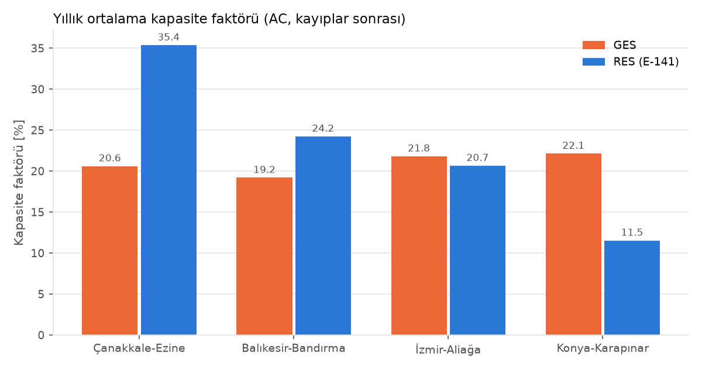

Ezine, rüzgâr kaynağında açık ara önde ve bağlantı başına en çok enerjiyi satıyor. Bölgede işletmedeki RES'ler
olması da rüzgâr modelinin gerçek üretimle kalibre edilmesine imkân verdi.

## 3. Üretim modeli ve kalibrasyon

**Güneş:** PVGIS-SARAH3 ışınımı, pvlib ile PVWatts yaklaşımı (sıcaklık, açı kaybı, DC/AC 1,20, inverter kırpması).
PVGIS'in kendi hesabıyla yıllık fark %4.

**Rüzgâr:** ERA5 10 m ve 100 m rüzgârı kuvvet yasasıyla 120 m göbek yüksekliğine taşındı. Hava yoğunluğu düzeltmesiyle
Enercon E-141/4200 güç eğrisinden geçirildi. %12 toplam kayıp uygulandı.

**Kalibrasyon.** Ezine çevresindeki üç RES'in EPİAŞ saatlik üretimiyle karşılaştırınca ERA5'in **öğleden sonraki deniz
meltemini kaçırdığı** görüldü. Önce tüm seriler aynı zaman tanımına (saat başı etiketli [t, t+1) UTC ortalaması)
getirildi. Sonra 12 ay × 24 saat hız katsayısı matrisi kalibre edildi, yumuşatıldı ve dönem bölmeli çapraz
doğrulamayla seçildi.

- Ay × saat hatası 10,6'dan 0,9 kapasite faktörü puanına indi.
- Gün içi profil gözlenen üretime oturdu.
- Sonuç tasarımı değiştirdi: GES–RES saatlik korelasyonu −0,11'den **+0,12'ye** çıktı. Rüzgâr artık güneşle aynı
  saatlerde tepe yapıyor ve 1+1 MW / 1 MW hibritte kesinti %6'dan %10'a yükseldi.

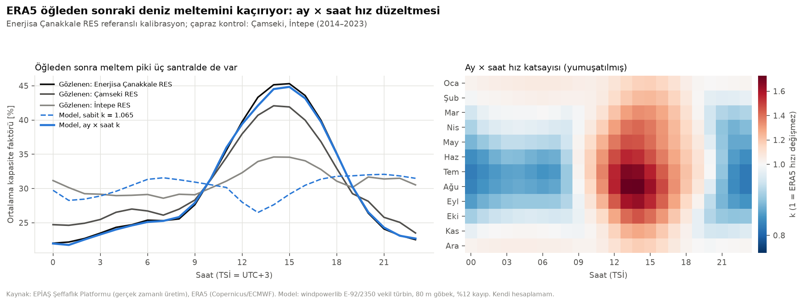

| Ezine, 2014–2023 (kalibre) | 1 MW GES | 1 MW RES | 1+1 MW / 1 MW bağlantı |
|---|---|---|---|
| Kapasite faktörü | %20,6 | %37,7 | %52,6 (bağlantı kullanımı) |
| P50 / P90 [MWh/yıl] | 1.815 / 1.741 | 3.328 / 3.057 | 4.652 / 4.390 |
| Yıllar arası değişkenlik | %2,6 | %5,7 | %3,7 |

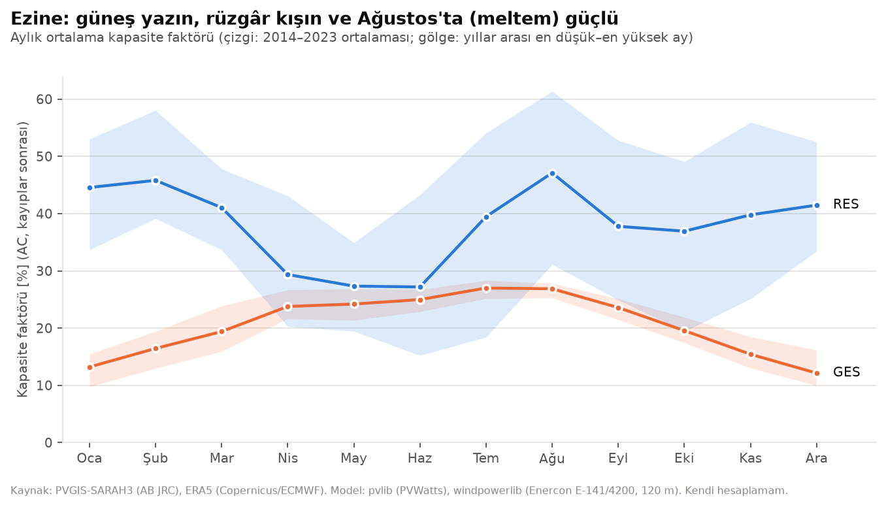

RES kışın (%40–45) ve Temmuz–Ağustos'ta (poyraz, %40–46) güçlü, Nisan–Haziran'da zayıf (%28–29); GES Nisan–Ağustos'ta yüksek. Tamamlayıcılık ilkbaharda ve kışta güçlü, yaz ortasında ise ikisi birlikte tepe yapıyor. Bağlantı paylaşımında kesintiyi bu saatlik ve mevsimsel çakışma belirliyor.

## 4. Piyasa analizi

EPİAŞ Şeffaflık Platformu'ndan 2014–2026 saatlik PTF ve kaynak bazında üretim çekildi; yaz saati geçişleri (2016'ya
kadar) ele alınarak UTC'ye çevrildi.

**Güneş kanibalizasyonu.** Türkiye'de güneş kurulu gücü 2019'da 6 GW iken 2025'te 25 GW'a çıktı. Öğle fiyatları çöktü:
güneşin yakalanma oranı (yakalanan fiyat / ortalama PTF) 2016'da 1,21 iken 2026'da 0,71. Akşam/öğle fiyat oranı 2015'te
0,89, 2026'da 2,33. 2026'da 10 $/MWh altındaki saat sayısı 1.564.

**Rüzgâr** ortalamaya yakın fiyat yakalıyor (2026: 1,00), ama kalibrasyondan sonra öğleden sonra üretimi arttığı için
kanibalizasyondan kısmen etkileniyor.

**Düzenleyici risk.** 2022–2023'teki azami uzlaştırma fiyatı (AUF) YEKDEM dışı yenilenebilir gelirlerini ~%44 kırptı.
Bu olay Monte Carlo'da "kriz + tavan" olayı olarak modellendi.

**Yan hizmet.** SFK kapasite fiyatı 2023'te 50, 2024'te 43, 2025'te 37, 2026'nın ilk dokuz ayında 68 $/MW-saat
(ortalama ihtiyaç ~953 MW). PTF ile korelasyonu −0,65: elektrik ucuzken rezerv pahalı.

**Fiyat senaryoları.** Saatlik fiyat = yıllık seviye (45 / 58 / 72 $/MWh) × son dönemin saatlik şekli. Öğle çukuru,
güneşin yakalanma oranı 2033'te 0,60'a inecek şekilde derinleştirilir ("kanibalizasyon devam"). Seviye ve şekil
birbirinden ayrık tutulur.

## 5. Finansal model

Reel USD proje finansmanı modeli, 2 yıl inşaat + 30 yıl işletme. Kalemler:

- **Gelirler:** saatlik üretim × saatlik fiyat (10 hava yılı × 2 fiyat şekli yılı ortalaması).
- **Giderler:** TEİAŞ kapasite ve enerji bedelleri, dengesizlik maliyeti (RES gelirin %4'ü), sabit O&M, arazi, sigorta,
  batarya augmentation ve yenileme.
- **Vergi:** %25 kurumlar vergisi, 10 yıl amortisman, 5 yıl zarar mahsubu.
- **Borç:** P90 nakit akışına göre heykelsi (DSCR 1,30, 15 yıl).

CAPEX: RES 1,15 M$/MW, GES 0,62 M$/MWac, batarya 110 bin $/MWh + 90 bin $/MW.

| 50 MW bağlantı, baz 58 $/MWh | (a) RES 50 | (b) RES 50 + GES 25 | (c) RES 50 + GES 50 | (d) GES 50 |
|---|---|---|---|---|
| NPV [M$] | −2,1 | −7,4 | −15,6 | −15,3 |
| Proje IRR (reel) | %6,6 | %5,9 | %4,9 | %1,1 |
| Başabaş fiyat [$/MWh] | 59,6 | 62,8 | 67,1 | 89,4 |

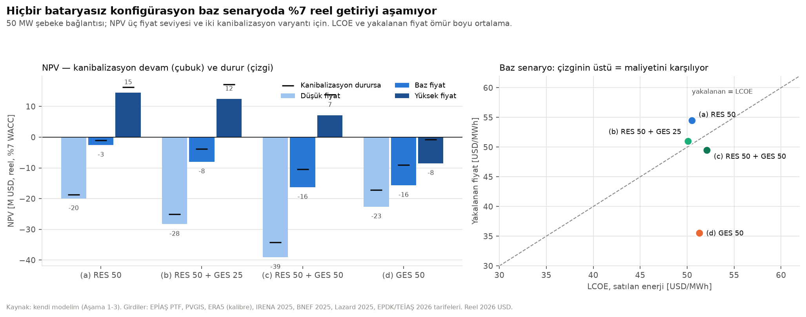

Bataryasız hiçbir konfigürasyon %7 reel getiriyi aşmıyor. İkinci 25 MW GES'in üretiminin %40'ı kesiliyor.
**Duyarlılık** (b için): fiyat seviyesi 40,6 M$, CAPEX ±%20 27,3 M$, WACC %5,5–8,5 17,6 M$ aralık.

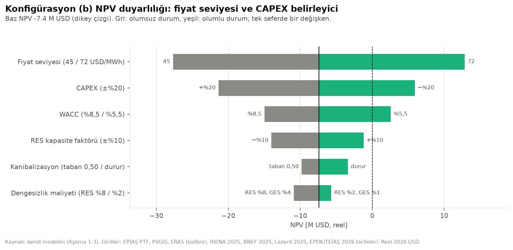

## 6. Optimizasyon

Model dört basamakta büyütüldü (formülasyonlar `docs/04_optimizasyon.md`):

1. **Batarya arbitrajı (LP).** 10 MW / 40 MWh batarya 2025 fiyatlarıyla yılda ~408 bin $ kazanıyor; yatırımı karşılamıyor.
2. **Hibrit + batarya dispatch (LP), şebeke gölge fiyatı.** Şebeke kısıtı yılda 1.263 saat bağlayıcı. En değerli saatler
   yaz öğleden sonraları (meltem + güneş).

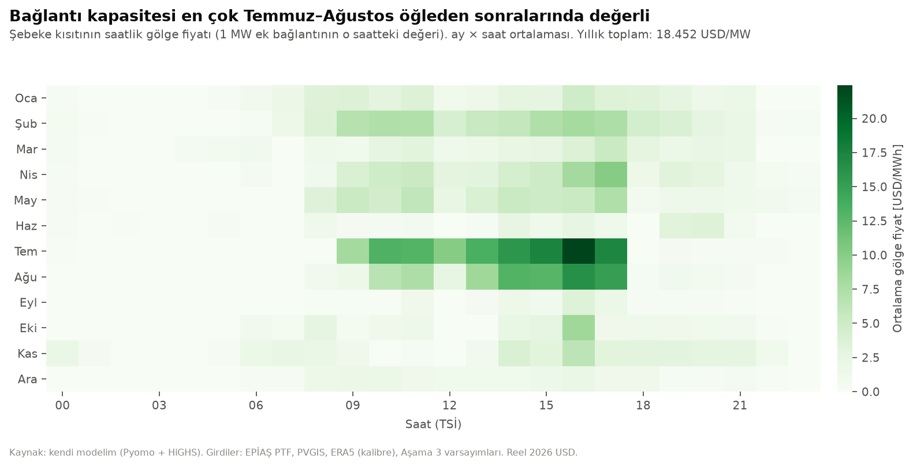

3. **Kapasite MILP'i.**
   - **Karar değişkenleri:** türbin sayısı (tamsayı), GES ve batarya gücü/enerjisi, yatırım kararı (ikili), saatlik dispatch.
   - **Amaç:** vergi düzeltmeli yıllıklandırılmış NPV.
   - **Ölçek:** tam yıl (2 × 8.760 saat), ~88 bin değişken, HiGHS ile ~35 saniyede çözülüyor.
   - **Temsilî günler:** k-means + medoid ile hızlandırma; tam yılla karşılaştırıldı (1 türbin fark).
4. **Senaryolar ve pişmanlık.**

| Fiyat / kanibalizasyon | Optimal karar | En iyi tasarım | NPV [M$] |
|---|---|---|---|
| Düşük 45 | Yatırım yapma | — | — |
| Baz 58 / devam | Sınırda | RES 58,8 MW | −1,0 |
| Yüksek 72 / devam | Kur | RES 63 + BESS 7 MW / 18 MWh | +18,9 |

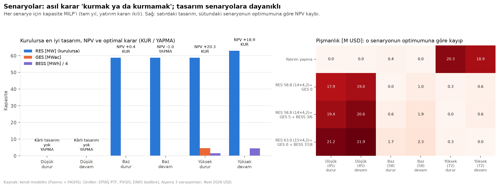

**Sonuç:** Bağlantıya ~%18 aşırı kurulu RES optimal, GES elenir. Asıl karar "hangi tasarım" değil "kurmalı mı":
tasarımlar arası pişmanlık ≤ 0,6 M$, yanlış yatırım kararının bedeli ~20 M$.

## 7. Gelir yığını: yan hizmet ve PPA

Bataryanın erişebileceği diğer gelirler modele eklendi:

- **SFK yan hizmeti:** saatlik rezerv; TEİAŞ kuralı gereği ≥30 MW için ikili katılım; rezerv için en az 1 saatlik enerji payı.
- **Dengesizlik azaltımı.**
- **YEK-G sertifikası.**
- **Kurumsal PPA:** P90'ın %70'i, 12 yıl, %10 iskonto; sözleşmeli kısma DSCR 1,20 ve 18 yıl vade.
- **Depolamalı lisans** (ek bağlantı).

| Kombinasyon | Tasarım | NPV [M$] | Başabaş [$/MWh] |
|---|---|---|---|
| Aşama 4 baz | RES 58,8 | −1,6 | 59 |
| + yan hizmet + dengesizlik + YEK-G | RES 58,8 + BESS 40 MW / 70 MWh | +26,4 | 40 |
| + PPA | RES 58,8 + BESS 39,5 / 63 | +26,0 | 33 |
| + depolamalı lisans | aynı (ek bağlantı kullanılmıyor) | +26,4 | 40 |

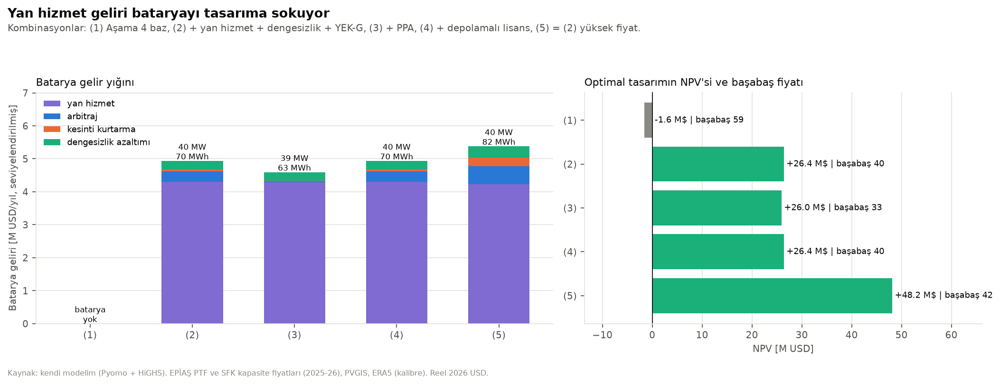

Batarya gelirinin %87'si SFK. Katılım kararı SFK fiyatı 2026 seviyesinin %7,5'ine inse bile değişmiyor. Depolamalı
lisans ekonomik değil: Ekim 2023'ten beri başvuru alınmıyor, ek bloğun üretimi yalnız batarya üzerinden satılabiliyor.

## 8. Risk analizi ve stres testi

### 8.1 Monte Carlo kurgusu

10.000 senaryo, ortak rastgele sayılar. Belirsizlikler:

- **Hava:** 10 yıldan blok bootstrap.
- **RES model hatası:** simülasyon başına sabit, 0,88–1,08.
- **Kullanılabilirlik.**
- **Fiyat:** ortalamaya dönen yıllık log-fiyat (φ 0,55, σ 0,20; 2014–2025'ten tahmin), lognormal uzun dönem ortalaması
  (medyan 58), %3/yıl kriz olayı (×1,6, %80 olasılıkla tavan).
- **Kanibalizasyon tabanı:** 0,55–0,77.
- **CAPEX ve OPEX:** fiyat–CAPEX arasında Gauss kopula, ρ = 0,4.
- **Batarya bozunması.**
- **SFK doyumu.**

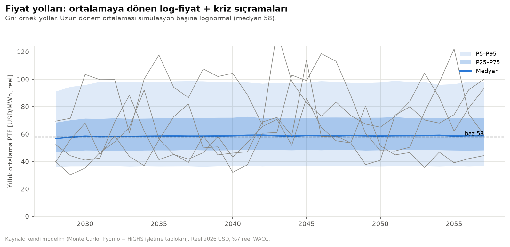

Hız için dispatch LP'leri önceden bir ızgarada çözülüp ara değerlemeyle kullanıldı. Tam LP'ye göre hata ~0,3 M$ (%1),
10.000 senaryo yaklaşık 2 dakika sürüyor.

### 8.2 SFK doyum stres testi

**Kalibrasyon:**
- **İngiltere DC:** uygun batarya ihtiyacın ~2 katına çıkınca fiyat £17'den £1,4–4'e indi (−%77 ile −%92), ~1,5–2 yılda.
- **Almanya FCR:** ~1,1 katında yıllık gelir −%45, ~3 katında "doymuş".
- **Avustralya FCAS:** FCAS'ın batarya gelirindeki payı 2023'ten 2026'ya %50'den %7'ye düştü.

**Model.** SFK fiyatı, SFK'ya teklif veren batarya / ihtiyaç oranına bağlı. Oran 0,8'i aşınca fiyat düşmeye başlıyor,
2'de **fırsat maliyetine** iniyor. Fırsat maliyeti, tipik 1,1 saatlik Türk bataryasının vazgeçtiği arbitraj kârı:
2,3 $/MW-saat, 2026 seviyesinin %4,8'i.

**Senaryolar:**

| Senaryo | Olasılık | Kurulu batarya | SFK tabana iner |
|---|---|---|---|
| Yavaş | %25 | 2030: 2,1 GW (ETKB hedefi) | ~2033 |
| Baz | %40 | 2028: 3 GW, 2030: 6 GW | 2029 |
| Hızlı | %20 | 2027: 5 GW | 2028 |
| Katılamama | %15 | — | SFK geliri yok |

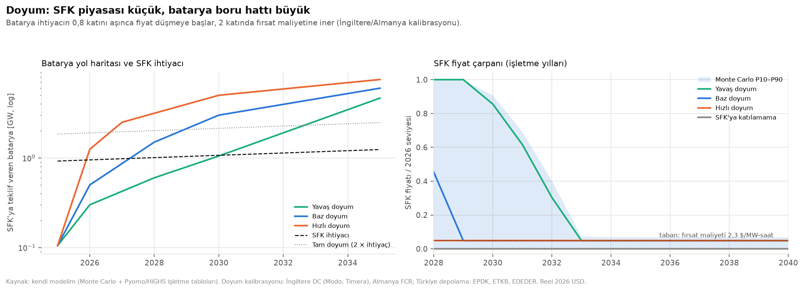

### 8.3 Sonuçlar

| Tasarım | E[NPV] [M$] | P(NPV>0) | CVaR %5 [M$] | P(DSCR<1), muhafazakâr borç |
|---|---|---|---|---|
| A: Yalnız RES 58,8 | −1,9 | %42 | −30,0 | %46 |
| E: RES + PPA | −4,9 | %28 | −21,5 | %35 |
| C: RES + BESS 40/70 | 6,2 | %59 | −30,1 | %41 |
| F1: RES + BESS 40/160 (uzun süreli) | −0,4 | %47 | −39,2 | %45 |
| F2: RES + BESS 30 → 40 (aşamalı) | **6,3** | **%60** | −28,4 | %40 |
| **F2P: aşamalı + PPA (öneri)** | 4,5 | %58 | **−23,2** | **%37** |
| *C, Aşama 5 (doyumsuz)* | *28,4* | *%97* | *−2,5* | — |

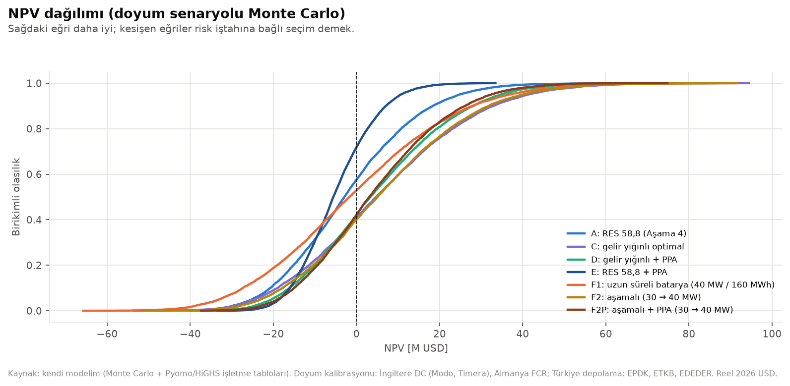

**Bulgular:**

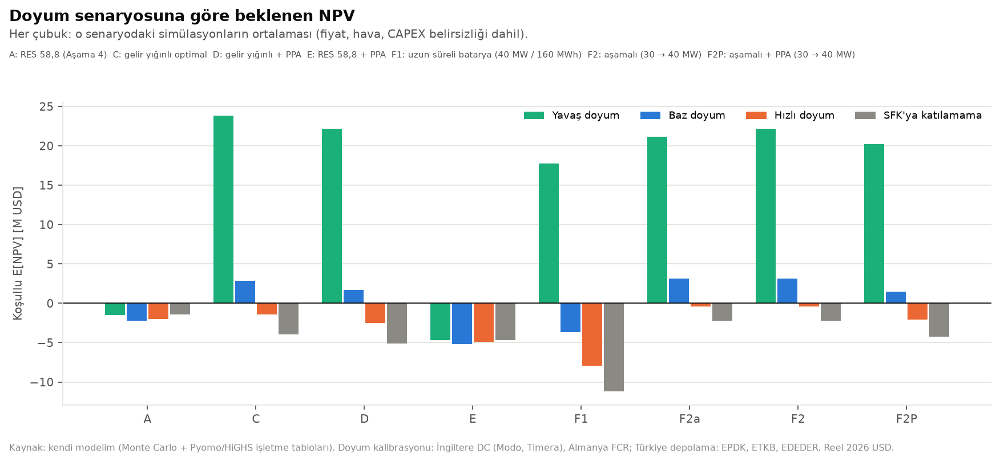

1. **Bataryanın değeri bir opsiyon.** C'nin koşullu beklenen değeri: yavaş doyumda +24 M$, bazda +3, hızlıda −1,
   katılamamada −4 M$.
2. **Küçük batarya daha iyi.** 30 MW, 30 MW'lık rezerv tavanının tamamını koruyor ve CAPEX'i ~2,8 M$ azaltıyor. Kötü
   senaryodaki kaybı yalnız RES'e göre yalnızca −0,8 M$.
3. **Esneklik türü önemli.** Bataryayı uzun süreli yapıp SFK düşünce arbitraja kaydırmak (F1) en kötü sonuç. Değerli
   esneklik, ölçeği SFK fiyatına göre ertelemek (F2).
4. **Fırsat penceresi kısa.** Bataryanın kendini ödemesi için 2026 seviyesinde ~6 aylık SFK geliri yetiyor (taban sıfır
   olsa bile). Her ek pencere yılı ~5–6 M$ değer katıyor.

5. **Beklemek değer kaybettiriyor.** Doyum belirsizliği bilginin değerini (EVPI) 0'dan ~5 M$'a çıkarıyor. Ama 1 yıl
   bekleyip senaryoyu kesin öğrenmek bile (4,8 M$) bugün kurmaktan (6,3 M$) kötü, çünkü SFK penceresi kaçıyor. Bilgi
   sözleşme ve ön yeterlilikle alınmalı, beklenerek değil.

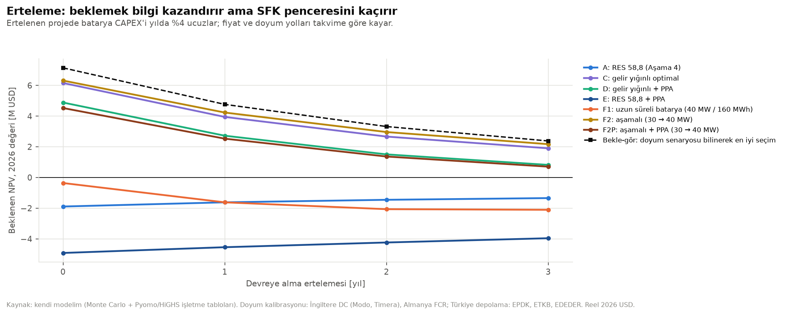

6. **Varyansın kaynağı.** F2P'de fiyat yolu %45, doyum senaryosu %34, RES model hatası %5. Aşama 3'teki tornado CAPEX'i
   ikinci sıraya koymuştu; gerçek dağılımlarla CAPEX'in payı ~%1.
7. **Finansman.** Borç SFK gelirine dayanarak boyutlanırsa tüm tasarımlarda en az bir yıl DSCR < 1 olasılığı ~%80.
   SFK'sız ve 45 $/MWh ile boyutlanan muhafazakâr borçla bu oran ~%37–46'ya iniyor. Kalan ihlaller yıllık fiyat
   oynaklığından; bir borç servisi yedek hesabı (DSRA) bunların çoğunu karşılar.

## 9. Tamamlayıcı analizler (Aşama 7)

Ayrıntılar ve kaynaklar: `docs/07_tamamlayici_analizler.md`.

**Sistem kaynaklı kesinti.**
- EPİAŞ sistem geneli YAT talimatları 2023–2025'te yılda ~2,5–2,9 TWh iken 2026'nın ilk dokuz ayında 9,5 TWh oldu
  (Mayıs'ta 3,1 TWh). YAT bahar öğlelerinde ve bayramlarda yoğunlaşıyor.
- Üç referans RES'te, kalibre ERA5'in yüksek üretim beklediği saatlerde eşzamanlı düşüşler 2026'da üretimin ~%9,5'ine
  ulaştı (2016–2025'te taban üstü %0–1).
- DGP'de YAT alan birim enerjiyi kendi teklif fiyatından geri alır. Düşük teklif veren bir RES gelirini korur; talimat
  DGP dışından geliyorsa ya da tesis YEKDEM'deyse kayıp tamdır. Tazmin oranı belirsiz.
- Modelde kesinti yıllık %1–12 (merkez %5), güneşle büyüyor. Batarya kayıp gelirin yalnız ~%16'sını kurtarıyor.
  **Etkisi:** önerilen tasarımda E[NPV] ~−2 M$ (ortak batarya sürücüsü kesintiyi biraz azaltır, bkz. docs/07).

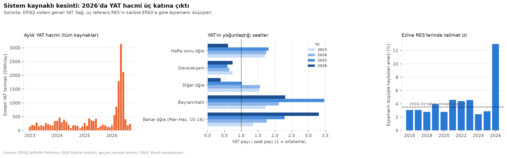

**Teşvikler.** 9903 sayılı karar RES ve depolamaya KDV istisnası ve gümrük muafiyeti veriyor; elektrik üretiminde vergi
indirimi yok. Model KDV'yi içermediği için zımnen belgeyi varsayıyordu. Belge olmazsa 14 M$ KDV'nin ön finansmanı ve
TL bakiyenin aşınması net **−5,8 M$**. Bu yüzden belge FID koşulu.

**YEKDEM ile batarya uyumu (tutarlılık düzeltmesi).**
- YEK Yönetmeliği'ne göre santralde üretilip depolanan enerji de YEKDEM fiyatından ödeniyor. Dengesizlik tesiste
  kalıyor. Bütünleşik batarya ayrı uzlaştırma birimi olarak SFK'ya katılabiliyor (TEİAŞ teyidi gerekli).
- Bu yüzden YEKDEM'de arbitraj değeri yok. Model artık YEKDEM'e özgü dispatch kullanıyor. PPA ise finansal fark
  sözleşmesi olarak modellendi (batarya tüccar dispatch'i).
- YEKDEM altında en iyi batarya 30 MW / 60 MWh (tam SFK rezervi).

**YEKDEM bir yıllık opsiyon dizisi.** YEK Yönetmeliği'ne göre YEKDEM takvim yılı bazında işletiliyor (md. 4/2). Lisanslı
tesis her yıl 30 Kasım'a kadar bir sonraki yıl için başvuruyor ya da vazgeçiyor (md. 5/1, 5/4). Hak süresi COD'dan
itibaren 10 yıl (md. 8/1). Model artık her yıl, o gün bilinen fiyat beklentisiyle karar veriyor:
YEKDEM reel fiyatı > 1,066 × beklenen PTF ise katıl.

**Gelir yapıları — nihai tasarım** (RES 58,8 + 30/60; doyum + kesinti + ortak batarya sürücüsü dahil):

| | COD 2028 (model) E[NPV] | **COD Kas 2029 (baz vaka) E[NPV]** | P(NPV>0) | CVaR %5 |
|---|---|---|---|---|
| **YEKDEM yıllık opsiyonu (nominal) + tüccar — baz vaka** | +4,9 | **+1,5** | %50 | −25,8 |
| YEKDEM yıllık opsiyonu (endeksli) + tüccar | +6,4 | +3,1 | %54 | −20,5 |
| Tüccar | +4,4 | +1,2 | %50 | −27,8 |
| PPA | −1,0 | −4,0 | %34 | −24,4 |
| YEKDEM 10 yıl sabit (nominal) | −6,3 | −10,9 | %14 | −28,6 |

Opsiyonun saf tüccara göre değeri +0,3 M$. Nominal koridor reel olarak aşındığı için YEKDEM yalnız fiyatların düştüğü
yıllarda seçiliyor (katılım 2. yılda %15, sonra azalıyor).

**Karbon ve çevresel etki.**
- Türkiye ETS'si 2026–27 pilot döneminde ücretsiz tahsisatla başladı; fiyat 2027'de. Gaz marjda iken €30–35/t ya da
  kömür marjda iken ~€15/t, yüksek fiyat senaryosunun (+14 $/MWh) gerekçesi.
- Yeni projeler için gönüllü karbon kredisi geliri yok: Verra ve Gold Standard LDC dışı ülkelerdeki şebeke bağlantılı
  yeni yenilenebilir projeleri kabul etmiyor.
- **Önlenen emisyon:** yılda ~111 bin t CO2 (ETKB 2024 faktörü 0,6345 t/MWh); 30 yılda 2,4–3,3 milyon t; ~62 bin
  hanenin tüketimi.

**Takvim riski (CPM + 10.000 Monte Carlo).**
- **Aktivite ağı:** 18 aktivite (ön lisans devri, ornitoloji, ÇED, imar, TEİAŞ anlaşması, lisans, PPA, finansman,
  türbin ve batarya tedariki, şebeke, montaj, devreye alma, SFK testleri).
- **Kritik yol:** ornitoloji → ÇED → imar → lisans → FID → türbin → montaj → COD (58 ay).
- **COD:** P50 Mayıs 2032, P80 Eylül 2032 (geliştirme); inşaata hazır projede P50 Kasım 2029, P80 Mart 2030.
- **Gecikmeye en çok katkı:** ÇED ve imar (Spearman 0,50), türbin tedariki (0,42).
- **Batarya zamanlaması:** Bataryayı 12 ay geç sipariş etmek SFK başlangıcını ~10 ay geciktirip ~0,8–0,9 M$
  kaybettiriyor. Erken/bağımsız batarya yalnız ~0,1–0,2 M$ kazandırıyor. Aşama 6'daki "12 ay sonra sipariş" koşulu
  kaldırıldı; gerçekçi takvimde FID'e kadar doyum zaten gözlenmiş olacak.
- **Takvim kontrolü:** İnşaata hazır projede bağlantı anlaşması tamam; finansman PPA'yı beklemiyor; türbin teslimi
  2024–25 sektör verisine göre 12/18/30 ay. Bununla COD P50 Kasım 2029, P80 Mart 2030 (önceden P50 Mart 2030).
- **Takvim → NPV:** 1,8 yıllık kayma, baz vaka yapısında beklenen NPV'yi 4,9'dan 1,5 M$'a indiriyor. Bunun nedeni SFK
  penceresinin kapanması ve kesintinin büyümesi.

**Risk kaydı.** 20 risk. En yüksek beşi: fiyat seviyesi (20), SFK doyumu (16), ÇED/imar gecikmesi (16), YEKDEM
sınırlarının nominal kalması (12), YEKDEM için 2030 COD sınırını kaçırma (12). Modelde olmayanlardan en önemlisi
ornitoloji: Çanakkale Boğazı süzülen kuş göç yolu (`outputs/07/risk_kaydi.xlsx`).

## 10. Öneri

| | Aşama 6 | Aşama 7 | Ö1–Ö2 | **Nihai (üç tutarlılık düzeltmesi sonrası)** |
|---|---|---|---|---|
| Karar | Koşullu onay | İnşaata hazır + YEKDEM: koşullu onay | Yatırım önerilmez | **Dar kapsamlı durum tespiti + bağlayıcı olmayan teklif** |
| Tasarım | RES 58,8 + 30 MW aşamalı | Aynı | RES 58,8 + 30/60 | RES 58,8 + 30/60 |
| Gelir yapısı | PPA | YEKDEM | YEKDEM sabit nominal | **YEKDEM yıllık opsiyonu + tüccar** |
| Beklenen NPV | +4,5 | +2,1 | −11,4 | **+1,5 M$** |
| Azami edinim primi | — | ~2 M$ | 0 | **~1,5 M$** |

**Karar:** İnşaata hazır bir Ezine RES projesinin edinimi için (i) ~0,5 M$'lık durum tespiti bütçesinin onayı (tavan
~1,0 M$, EVPPI ile gerekçeli) ve (ii) en fazla ~1,5 M$ edinim primiyle sınırlı, bağlayıcı olmayan teklif yetkisi.

**Durum tespiti kapsamı (FID koşullarından):**
1. TEİAŞ'tan bataryanın SFK ön yeterliliği.
2. YEKDEM koridorunun endekslemesine dair hukuki görüş. Endeksliyse azami prim ~3,1 M$'a çıkar.
3. Teşvik belgesi.
4. Ornitoloji ve işletme izleme yükümlülükleri.
5. COD ve türbin teslim slotunun teyidi.

**Tetikleyiciler:**

| Gösterge | Eşik | Karar |
|---|---|---|
| TEİAŞ SFK ön yeterliliği | Red | Bataryasız değerle yeniden fiyatla (teklif primi düşer) |
| YEKDEM endekslemesi | Teyit | Azami prim ~3,1 M$'a çıkar |
| Teşvik belgesi | Alınamaz | Vazgeç (−5,8 M$) |
| RES'lere YAT/kesinti | 2027'de de > %8 | Teklifi düşür |
| Uzun vadeli fiyat beklentisi | < ~52 $/MWh | Vazgeç |
| İşletmedeki depolama | FID'de > ~1,5 GW | Batarya 30 MW'ta, SFK değeri düşük |

## 11. Sınırlamalar ve sonraki adımlar

**Sınırlamalar:**
- **Kaynak verisi:** Rüzgâr kaynağı ERA5 + üç santrale kalibrasyona dayanıyor; saha ölçümü yok. İz kaybı (wake) toplam
  kayıp oranıyla yaklaşıklandı.
- **SFK tahminleri:** SFK fiyatı, doyum hızı, senaryo olasılıkları ve PPA iskontosu tahmin; Türkiye'de SFK'ya fiilen
  katılan batarya verisi henüz yok.
- **Dispatch:** Mükemmel öngörüyle (yıllık LP); gerçek arbitraj geliri daha düşük olur. Etkisi sınırlı, çünkü gelirin
  çoğu kapasite ödemesi.
- **Kur ve finansman:** Kur riski ayrıca modellenmedi (reel USD). Borç simülasyonda yeniden yapılandırılmıyor.
- **Aşamalı büyütme:** Karar basit bir eşik kuralı; optimal durma problemi olarak çözülmedi.

**Sonraki adımlar (gerçek bir proje için):**
1. En az 12 aylık met direği / LiDAR ölçümü ve MCP ile uzun dönem düzeltme; türbin yerleşimi ve iz kaybı analizi.
2. TEİAŞ ile bağlantı görüşü ve SFK ön yeterlilik süreci.
3. PPA alıcı teklifleri ve tedarikçi CAPEX teklifleriyle varsayımların güncellenmesi.
4. Gün öncesi tahmin hatalı dispatch simülasyonu ve SFK/PFK birlikte optimizasyonu.
5. Batarya sipariş zamanlamasının gerçek opsiyon modeli.
6. Santral bazında talimat verisi (TEİAŞ/EPİAŞ) ile kesinti tahmininin doğrulanması; YEKDEM endekslemesi için hukuki görüş.

---
*Ekler: tüm formülasyonlar ve ayrıntılı tablolar `docs/00_isinma_modeli.md` – `docs/05_risk_ve_gelir_yigini.md`;
etkileşimli sonuçlar Streamlit dashboard'unda.*
